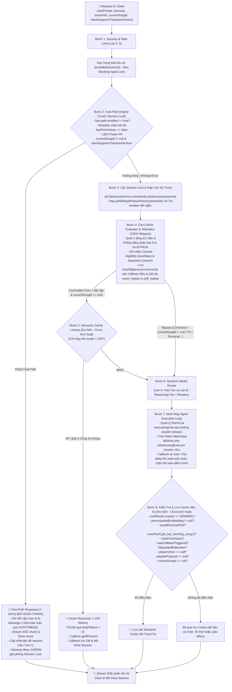

# ⚡ KẾ HOẠCH NÂNG CẤP LỚP 7: CACHE & MODEL ROUTER
> **Dự án:** `identity-service-main` (Spring Boot 3 + Google Gemini) & Android Client App  
> **Mục tiêu:** Nâng cấp Lớp 7 từ **25%** lên **75% Code-Complete, Telemetry Instrumented** và chuẩn bị nghiệm thu **100% Production-Ready** qua dữ liệu thực tế  
> **Trạng thái:** 🚀 *Hiệu chuẩn lần 16 — Nghiệm thu toàn diện Giai đoạn 1 & Giai đoạn 2 (75% Code-Complete, Telemetry Instrumented, 104/104 Unit & Integration tests passed, 100% Pass Rate). Hạ tầng Telemetry 2 cửa sổ (30m & 24h), Persona Isolation và CanCacheEvaluator Giai đoạn 3 đã sẵn sàng thu thập số liệu thực tế để ra quyết định kiến trúc.*

---

## 📌 1. ĐÁNH GIÁ HIỆN TRẠNG & PHÂN RÃ TIẾN ĐỘ CHUẨN XÁC

Tiến độ của Lớp 7 được tính toán minh bạch dựa trên 4 thành phần kỹ thuật (mỗi thành phần chiếm trọng số 25%):

| Thành phần kỹ thuật | Trọng số | Trạng thái đạt được | Chi tiết kỹ thuật & Hiện trạng kiểm thử |
| :--- | :---: | :---: | :--- |
| **Traditional Data Cache** | 25% | **25% (Sẵn có)** | Caffeine cache cho top trending SQL, In-memory ConcurrentMap cho Vector bài hát |
| **Fast-Path Command Engine** | 25% | **+25% (Lũy kế 50%)** | **ĐÃ HOÀN THÀNH & NGHIỆM THU (62 tests):** Regex Two-tier có/không dấu, unaccented fallback, "bài tiếp theo", chạy trước Session Lock, đồng bộ Android Client, `DATETIME(6)` microsecond precision, `@Transactional saveFastPathMessages`, Dual Tie-Breaker theo String |
| **Dynamic Model Router & Fallback** | 25% | **+25% (Lũy kế 75%)** | **ĐÃ HOÀN THÀNH & NGHIỆM THU (17 tests):** `ModelRouterService`, Resilience4j `geminiCriticRouter` (loại trừ 400/403 safety khỏi Breaker), watchdog 8000ms trên `aiStreamingExecutor` (socket 15s), phân cấp `UpstreamAiException`, fallback an toàn phân biệt read-only vs side-effect |
| **Telemetry & Data-Driven Decision** | 25% | **Hạ tầng hoàn tất (25 tests)<br/>Đang thu thập số liệu** | **ĐÃ TRIỂN KHAI HOÀN TẤT & TEST (25 tests):** `CanCacheEvaluator` (8 cổng bypass, regex `(?U)`, over-bypass "nhạc Anh" có chủ ý), `TelemetryService` (Caffeine 50k, cửa sổ 30m & 24h, cô lập `persona:canonical`, tách riêng anonymous prompts), `VietnameseTextNormalizer.stripDiacritics`. **100% Production-Ready** sẽ được ký duyệt sau khi hoàn tất đo đạc thực tế |
| **TỔNG CỘNG** | **100%** | **75% Code-Complete, Telemetry Instrumented** | **104/104 Unit & Integration Tests Passed (100% Pass Rate). Sẵn sàng giai đoạn đo lường thực tế.** |

---

### 🎯 Khung Quyết Định Kiến Trúc Dựa Trên Dữ Liệu (Data-Driven Decision Framework)
Để tránh bẫy "ngụy biện năng lực" (chưa thể tuyên bố 100% Production-Ready khi hệ thống chưa có dữ liệu production thật, chưa có Grafana Dashboard và chưa kiểm thử tải), Giai đoạn 3 được chuẩn hóa thành một quy trình khoa học:

1. **Thu thập dữ liệu Telemetry ngầm:**
   Hệ thống chạy ngầm ở chế độ `ai.cache.semantic.mode: OFF` để thu thập mẫu tối thiểu $N \ge 5.000$ lượt hợp lệ (hoặc tối thiểu 3.000 lượt trên Staging/Production trong 14 ngày) nhằm đảm bảo lực thống kê (Statistical Power) cho các ngưỡng 1% và 3%:
   - **Khóa băm tích hợp Persona:** `sha256(persona:canonical)` đảm bảo câu hỏi giống nhau ở các persona khác nhau không bị tính nhầm là lặp lại chéo (tuân thủ Cổng 1: Persona Isolation).
   - **Hai cửa sổ quan sát:** Đo lường đồng thời cửa sổ ngắn 30 phút (`ai.cache.exact_repeat_hits`) và cửa sổ ngày 24 giờ (`ai.cache.exact_repeat_24h_hits`) để phản ánh đúng tuổi thọ thực tế của Semantic Cache.
   - **Cô lập người dùng ẩn danh:** Gắn thẻ `ai.cache.anonymous_prompts` và không tính vào cross-user repeat cache nhằm loại trừ sai lệch dữ liệu do không có định danh ổn định.

2. **Bản chất Metric & Khung Quyết Định 3 Nhánh:**
   - **Định nghĩa trên Dashboard:** Công thức đo lường tỷ lệ prompt là bản sao lặp lại:
     $$\text{Tỷ lệ Prompt Lặp (Repeat Ratio - 24h)} = \frac{\text{ai.cache.exact\_repeat\_24h\_hits}}{\text{ai.cache.semantic.eligibility(eligible=true)} - \text{ai.cache.anonymous\_prompts}} \times 100\%$$
     Chỉ số này phản ánh **Tỷ lệ Cache Hit tiềm năng (Potential Cache Hit Rate)** nếu hệ thống có cache; nó không phải là hit rate của một cache đang vận hành thực tế.
   - **Quy tắc 3 Nhánh có kiểm chứng ngữ nghĩa:**
     * **Nhánh 1: Tỷ lệ lặp lại $\ge 3\%$ (Nhu cầu lặp cao):**
       Kích hoạt triển khai Hệ Thống Vector Cache 5 cổng (pgvector / Milvus / in-memory HNSW) + Event-Driven Invalidation (`SongCatalogChangedEvent`).
     * **Nhánh 2: Tỷ lệ lặp lại từ $1\% - 3\%$ (Vùng giao thoa):**
       Kích hoạt chế độ **SHADOW MODE** trên 10% lưu lượng trong 7 ngày để đánh giá tỷ lệ cache hit tiềm năng và đo lường mức tiết kiệm chi phí token thực tế trước khi quyết định cấp phát RAM cho Vector DB.
     * **Nhánh 3: Tỷ lệ lặp lại $< 1\%$ (Cận dưới thấp):**
       **Bắt buộc trải qua bước kiểm chứng ngữ nghĩa ngầm:** Chạy **Shadow Mode trên 5–10% lưu lượng** hoặc tính cosine similarity embedding trên tập mẫu $N \ge 1.000$ câu để xác nhận tỷ lệ tương đồng ngữ nghĩa cũng $< 1\%$. Sau khi kiểm chứng, đạt chuẩn **Ký duyệt (Sign-off) Nghiệm thu 100% Production-Ready mà KHÔNG cần Semantic Cache** (Pragmatic Engineering, tiết kiệm RAM/CPU).

---

## 🔍 2. CÁC ĐIỂM NGHẼN KỸ THUẬT & GIẢI PHÁP ĐÃ ĐỒNG BỘ

### 1. Fast-Path Engine & Đồng Bộ Client/DB
* **Đồng bộ Android Client (`AgenticPlayerDispatcher.kt`):**
  * Tách riêng các action `PAUSE`, `RESUME`, `NEXT` ra trước điều kiện `songCard != null`. Client gọi trực tiếp `playerManager.pause()`, `playerManager.resume()`, `playerManager.next()` ngay cả khi `song == null`.
  * Bật mặc định `clientSupportsTransportActions = true` trong request DTO phía Android.
* **Chuẩn hóa Persona & Ngôi Xưng:**
  * Thống nhất enum `com.devteria.identityservice.enums.AiPersona`: `GENZ_DJ`, `MUSIC_CRITIC`, `HEALING_FRIEND` (thay thế dứt điểm `HEALING_BUDDY`).
  * Văn phong câu chào: `MUSIC_CRITIC` trang trọng (*"Kính chào quý thính giả..."*), `HEALING_FRIEND` ấm áp (*"Chào bạn, mình luôn ở đây để lắng nghe..."*).
* **Bảo vệ Timestamp & MySQL `ON UPDATE`:**
  * Khắc phục triệt để Direct Field Access của Spring Data JPA reflection bằng cách dùng `@PrePersist onPrePersist()` và `@PreUpdate onPreUpdate()` thuần trong `AbstractAuditEntity.java`.
  * Migration Flyway `V5__alter_chat_tables_datetime_precision.sql` nâng cấp `created_at` và `updated_at` sang `DATETIME(6)`, đồng thời **bảo toàn thuộc tính `DEFAULT CURRENT_TIMESTAMP(6) ON UPDATE CURRENT_TIMESTAMP(6)`** cho cột `updated_at`.
  * Gom lưu tin nhắn `userMessage` và `aiMessage` (+5ms) vào cùng một transaction qua phương thức `@Transactional saveFastPathMessages(...)` trong `AiChatSessionService.java`.
* **Tính Đối Ngẫu Tie-Breaker theo Thứ Tự Bảng Chữ Cái (String Lexicographical):**
  * `ChatMessage` lưu `@Enumerated(EnumType.STRING)` trên cột `VARCHAR(16)` với giá trị `'USER'` và `'AI'`.
  * Trong bảng mã ASCII: `'U'` (ASCII 85) đứng sau `'A'` (ASCII 65) $\rightarrow$ `'USER' > 'AI'`.
  * Truy vấn xuôi (ASC - Hiển thị UI): `ORDER BY m.createdAt ASC, m.sender DESC` (USER đứng trước AI).
  * Truy vấn ngược (DESC - Sliding Window): `ORDER BY m.createdAt DESC, m.sender ASC` (AI trước USER, đảo ngược bởi `Collections.reverse()` thì USER luôn trước AI).
* **Phản Hồi An Toàn và Tương Thích:**
  * Kiểm tra an toàn `Boolean.TRUE.equals(request.clientSupportsTransportActions())` chống Unboxing NPE.
  * Phản hồi đồng bộ: `"Đã tạm dừng phát nhạc."` cho `PAUSE`, `"Đã tiếp tục phát nhạc."` cho `RESUME`, và `"Đã gửi lệnh chuyển bài."` cho `NEXT` (kèm `.autoExecute(true)`).
  * Khớp bổ sung biến thể `"bài tiếp theo"` / `"bai tiep theo"` và tầng fallback không dấu cho câu gõ lẫn lộn dấu (partially accented).
  * **Lưu ý phòng thủ:** Đã ghi nhận rủi ro câu phủ định không dấu (`dung tat nhac`, `ko dung lai`) để bổ sung bộ lọc phủ định không dấu ở đợt refactor kế tiếp.

---

### 2. Model Router & Resilience4j Circuit Breaker
* **Loại Trừ Lỗi Client (400/403) Khỏi Circuit Breaker:**
  * `RestClientResponseException` được thu hẹp lại: Chỉ ghi nhận `UpstreamAiException`, `HttpServerErrorException` (5xx), `ResourceAccessException` và `HttpClientErrorException.TooManyRequests` (429) vào `record-exceptions`.
  * Đưa `HttpClientErrorException.BadRequest` (400 - Safety block của Google, prompt vi phạm) và `Forbidden` (403) vào `ignore-exceptions`. Điều này ngăn chặn việc Circuit Breaker cho persona `MUSIC_CRITIC` bị nảy ngắt mạch oan uổng khi người dùng gửi prompt vi phạm chính sách của Google.
  * Giám sát lỗi 400/403 và in-stream safety blocks (`finishReason=SAFETY`) qua Prometheus Alerting riêng biệt.
* **Vòng Đời Permit, First-Token Watchdog 8000ms & Socket Timeout (15s):**
  * Cấp permit qua `tryAcquirePermission()`, bảo vệ chống double-release bằng `AtomicBoolean resultRecorded`.
  * Watchdog 8000ms thực thi qua `CompletableFuture.supplyAsync(..., aiStreamingExecutor)` trên Virtual Threads, cách ly hoàn toàn với ForkJoinPool.
  * Chỉ định gọi qua `geminiRestClient` (15s read timeout), socket tự đóng sau tối đa 7s nếu Watchdog cancel, **không dùng `geminiStreamRestClient` (90s)**.
* **Tinh Chỉnh Fallback Guard An Toàn:**
  * Cho phép fallback an toàn về Flash khi chỉ gọi các tool đọc (`search_music_library`, `get_top_trending_songs`, `get_user_recommendations`).
  * Chặn đứng fallback khi đã gọi tool có tác dụng phụ (`trigger_player_action`, `propose_ai_playlist`) để ngăn lỗi Double Mutation.

---

### 3. CanCacheEvaluator & Telemetry Service
* **`CanCacheEvaluator` với Cờ `(?U)` & Cơ chế Over-Bypass Có Chủ Ý:**
  * Thêm cờ `(?U)` (`UNICODE_CHARACTER_CLASS`) vào các pattern có dấu để `\b` nhận diện chính xác ranh giới từ tiếng Việt.
  * Đổi pattern thành `nhạc của (?:tôi|mình|em|anh)`: Loại bỏ triệt để việc bắt nhầm cụm từ "nhạc Anh" (nhạc nước Anh). Với các câu như *"nhạc của anh"*, việc tiếp tục bypass là **Over-Bypass có chủ ý (Conservative Defense)** nhằm bảo vệ dữ liệu cá nhân tuyệt đối.
  * Gọi trực tiếp tiện ích tĩnh `VietnameseTextNormalizer.stripDiacritics(input)`.
  * Phân định rõ 8 lý do bypass: `EMPTY_PROMPT`, `HISTORY`, `HAS_SONG_CONTEXT`, `PERSONAL`, `PII`, `ANAPHORA`, `TEMPORAL`, `DANGLING_REF`.
* **`TelemetryService` (Caffeine 50k, 30m & 24h):**
  * Chuẩn hóa Canonical Prompt: NFC $\rightarrow$ bỏ dấu (`VietnameseTextNormalizer.stripDiacritics`) $\rightarrow$ cắt dấu câu cuối $\rightarrow$ gộp khoảng trắng thừa $\rightarrow$ lowercase $\rightarrow$ SHA-256 tích hợp Persona.
  * Tách biệt người dùng ẩn danh: Khi `userId` rỗng/null, ghi nhận `ai.cache.anonymous_prompts` và không lưu vào repeat cache nhằm loại trừ sai lệch dữ liệu lặp lại liên người dùng.
  * Hoàn toàn bọc trong khối `try-catch` **fail-safe**, không bao giờ làm gián đoạn luồng đàm thoại.

---

## 🏛️ 3. SƠ ĐỒ LUỒNG XỬ LÝ CHUẨN (EXECUTION PIPELINE)



---

## 📊 4. KẾT QUẢ ĐỐI CHUẨN THỰC NGHIỆM (104/104 TESTS PASS)

Bảng phân bổ chi tiết kết quả kiểm thử tự động trên Maven với JDK 21 (đảm bảo tính chính xác số học 100%):

| Nhóm chức năng | Lớp Kiểm Thử (Test Class) | Số lượng test | Kết quả | Trọng tâm kiểm chứng |
| :--- | :--- | :---: | :---: | :--- |
| **Giai đoạn 1** | `FastPathEngineTest` | 53 | **53/53 PASS** | Regex Two-Tier có/không dấu, lệnh đệm dài, phản hồi trung tính NEXT, "bài tiếp theo", fallback partially accented, chặn phủ định, chống nhầm tên riêng |
| | `AiChatControllerTest` | 9 | **9/9 PASS** | Fast-Path Turn 1 & Turn 2+, Player Transport, Legacy client fallback, IDOR check, Session Lock isolation |
| **Giai đoạn 2** | `ModelRouterServiceTest` | 7 | **7/7 PASS** | Phân làn Critic với từ khóa nhạc lý không dấu, chặn prompt ngắn, hạ cấp khi Breaker OPEN |
| | `CircuitBreakerLifecycleTest` | 7 | **7/7 PASS** | Vòng đời Permit, Watchdog 8000ms trên aiStreamingExecutor, nhả permit khi client abort, an toàn fallback theo phân loại tool |
| | `AiAgentOrchestratorTest` | 3 | **3/3 PASS** | Vòng lặp Agentic loop, kiểm định anti-hallucination, xử lý fallback |
| **Giai đoạn 3** | `CanCacheEvaluatorTest` | 11 | **11/11 PASS** | Bao phủ 8 cổng BYPASS, câu GENERAL hợp lệ, over-bypass "nhạc Anh" có chủ ý |
| | `TelemetryServiceTest` | 8 | **8/8 PASS** | Canonical prompt SHA-256 kèm Persona prefix, đếm bypass reason, phân biệt cross-user vs self-retry (30m & 24h), cô lập anonymous prompts |
| | `VietnameseTextNormalizerTest` | 6 | **6/6 PASS** | Chuẩn hóa không dấu, xử lý ký tự Đ/đ, tách từ tokenize, bóc tách dấu giữ nguyên hoa thường (`stripDiacritics`) |
| **TỔNG CỘNG** | **8 test classes** | **104** | **104/104 PASS** | **Tỷ lệ vượt qua: 100% (BUILD SUCCESS)** |

---

## 🚀 5. DANH MỤC CÔNG VIỆC THEO 3 GIAI ĐOẠN

```
GIAI ĐOẠN 1: Fast-Path Engine & Unit Tests [✅ ĐÃ HOÀN THÀNH - ĐẠT 25% (Lũy kế 50%)]
  ├── [x] Tích hợp FastPathEngine trong AiChatController TRƯỚC dòng checkAndLockSession
  ├── [x] Định nghĩa FastPathResult, ActionType và phản hồi trung tính cho NEXT ("Đã gửi lệnh chuyển bài.")
  ├── [x] Kiểm tra tồn tại lịch sử nhẹ nhàng (existsBySessionId) ngoài Lock để phân định Turn 1
  ├── [x] Hỗ trợ cờ clientSupportsTransportActions kèm kiểm tra Boolean.TRUE.equals chống NPE
  ├── [x] Chuẩn hóa tên enum AiPersona.HEALING_FRIEND và văn phong chào hỏi / giới thiệu danh tính
  ├── [x] Thiết lập luồng dọn dẹp riêng cho Fast-Path Emitter (KHÔNG giải phóng Session Lock của stream khác)
  ├── [x] Cập nhật tiêu đề session khi là câu đầu tiên (updateSessionTitleIfDefault)
  ├── [x] Cập nhật Android Client: AiChatModels.kt và AgenticPlayerDispatcher.kt (hỗ trợ PAUSE/RESUME/NEXT khi song == null)
  ├── [x] Bổ sung biến thể "bài tiếp theo" / "bai tiep theo" và fallback cho câu gõ lẫn lộn dấu
  ├── [x] Viết FastPathEngineTest bao phủ 53 ca biên (53/53 PASS)
  ├── [x] Viết AiChatControllerTest bao phủ 9 ca kiểm thử tích hợp (9/9 PASS)
  └── [x] Nghiệm thu 62/62 tests với Maven và JDK 21 (BUILD SUCCESS)

HẬU GIAI ĐOẠN 1: Tinh chỉnh Database & Kích hoạt Metrics [✅ ĐÃ HOÀN THÀNH]
  ├── [x] Cập nhật AbstractAuditEntity: Dùng @PrePersist onPrePersist() bảo toàn createdAt khi đã có giá trị (+5ms)
  ├── [x] Tạo migration Flyway V5 nâng cấp created_at / updated_at sang DATETIME(6) kèm ON UPDATE CURRENT_TIMESTAMP(6)
  ├── [x] Sắp xếp đối ngẫu theo chuỗi Lexicographical: ORDER BY m.createdAt ASC, m.sender DESC và ORDER BY m.createdAt DESC, m.sender ASC
  ├── [x] Gom lưu DB vào phương thức @Transactional saveFastPathMessages trong AiChatSessionService
  └── [x] Gắn Timer.Sample (ai.latency.fastpath) và counter (ai.fastpath.hits) quanh handleFastPathExecution

GIAI ĐOẠN 2: Model Router & Circuit Breaker [✅ ĐÃ HOÀN THÀNH - ĐẠT 25% (Lũy kế 75% Code-Complete)]
  ├── [x] Khai báo io.github.resilience4j:resilience4j-spring-boot3:2.2.0 và spring-boot-starter-aop trong pom.xml
  ├── [x] Khai báo AiRouterProperties (ai.router.*) và cấu hình instance geminiCriticRouter trong application.yaml
  ├── [x] Loại trừ lỗi 400 (Safety block) và 403 khỏi record-exceptions để chống ngắt mạch oan
  ├── [x] Thiết lập cảnh báo Prometheus Alert độc lập cho lỗi 400/403 và in-stream safety blocks (finishReason=SAFETY)
  ├── [x] Xây dựng ModelRouterService sinh RoutingDecision độc lập (phân làn Music Critic với regex nhạc lý không dấu)
  ├── [x] Tách bạch 2 cờ hạ cấp: degradedByBreaker (chặn lưu cache) và reasoningTierDisabled (cho phép lưu cache)
  ├── [x] Quản lý Permit tại executeAgentLoop với cờ resultRecorded chống double release
  ├── [x] Áp dụng First-Token Watchdog 8000ms qua CompletableFuture trên aiStreamingExecutor; kết nối geminiRestClient (socket 15s)
  ├── [x] Tinh chỉnh fallback guard: Cho phép read-only tools, chặn đứng side-effect tools chống Double Mutation
  ├── [x] Định nghĩa phân cấp UpstreamAiException ghi nhận vào record-exceptions của Breaker
  ├── [x] Phân loại ngoại lệ theo nguồn: ClientAbortException (hủy upstream + nhả permit) vs Upstream error (ghi nhận vào Breaker)
  └── [x] Viết ModelRouterServiceTest (7/7 PASS), CircuitBreakerLifecycleTest (7/7 PASS), AiAgentOrchestratorTest (3/3 PASS)

GIAI ĐOẠN 3: Bước Đệm Telemetry & Khung Quyết Định Dữ Liệu [✅ HẠ TẦNG HOÀN TẤT - TIẾN TỚI 100% PRODUCTION-READY]
  ├── [x] Xây dựng CanCacheEvaluator quét 2 tầng có dấu ((?U)) và không dấu phân loại 8 lý do BYPASS
  ├── [x] Cơ chế Over-Bypass có chủ ý: Tách "nhạc của anh" khỏi "nhạc Anh" bảo vệ an toàn PII
  ├── [x] Xây dựng TelemetryService (Caffeine 50.000 mục, TTL 30m & 24h, canonicalization SHA-256 tích hợp Persona)
  ├── [x] Cô lập người dùng ẩn danh bằng metric ai.cache.anonymous_prompts, không làm ô nhiễm repeat cache
  ├── [x] Tách tiện ích dùng chung VietnameseTextNormalizer.stripDiacritics dùng cho cả 3 service
  ├── [x] Tích hợp CanCacheEvaluator và TelemetryService an toàn (fail-safe) vào AiAgentOrchestrator
  ├── [x] Viết CanCacheEvaluatorTest (11/11 PASS), TelemetryServiceTest (8/8 PASS), VietnameseTextNormalizerTest (6/6 PASS)
  ├── [ ] Thu thập số liệu telemetry thực tế trên production/staging (Mẫu N >= 5.000 lượt):
  │     ├── Nếu >= 3%: Kích hoạt triển khai Vector Cache 5 cổng (pgvector / Milvus / in-memory HNSW)
  │     ├── Nếu 1% - 3%: Chạy thử nghiệm SHADOW MODE trên 10% lưu lượng trong 7 ngày
  │     └── Nếu < 1%: Bắt buộc kiểm chứng qua Shadow Mode hoặc Embedding Cosine Similarity; ký duyệt nếu ngữ nghĩa cũng < 1%
  ├── [ ] Bổ sung điều kiện loại trừ get_top_trending_songs khỏi Semantic Cache ở Bước 8
  └── [ ] Thiết lập Dashboard Prometheus/Grafana giám sát ai.cache.exact_repeat_hits, ai.cache.exact_repeat_24h_hits và kiểm thử tải
```

---

> [!TIP]
> **Tóm tắt trạng thái:** Lớp 7 đã đạt mốc **75% Code-Complete, Telemetry Instrumented** với **104/104 Unit & Integration tests passed (100% Pass Rate)**. Toàn bộ mã nguồn Backend và Android Client đã được đồng bộ, bảo vệ an toàn với microsecond timestamp, ngắt mạch Resilience4j chuẩn xác, cách ly Watchdog trên Virtual Threads và hạ tầng Telemetry 2 cửa sổ fail-safe. Mốc 100% Production-Ready sẽ được ký duyệt chính thức sau khi thu thập đủ dữ liệu thực tế ($N \ge 5.000$ lượt), kiểm chứng ngữ nghĩa qua Shadow Mode và thiết lập dashboard kiểm thử tải.
