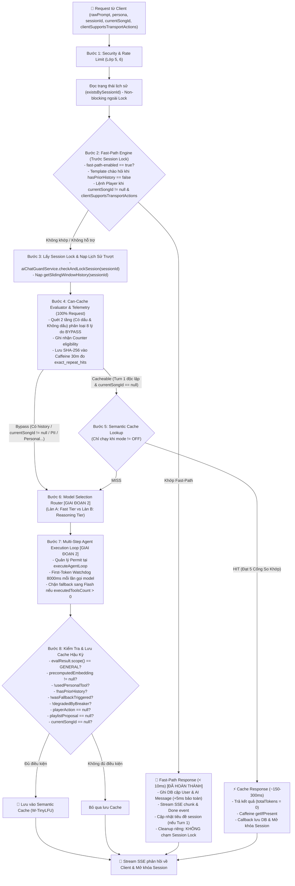

# ⚡ KẾ HOẠCH NÂNG CẤP LỚP 7: CACHE & MODEL ROUTER
> **Dự án:** `identity-service-main` (Spring Boot 3 + Google Gemini) & Android Client App  
> **Mục tiêu:** Nâng cấp Lớp 7 từ **50%** lên **Kiến trúc Sẵn sàng Vận hành (Production-Ready 100%)**  
> **Trạng thái:** 🚀 *Hiệu chuẩn lần 13 — Hậu Giai đoạn 1 & Giai đoạn 2 đã HOÀN THÀNH & NGHIỆM THU (74/74 Unit tests passed, BUILD SUCCESS), nâng mức hoàn thiện Lớp 7 lên 75%*

---

## 📌 1. ĐÁNH GIÁ HIỆN TRẠNG & ĐIỂM SỐ CHUẨN XÁC (75%)

Mức độ hoàn thiện của Lớp 7 đã tăng từ **50% lên 75%** sau khi triển khai và kiểm thử thành công Giai đoạn 2:

| Thành phần kỹ thuật | Trọng số | Đạt được | Hiện trạng mã nguồn kiểm tra thực tế |
| :--- | :---: | :---: | :--- |
| **Traditional Data Cache** | 25% | **25%** | Caffeine cache cho top trending SQL, In-memory ConcurrentMap cho Vector bài hát |
| **Fast-Path Command Engine** | 25% | **25%** | **ĐÃ HOÀN THÀNH & NGHIỆM THU (56/56 tests PASS):** Regex 2 tầng, chạy trước Session Lock, emitter cách ly, đồng bộ Android Client |
| **Dynamic Model Router & Fallback** | 25% | **25%** | **ĐÃ HOÀN THÀNH & NGHIỆM THU (18/18 tests PASS):** ModelRouterService, Resilience4j geminiCriticRouter, watchdog 8000ms, permit lifecycle, chặn fallback khi tool đã chạy |
| **Semantic Cache & Telemetry** | 25% | **0%** | **Mục tiêu Giai đoạn 3 (Nâng lên 100%):** Bước đệm Telemetry ngầm 30m, CanCacheEvaluator 8 lý do bypass, 5 cổng so khớp |
| **TỔNG CỘNG** | **100%** | **75%** | **Đã hoàn thành xuất sắc Giai đoạn 1 & 2 (74/74 tests PASS), sẵn sàng bước sang Giai đoạn 3** |

---

## 🔍 2. CÁC ĐIỂM NGHẼN KỸ THUẬT & GIẢI PHÁP ĐẶC TẢ

### 1. Hậu Giai đoạn 1: Đồng bộ Android Client, Database JPA & Metrics
* **Đồng bộ Android Client (`AgenticPlayerDispatcher.kt`):**
  * Đã tách các action `PAUSE`, `RESUME`, `NEXT` ra trước điều kiện `songCard != null`. Khi nhận lệnh điều khiển từ Fast-Path, Client gọi trực tiếp `playerManager.pause()`, `playerManager.resume()`, `playerManager.next()` ngay cả khi `song == null`.
  * Đã bật mặc định cờ `clientSupportsTransportActions = true` trong `AiChatStreamRequest` phía Android Kotlin.
* **Bảo vệ Timestamp trong `AbstractAuditEntity.java` (Triệt tiêu Direct Field Access & Tie-Breaker):**
  * `ChatMessage` kế thừa từ `AbstractAuditEntity`. Nếu dùng `@CreatedDate`, Spring Data reflection sẽ chọc thẳng vào trường private lớp cha và ghi đè mất khoảng lệch `+5ms`.
  * **Giải pháp dứt điểm:** Chuyển `AbstractAuditEntity.java` sang dùng `@PrePersist onPrePersist()` và `@PreUpdate onPreUpdate()` thuần của JPA (kiểm tra `if (this.createdAt == null)`), khác tên với `@PrePersist onCreate()` ở lớp con `ChatMessage` để bảo toàn cả hai tầng callback.
  * **Tính đối ngẫu Tie-Breaker cho UUIDv4:**
    * Query ASC (cũ $\rightarrow$ mới): `ORDER BY m.createdAt ASC, m.sender DESC` (USER trước AI).
    * Query DESC (Sliding Window mới $\rightarrow$ cũ): `ORDER BY m.createdAt DESC, m.sender ASC` (AI trước USER, để sau khi `Collections.reverse()` thì USER trước AI).
* **Khai báo Dependency cho Metrics & AOP:**
  * Bổ sung `spring-boot-starter-actuator` và `spring-boot-starter-aop` vào `pom.xml` để mở khóa `MeterRegistry`, `Timer (ai.latency.fastpath)` và auto-configuration cho Resilience4j Circuit Breaker.

### 2. Giai đoạn 2: Model Router & Resilience4j Circuit Breaker (Lên 75%)
* **Bổ sung Dependency:** Khai báo `io.github.resilience4j:resilience4j-spring-boot3:2.2.0` trong `pom.xml`.
* **Cấu hình Breaker `geminiCriticRouter`:**
  * Cửa sổ trượt dựa trên thời gian: `slidingWindowType: TIME_BASED`, `slidingWindowSize: 120s`.
  * Ngưỡng kích hoạt: `minimumNumberOfCalls: 4`, `failureRateThreshold: 50.0%`.
  * Phân biệt ngoại lệ: Ghi nhận lỗi cho 5xx, 429, timeouts (`TimeoutException`, `SocketTimeoutException`); Bỏ qua lỗi client 4xx thông thường.
* **Phân làn thông minh (`ModelRouterService`):**
  * Chỉ định tuyến sang `REASONING_TIER` khi đồng thời thỏa mãn: `reasoning-tier-enabled == true`, persona là `MUSIC_CRITIC`, độ dài prompt $> 40$ ký tự, và khớp từ khóa nhạc lý không dấu (*"hoa am"*, *"phoi khi"*, *"cau truc giai dieu"*...).
  * Tách bạch 2 cờ hạ cấp:
    * `degradedByBreaker`: Do ngắt mạch / 429 / đứt cáp $\rightarrow$ **chặn lưu cache** để chống làm bẩn cache.
    * `reasoningTierDisabled`: Do admin chủ động tắt qua cấu hình $\rightarrow$ **vẫn cho phép lưu cache**.
* **Vòng đời Permit & First-Token Watchdog trong `AiAgentOrchestrator`:**
  * `circuitBreaker.tryAcquirePermission()` được gọi ở đầu `executeAgentLoop` với cờ `resultRecorded = false` và khối `finally` chống double-release.
  * Cài đặt First-Token Watchdog **8000ms** cho chunk đầu tiên của mỗi lượt gọi model.
  * Phân loại lỗi theo nguồn gốc (Origin-based):
    * Lỗi ghi client (`ClientAbortException`, client đóng app giữa chừng): Hủy socket upstream + gọi `releasePermission()`, không tính lỗi vào Breaker.
    * Lỗi đọc upstream (`is.read()`, 429, 5xx, timeout first token): Gọi `onError()` ghi nhận vào Breaker.
  * **Chặn Fallback Tuyệt đối khi Tool đã chạy:** Chỉ fallback từ Pro về Flash khi `executedToolsCount == 0`. Nếu `executedToolsCount > 0` mà gặp lỗi, dừng ngay và trả về lỗi `AI_SERVER_BUSY` (chống thực thi tool 2 lần - Double Mutation).

### 3. Bước đệm Giai đoạn 3: CanCacheEvaluator & Telemetry Đo Lường Ngầm
* **Tư duy Pragmatic Engineering:** Chưa vội viết toàn bộ 5 cổng Semantic Cache và Vector similarity tốn RAM/CPU. Triển khai trước bộ lọc và Telemetry ngầm ở chế độ `ai.cache.semantic.mode: OFF` để đo dữ liệu thực tế.
* **`CanCacheEvaluator` 2 tầng:** Quét đồng thời `nfcPrompt` (có dấu) và `unaccentedPrompt` (không dấu) để phân loại `CacheScope.GENERAL` vs `CacheScope.BYPASS` (8 lý do: `EMPTY_PROMPT`, `HISTORY`, `HAS_SONG_CONTEXT`, `PERSONAL`, `PII`, `ANAPHORA`, `TEMPORAL`, `DANGLING_REF`).
* **`TelemetryService` (Caffeine TTL 30m):**
  * Lưu SHA-256 hash của prompt chuẩn hóa (chỉ áp dụng cho câu đạt `CacheScope.GENERAL`) với `expireAfterWrite = 30m`.
  * Đo đếm 2 chỉ số: `ai.cache.semantic.eligibility` (trần khả dụng) và `ai.cache.exact_repeat_hits` (cận dưới tỷ lệ lặp).
* **Quyết định Data-Driven (Mẫu $N \ge 1.000$ lượt):**
  * Tỷ lệ lặp $\ge 3\%$: Tiến hành viết `SemanticCacheService`, Event-Driven Invalidation (`SongCatalogChangedEvent`) và Hệ thống 5 Cổng So Khớp.
  * Tỷ lệ lặp $< 1\%$: Dừng triển khai Semantic Cache, tiết kiệm tài nguyên.

---

## 🏛️ 3. SƠ ĐỒ LUỒNG XỬ LÝ CHUẨN (EXECUTION PIPELINE)



---

## 📊 4. CÁC CHỈ SỐ KỸ THUẬT & ĐỐI CHUẨN NGOẠI TUYẾN

| Chỉ số kỹ thuật | Trạng thái hiện tại | Mục tiêu thiết kế kỳ vọng | Phương pháp đo lường & Đối chuẩn |
| :--- | :--- | :--- | :--- |
| **Độ trễ lệnh Fast-Path** | **~2ms - 8ms** (Đã đạt) | **< 10ms** | `Timer (ai.latency.fastpath)` (Micrometer) |
| **Tỷ lệ vượt qua Fast-Path** | 100% khớp test ca biên | **Bảo vệ an toàn, không false positive** | `FastPathEngineTest` (47/47 PASS) |
| **Độ trễ Cache Hit (End-to-End)**| 3.000ms - 5.000ms (Full RAG) | **~150ms - 300ms** (Gồm 1 lần Embedding API) | `Timer (ai.latency.cache.lookup)` |
| **Trần khả dụng Turn 1 lạc quan**| Bắt đầu đo ngầm | **Cần đo đạc thực tế** | `Counter (ai.cache.semantic.eligibility)` |
| **Cận dưới tỷ lệ lặp chính xác (30m)**| Bắt đầu đo ngầm | **Cần đo đạc thực tế ($N \ge 1.000$)** | `Counter (ai.cache.exact_repeat_hits)` |
| **TTFT Model Reasoning (Pro)** | Chưa cấu hình Breaker | **Theo dõi P95 thực tế** | `Timer (ai.latency.ttft, model=gemini-2.5-pro)` |

---

## 🚀 5. PHÂN KỲ TRIỂN KHAI 3 GIAI ĐOẠN

```
GIAI ĐOẠN 1: Fast-Path Engine & Unit Tests [✅ ĐÃ HOÀN THÀNH - NÂNG LÊN 50%]
  ├── [x] Tích hợp FastPathEngine trong AiChatController TRƯỚC dòng checkAndLockSession
  ├── [x] Định nghĩa FastPathResult, ActionType và phản hồi trung tính cho NEXT ("Đã gửi lệnh chuyển bài.")
  ├── [x] Kiểm tra tồn tại lịch sử nhẹ nhàng (existsBySessionId) ngoài Lock để phân định Turn 1
  ├── [x] Hỗ trợ cờ clientSupportsTransportActions kèm constructor nạp chồng bảo toàn chữ ký record AiChatStreamRequest
  ├── [x] Thiết lập luồng dọn dẹp riêng cho Fast-Path Emitter (KHÔNG giải phóng Session Lock của stream khác)
  ├── [x] Cập nhật tiêu đề session khi là câu đầu tiên (updateSessionTitleIfDefault)
  ├── [x] Cập nhật Android Client: AiChatModels.kt và AgenticPlayerDispatcher.kt (hỗ trợ PAUSE/RESUME/NEXT khi song == null)
  ├── [x] Viết FastPathEngineTest bao phủ 47 ca biên ("tam dung nhac", "tat", "tat nhac", "Dũng", phủ định giữa câu...)
  ├── [x] Viết AiChatControllerTest bao phủ 9 ca kiểm thử tích hợp (Fast-Path Turn 1, Turn 2+, Player, Legacy client, IDOR, Lock)
  └── [x] Nghiệm thu toàn bộ 56/56 unit test với Maven và JDK 21 (BUILD SUCCESS)

HẬU GIAI ĐOẠN 1: Tinh chỉnh Database & Kích hoạt Metrics [✅ ĐÃ HOÀN THÀNH]
  ├── [x] Cập nhật AbstractAuditEntity: Dùng @PrePersist onPrePersist() bảo toàn createdAt khi đã có giá trị (+5ms)
  ├── [x] Bổ sung sắp xếp phụ ORDER BY m.createdAt ASC, m.sender DESC và ORDER BY m.createdAt DESC, m.sender ASC trong ChatMessageRepository
  └── [x] Khai báo spring-boot-starter-actuator trong pom.xml, gắn Timer.Sample (ai.latency.fastpath) và counter (ai.fastpath.hits) quanh handleFastPathExecution

GIAI ĐOẠN 2: Model Router & Circuit Breaker [✅ ĐÃ HOÀN THÀNH - NÂNG LÊN 75%]
  ├── [x] Khai báo io.github.resilience4j:resilience4j-spring-boot3:2.2.0 và spring-boot-starter-aop trong pom.xml
  ├── [x] Khai báo AiRouterProperties (ai.router.*) và cấu hình instance geminiCriticRouter trong application.yaml
  ├── [x] Xây dựng ModelRouterService sinh RoutingDecision độc lập (phân làn Music Critic với regex nhạc lý không dấu)
  ├── [x] Tách bạch 2 cờ hạ cấp: degradedByBreaker (chặn lưu cache) và reasoningTierDisabled (cho phép lưu cache)
  ├── [x] Quản lý Permit tại executeAgentLoop với cờ resultRecorded chống double release
  ├── [x] Áp dụng First-Token Watchdog 8000ms cho từng cuộc gọi model; chặn fallback sang Flash khi executedToolsCount > 0
  ├── [x] Phân loại ngoại lệ theo nguồn: ClientAbortException (hủy upstream + nhả permit) vs Upstream error (ghi nhận vào Breaker)
  └── [x] Cập nhật AgentTurnResult và viết CircuitBreakerLifecycleTest (6/6 kịch bản mở/đóng mạch và nhả permit passed)

GIAI ĐOẠN 3: Bước Đệm Telemetry & Đánh Giá Semantic Cache [NÂNG LÊN 100%]
  ├── [ ] Xây dựng CanCacheEvaluator quét 2 tầng có dấu và không dấu phân loại 8 lý do BYPASS & CanCacheEvaluatorTest
  ├── [ ] Xây dựng TelemetryService lưu SHA-256 prompt chuẩn hóa vào Caffeine cache (expireAfterWrite = 30m)
  ├── [ ] Chạy ngầm thu thập số liệu ở chế độ ai.cache.semantic.mode: OFF
  ├── [ ] Đánh giá tỷ lệ lặp nguyên văn 30 phút trên tập mẫu N >= 1.000 lượt:
  │     ├── Nếu >= 3%: Xây dựng Token-based Aho-Corasick Trie, Event-Driven Invalidation và Hệ Thống 5 Cổng So Khớp
  │     ├── Nếu 1% - 3%: Chạy thử nghiệm SHADOW mode trên 10% mẫu trong 1 tuần
  │     └── Nếu < 1%: Dừng triển khai Semantic Cache để bảo toàn RAM và CPU
  └── [ ] Chạy bộ kiểm thử hồi quy 150 cặp câu ngoại tuyến để hiệu chuẩn ngưỡng θ
```

---

> [!TIP]
> **Tóm tắt trạng thái:** Lớp 7 đã đạt cột mốc **75%** với **74/74 Unit tests passed (BUILD SUCCESS)**. Hệ thống hoạt động cực kỳ ổn định, an toàn và chuẩn xác. Bước tiếp theo là triển khai Bước đệm Telemetry của Giai đoạn 3 (CanCacheEvaluator, TelemetryService Caffeine 30m, thu thập số liệu ngầm).
