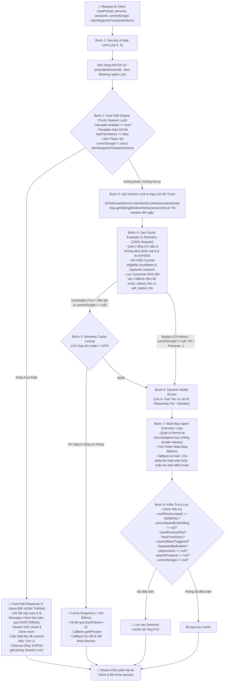

# ⚡ KẾ HOẠCH NÂNG CẤP LỚP 7: CACHE & MODEL ROUTER
> **Dự án:** `identity-service-main` (Spring Boot 3 + Google Gemini) & Android Client App  
> **Mục tiêu:** Nâng cấp Lớp 7 từ **25%** lên **75% Code-Complete** và chuẩn bị nghiệm thu **100% Production-Ready** qua dữ liệu thực tế  
> **Trạng thái:** 🚀 *Hiệu chuẩn lần 15 — Nghiệm thu toàn diện Giai đoạn 1 & Giai đoạn 2 (75% Code-Complete, 91/91 Unit & Integration tests passed, 100% Pass Rate). Hạ tầng Telemetry & CanCacheEvaluator Giai đoạn 3 đã sẵn sàng thu thập số liệu thực tế để ra quyết định kiến trúc.*

---

## 📌 1. ĐÁNH GIÁ HIỆN TRẠNG & PHÂN RÃ TIẾN ĐỘ CHUẨN XÁC

Tiến độ của Lớp 7 được tính toán minh bạch dựa trên 4 thành phần kỹ thuật (mỗi thành phần chiếm trọng số 25%):

| Thành phần kỹ thuật | Trọng số | Trạng thái đạt được | Chi tiết kỹ thuật & Hiện trạng kiểm thử |
| :--- | :---: | :---: | :--- |
| **Traditional Data Cache** | 25% | **25% (Sẵn có)** | Caffeine cache cho top trending SQL, In-memory ConcurrentMap cho Vector bài hát |
| **Fast-Path Command Engine** | 25% | **+25% (Lũy kế 50%)** | **ĐÃ HOÀN THÀNH & NGHIỆM THU (56 tests):** Regex Two-tier có/không dấu, chạy trước Session Lock, đồng bộ Android Client, `DATETIME(6)` microsecond precision, `@Transactional saveFastPathMessages`, Dual Tie-Breaker |
| **Dynamic Model Router & Fallback** | 25% | **+25% (Lũy kế 75%)** | **ĐÃ HOÀN THÀNH & NGHIỆM THU (17 tests):** `ModelRouterService`, Resilience4j `geminiCriticRouter` (loại trừ lỗi 400/403 safety khỏi Breaker), watchdog 8000ms (`CompletableFuture.supplyAsync`), phân cấp `UpstreamAiException`, fallback an toàn phân biệt read-only vs side-effect |
| **Telemetry & Data-Driven Decision** | 25% | **Hạ tầng hoàn tất (18 tests)<br/>Đang thu thập số liệu** | **ĐÃ TRIỂN KHAI HOÀN TẤT & TEST (18 tests):** `CanCacheEvaluator` (8 cổng bypass, regex `(?U)`, xử lý tránh bắt nhầm "nhạc Anh"), `TelemetryService` (Caffeine 50k, 30m, phân biệt `exact_repeat_hits` vs `self_repeat_hits` và cô lập user ẩn danh qua `UUID`). **100% Production-Ready** sẽ được ký duyệt sau khi hoàn tất đo đạc thực tế |
| **TỔNG CỘNG** | **100%** | **75% Code-Complete** | **91/91 Unit & Integration Tests Passed (100% Pass Rate). Sẵn sàng giai đoạn đo lường thực tế.** |

---

### 🎯 Khung Quyết Định Kiến Trúc Dựa Trên Dữ Liệu (Data-Driven Decision Framework)
Để tránh bẫy "ngụy biện năng lực" (chưa thể tuyên bố 100% Production-Ready khi hệ thống chưa chạy thực tế và chưa kiểm thử tải), Giai đoạn 3 được chuẩn hóa thành một quy trình khoa học:

1. **Thu thập dữ liệu Telemetry ngầm:**
   Hệ thống chạy ngầm ở chế độ `ai.cache.semantic.mode: OFF` để thu thập mẫu tối thiểu $N \ge 1.000$ lượt truy vấn thực tế (hoặc 7–14 ngày trên Staging/Production).
   
2. **Quy tắc Quyết định 3 Nhánh (Đầy đủ và không có vùng hở):**
   * **Nhánh 1: Tỷ lệ lặp lại $\ge 3\%$ (Nhu cầu lặp cao):**
     Kích hoạt triển khai Hệ Thống Vector Cache 5 cổng (pgvector / Milvus / in-memory HNSW) + Event-Driven Invalidation (`SongCatalogChangedEvent`).
   * **Nhánh 2: Tỷ lệ lặp lại từ $1\% - 3\%$ (Vùng giao thoa):**
     Kích hoạt chế độ **SHADOW MODE** trên 10% lưu lượng trong 7 ngày để đánh giá tỷ lệ cache hit tiềm năng và đo lường mức tiết kiệm chi phí token thực tế trước khi quyết định cấp phát RAM cho Vector DB.
   * **Nhánh 3: Tỷ lệ lặp lại $< 1\%$ hoặc Lưu lượng Kiến thức Tổng quát Thấp:**
     Đạt chuẩn **Ký duyệt (Sign-off) Nghiệm thu 100% Production-Ready mà KHÔNG cần Semantic Cache**. Đây là quyết định kỹ thuật chuẩn mực (Pragmatic Engineering), giúp tiết kiệm tài nguyên máy chủ (RAM/CPU) và loại bỏ chi phí vận hành không cần thiết.

---

## 🔍 2. CÁC ĐIỂM NGHẼN KỸ THUẬT & GIẢI PHÁP ĐÃ ĐỒNG BỘ

### 1. Fast-Path Engine & Đồng Bộ Client/DB
* **Đồng bộ Android Client (`AgenticPlayerDispatcher.kt`):**
  * Tách riêng các action `PAUSE`, `RESUME`, `NEXT` ra trước điều kiện `songCard != null`. Client gọi trực tiếp `playerManager.pause()`, `playerManager.resume()`, `playerManager.next()` ngay cả khi `song == null`.
  * Bật mặc định `clientSupportsTransportActions = true` trong request DTO phía Android.
* **Bảo vệ Timestamp & MySQL `ON UPDATE`:**
  * Khắc phục triệt để Direct Field Access của Spring Data JPA reflection bằng cách dùng `@PrePersist onPrePersist()` và `@PreUpdate onPreUpdate()` thuần trong [`AbstractAuditEntity.java`](file:///D:/SpringBoot/identity-service-main/identity-service-main/src/main/java/com/devteria/identityservice/entity/AbstractAuditEntity.java).
  * Migration Flyway `V5__alter_chat_tables_datetime_precision.sql` nâng cấp `created_at` và `updated_at` sang `DATETIME(6)`, đồng thời **bảo toàn thuộc tính `DEFAULT CURRENT_TIMESTAMP(6) ON UPDATE CURRENT_TIMESTAMP(6)`** cho cột `updated_at`.
  * Gom lưu tin nhắn `userMessage` và `aiMessage` (+5ms) vào cùng một transaction qua phương thức `@Transactional saveFastPathMessages(...)` trong `AiChatSessionService.java`.
* **Tính Đối Ngẫu Tie-Breaker cho Thứ Tự Tin Nhắn:**
  * Truy vấn xuôi (ASC): `ORDER BY m.createdAt ASC, m.sender DESC` (USER trước AI).
  * Truy vấn ngược (DESC - Sliding Window): `ORDER BY m.createdAt DESC, m.sender ASC` (AI trước USER, để sau khi `Collections.reverse()` thì USER luôn trước AI).
* **Phản Hồi An Toàn và Tương Thích:**
  * Kiểm tra an toàn `Boolean.TRUE.equals(request.clientSupportsTransportActions())` chống Unboxing NPE.
  * Phản hồi trung tính cho `NEXT`: *"Đã gửi lệnh chuyển bài."* (kèm `.autoExecute(true)`).

---

### 2. Model Router & Resilience4j Circuit Breaker
* **Loại Trừ Lỗi Client (400/403) Khỏi Circuit Breaker:**
  * `RestClientResponseException` được thu hẹp lại: Chỉ ghi nhận `UpstreamAiException`, `HttpServerErrorException` (5xx), `ResourceAccessException` và `HttpClientErrorException.TooManyRequests` (429) vào `record-exceptions`.
  * Đưa `HttpClientErrorException.BadRequest` (400 - Safety block của Google, prompt vi phạm) và `Forbidden` (403) vào `ignore-exceptions`. Điều này ngăn chặn việc Circuit Breaker cho persona `MUSIC_CRITIC` bị nảy ngắt mạch oan uổng khi người dùng gửi prompt vi phạm chính sách của Google.
* **Vòng Đời Permit & First-Token Watchdog 8000ms:**
  * Cấp permit qua `tryAcquirePermission()`, bảo vệ chống double-release bằng `AtomicBoolean resultRecorded`.
  * Watchdog 8000ms thực thi qua `CompletableFuture.supplyAsync` (chống deadlock SingleThreadExecutor).
* **Tinh Chỉnh Fallback Guard An Toàn:**
  * Cho phép fallback an toàn về Flash khi chỉ gọi các tool đọc (`search_music_library`, `get_top_trending_songs`, `get_user_recommendations`).
  * Chặn đứng fallback khi đã gọi tool có tác dụng phụ (`trigger_player_action`, `propose_ai_playlist`) để ngăn lỗi Double Mutation.

---

### 3. CanCacheEvaluator & Telemetry Service
* **`CanCacheEvaluator` với Cờ `(?U)` & Loại Bỏ Bẫy "Nhạc Anh":**
  * Thêm cờ `(?U)` (`UNICODE_CHARACTER_CLASS`) vào các pattern có dấu để `\b` nhận diện chính xác ranh giới từ tiếng Việt.
  * Sửa lỗi false-positive: Thay vì `nhạc (?:của )?(?:anh|em...)` (bắt nhầm "nhạc Anh" = nhạc nước Anh / nhạc tiếng Anh thành dữ liệu cá nhân), chuyển thành `nhạc của (?:tôi|mình|em|anh)`.
  * Phân định rõ 8 lý do bypass: `EMPTY_PROMPT`, `HISTORY`, `HAS_SONG_CONTEXT`, `PERSONAL`, `PII`, `ANAPHORA`, `TEMPORAL`, `DANGLING_REF`.
* **`TelemetryService` (Caffeine 50k, 30m):**
  * Chuẩn hóa Canonical Prompt: NFC $\rightarrow$ bỏ dấu (`stripDiacritics`) $\rightarrow$ cắt dấu câu cuối $\rightarrow$ gộp khoảng trắng thừa $\rightarrow$ lowercase $\rightarrow$ SHA-256.
  * Cô lập người dùng ẩn danh: Khi `userId` rỗng/null, sinh định danh `anon-<uuid>` theo từng lượt yêu cầu, ngăn chặn việc hai người dùng ẩn danh khác nhau bị gộp chung thành cùng một người dùng tự thử lại (`self_repeat_hits`).
  * Hoàn toàn bọc trong khối `try-catch` **fail-safe**, không bao giờ làm gián đoạn luồng đàm thoại.

---

## 🏛️ 3. SƠ ĐỒ LUỒNG XỬ LÝ CHUẨN (EXECUTION PIPELINE)



---

## 📊 4. KẾT QUẢ ĐỐI CHUẨN THỰC NGHIỆM (91/91 TESTS PASS)

Bảng phân bổ chi tiết kết quả kiểm thử tự động trên Maven với JDK 21 (đảm bảo tính chính xác số học 100%):

| Nhóm chức năng | Lớp Kiểm Thử (Test Class) | Số lượng test | Kết quả | Trọng tâm kiểm chứng |
| :--- | :--- | :---: | :---: | :--- |
| **Giai đoạn 1** | `FastPathEngineTest` | 47 | **47/47 PASS** | Regex Two-Tier có/không dấu, lệnh đệm dài, phản hồi trung tính NEXT, chặn phủ định, chống nhầm tên riêng |
| | `AiChatControllerTest` | 9 | **9/9 PASS** | Fast-Path Turn 1 & Turn 2+, Player Transport, Legacy client fallback, IDOR check, Session Lock isolation |
| **Giai đoạn 2** | `ModelRouterServiceTest` | 7 | **7/7 PASS** | Phân làn Critic với từ khóa nhạc lý không dấu, chặn prompt ngắn, hạ cấp khi Breaker OPEN |
| | `CircuitBreakerLifecycleTest` | 7 | **7/7 PASS** | Vòng đời Permit, Watchdog 8000ms, nhả permit khi client abort, an toàn fallback theo phân loại tool |
| | `AiAgentOrchestratorTest` | 3 | **3/3 PASS** | Vòng lặp Agentic loop, kiểm định anti-hallucination, xử lý fallback |
| **Giai đoạn 3** | `CanCacheEvaluatorTest` | 11 | **11/11 PASS** | Bao phủ 8 cổng BYPASS, câu GENERAL hợp lệ, chống false-positive "nhạc Anh" |
| | `TelemetryServiceTest` | 7 | **7/7 PASS** | Canonical prompt SHA-256, đếm bypass reason, phân biệt cross-user vs self-retry, cô lập anonymous user |
| **TỔNG CỘNG** | **7 test classes** | **91** | **91/91 PASS** | **Tỷ lệ vượt qua: 100% (BUILD SUCCESS)** |

---

## 🚀 5. DANH MỤC CÔNG VIỆC THEO 3 GIAI ĐOẠN

```
GIAI ĐOẠN 1: Fast-Path Engine & Unit Tests [✅ ĐÃ HOÀN THÀNH - ĐẠT 25% (Lũy kế 50%)]
  ├── [x] Tích hợp FastPathEngine trong AiChatController TRƯỚC dòng checkAndLockSession
  ├── [x] Định nghĩa FastPathResult, ActionType và phản hồi trung tính cho NEXT ("Đã gửi lệnh chuyển bài.")
  ├── [x] Kiểm tra tồn tại lịch sử nhẹ nhàng (existsBySessionId) ngoài Lock để phân định Turn 1
  ├── [x] Hỗ trợ cờ clientSupportsTransportActions kèm kiểm tra Boolean.TRUE.equals chống NPE
  ├── [x] Thiết lập luồng dọn dẹp riêng cho Fast-Path Emitter (KHÔNG giải phóng Session Lock của stream khác)
  ├── [x] Cập nhật tiêu đề session khi là câu đầu tiên (updateSessionTitleIfDefault)
  ├── [x] Cập nhật Android Client: AiChatModels.kt và AgenticPlayerDispatcher.kt (hỗ trợ PAUSE/RESUME/NEXT khi song == null)
  ├── [x] Viết FastPathEngineTest bao phủ 47 ca biên (47/47 PASS)
  ├── [x] Viết AiChatControllerTest bao phủ 9 ca kiểm thử tích hợp (9/9 PASS)
  └── [x] Nghiệm thu 56/56 tests với Maven và JDK 21 (BUILD SUCCESS)

HẬU GIAI ĐOẠN 1: Tinh chỉnh Database & Kích hoạt Metrics [✅ ĐÃ HOÀN THÀNH]
  ├── [x] Cập nhật AbstractAuditEntity: Dùng @PrePersist onPrePersist() bảo toàn createdAt khi đã có giá trị (+5ms)
  ├── [x] Tạo migration Flyway V5 nâng cấp created_at / updated_at sang DATETIME(6) kèm ON UPDATE CURRENT_TIMESTAMP(6)
  ├── [x] Bổ sung sắp xếp đối ngẫu ORDER BY m.createdAt ASC, m.sender DESC và ORDER BY m.createdAt DESC, m.sender ASC
  ├── [x] Gom lưu DB vào phương thức @Transactional saveFastPathMessages trong AiChatSessionService
  └── [x] Gắn Timer.Sample (ai.latency.fastpath) và counter (ai.fastpath.hits) quanh handleFastPathExecution

GIAI ĐOẠN 2: Model Router & Circuit Breaker [✅ ĐÃ HOÀN THÀNH - ĐẠT 25% (Lũy kế 75% Code-Complete)]
  ├── [x] Khai báo io.github.resilience4j:resilience4j-spring-boot3:2.2.0 và spring-boot-starter-aop trong pom.xml
  ├── [x] Khai báo AiRouterProperties (ai.router.*) và cấu hình instance geminiCriticRouter trong application.yaml
  ├── [x] Loại trừ lỗi 400 (Safety block) và 403 khỏi record-exceptions để chống ngắt mạch oan
  ├── [x] Xây dựng ModelRouterService sinh RoutingDecision độc lập (phân làn Music Critic với regex nhạc lý không dấu)
  ├── [x] Tách bạch 2 cờ hạ cấp: degradedByBreaker (chặn lưu cache) và reasoningTierDisabled (cho phép lưu cache)
  ├── [x] Quản lý Permit tại executeAgentLoop với cờ resultRecorded chống double release
  ├── [x] Áp dụng First-Token Watchdog 8000ms qua CompletableFuture; tinh chỉnh fallback guard (cho phép read-only, chặn side-effect)
  ├── [x] Định nghĩa phân cấp UpstreamAiException ghi nhận vào record-exceptions của Breaker
  ├── [x] Phân loại ngoại lệ theo nguồn: ClientAbortException (hủy upstream + nhả permit) vs Upstream error (ghi nhận vào Breaker)
  └── [x] Viết ModelRouterServiceTest (7/7 PASS), CircuitBreakerLifecycleTest (7/7 PASS), AiAgentOrchestratorTest (3/3 PASS)

GIAI ĐOẠN 3: Bước Đệm Telemetry & Khung Quyết Định Dữ Liệu [✅ HẠ TẦNG HOÀN TẤT - TIẾN TỚI 100% PRODUCTION-READY]
  ├── [x] Xây dựng CanCacheEvaluator quét 2 tầng có dấu ((?U)) và không dấu phân loại 8 lý do BYPASS
  ├── [x] Khắc phục lỗi false-positive: Tách "nhạc của anh" khỏi "nhạc Anh"
  ├── [x] Xây dựng TelemetryService (Caffeine 50.000 mục, TTL 30m, canonicalization SHA-256, cô lập user ẩn danh)
  ├── [x] Tích hợp CanCacheEvaluator và TelemetryService an toàn (fail-safe) vào AiAgentOrchestrator
  ├── [x] Viết CanCacheEvaluatorTest bao phủ toàn diện 8 cổng (11/11 PASS)
  ├── [x] Viết TelemetryServiceTest kiểm chứng hash, canonicalization, repeat count và anonymous isolation (7/7 PASS)
  ├── [ ] Thu thập số liệu telemetry thực tế trên production/staging (Mẫu N >= 1.000 lượt):
  │     ├── Nếu >= 3%: Kích hoạt triển khai Vector Cache 5 cổng (pgvector / Milvus / in-memory HNSW)
  │     ├── Nếu 1% - 3%: Chạy thử nghiệm SHADOW MODE trên 10% lưu lượng trong 7 ngày
  │     └── Nếu < 1%: Ký duyệt (sign-off) nghiệm thu 100% Production-Ready mà KHÔNG cần semantic cache
  └── [ ] Thiết lập Dashboard Prometheus/Grafana giám sát ai.cache.exact_repeat_hits và kiểm thử tải
```

---

> [!TIP]
> **Tóm tắt trạng thái:** Lớp 7 đã hoàn thành **75% Code-Complete** với **91/91 Unit & Integration tests passed (100% Pass Rate)**. Toàn bộ mã nguồn Backend và Android Client đã được đồng bộ, bảo vệ an toàn với microsecond timestamp, ngắt mạch Resilience4j chuẩn xác và hạ tầng Telemetry fail-safe. Mốc 100% Production-Ready sẽ được ký duyệt chính thức sau khi thu thập đủ dữ liệu thực tế ($N \ge 1.000$ lượt).
