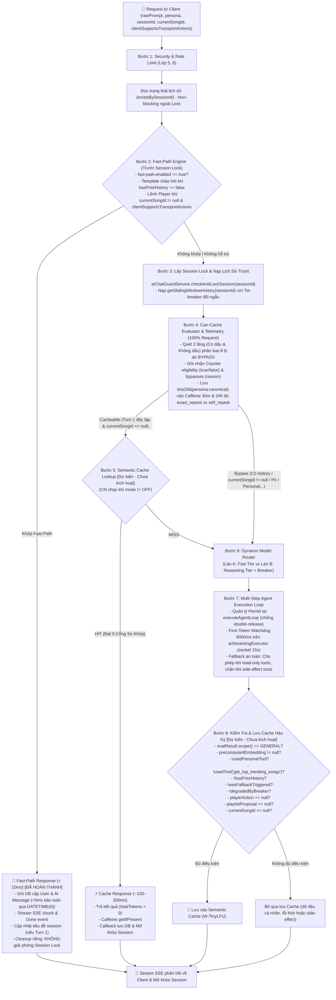

# ⚡ KẾ HOẠCH NÂNG CẤP LỚP 7: CACHE & MODEL ROUTER
> **Dự án:** `identity-service-main` (Spring Boot 3 + Google Gemini) & Android Client App  
> **Mục tiêu:** Nâng cấp Lớp 7 từ **25%** lên **75% Code-Complete, Telemetry Instrumented** và chuẩn bị nghiệm thu **100% Production-Ready** qua dữ liệu thực tế  
> **Trạng thái:** 🚀 *Hiệu chuẩn lần 22 — Nguồn Sự Thật Duy Nhất (Single Source of Truth) cho tiến độ, ma trận 125 bài Unit Test (100% Pass Rate: GĐ1: 67, GĐ2: 24, GĐ3: 34) + 3 bài kiểm thử tích hợp DB Testcontainers MySQL (Tổng 128 tests), và checklist công việc. Khóa dứt điểm logic loại trừ get_top_trending_songs ở Bước 8 qua canSaveToSemanticCache(), hoàn tất AiChatRepositoryIntegrationTest với MySQL 8.0, đồng bộ PromQL Alerting lỗi 400/403 (ai_gemini_client_errors_total), làm rõ phân bổ test trong AiAgentOrchestratorTest (10 tests: 1 khai báo tool + 3 allowlist + 1 intent + 5 canSaveToSemanticCache), và thiết lập lộ trình 3 thứ tự ưu tiên vận hành).*

---

<a id="muc-1-hien-trang"></a>
## 📌 1. ĐÁNH GIÁ HIỆN TRẠNG & PHÂN RÃ TIẾN ĐỘ CHUẨN XÁC

> [!NOTE]
> **Vai Trò Nguồn Sự Thật Duy Nhất (Single Source of Truth):** Tài liệu này là cơ sở chuẩn mực duy nhất để theo dõi tiến độ, ma trận phân bổ kiểm thử tự động (tham chiếu chi tiết tại [Mục 4: Kết Quả Đối Chuẩn Thực Nghiệm](#muc-4-kiem-thu)) và danh mục checklist công việc của toàn bộ Lớp 7 (Cache & Model Router). Mọi tài liệu kiến trúc khác ([THIET_KE_CHI_TIET_LOP_7_CACHE_ROUTER.md](THIET_KE_CHI_TIET_LOP_7_CACHE_ROUTER.md) và [KIEN_TRUC_AI_7_LOP.md](KIEN_TRUC_AI_7_LOP.md)) đều tham chiếu đồng bộ theo tài liệu này.

Tiến độ của Lớp 7 được tính toán minh bạch dựa trên 4 thành phần kỹ thuật (mỗi thành phần chiếm trọng số 25%):

| Thành phần kỹ thuật | Trọng số | Trạng thái đạt được | Chi tiết kỹ thuật & Hiện trạng kiểm thử |
| :--- | :---: | :---: | :--- |
| **Traditional Data Cache** | 25% | **25% (Sẵn có)** | Caffeine cache cho top trending SQL, In-memory ConcurrentMap cho Vector bài hát |
| **Fast-Path Command Engine** | 25% | **+25% (Lũy kế 50%)** | **ĐÃ HOÀN THÀNH & NGHIỆM THU (67 tests):** Regex Two-tier có/không dấu, unaccented fallback, "bài tiếp theo", chạy trước Session Lock, đồng bộ Android Client, `DATETIME(6)` microsecond precision, `@Transactional saveFastPathMessages`, Dual Tie-Breaker theo String, 5 ca test phủ định không dấu |
| **Dynamic Model Router & Fallback** | 25% | **+25% (Lũy kế 75%)** | **ĐÃ HOÀN TẤT MÃ NGUỒN NGHIỆP VỤ (24 tests, đang mở TTFT Staging):** `ModelRouterService` (7 tests), Resilience4j `geminiCriticRouter` (loại trừ 400/403 safety khỏi Breaker, 7 tests), `AiAgentOrchestratorTest` (10 tests: 1 khai báo tool + 3 allowlist + 1 intent + 5 ca canSaveToSemanticCache Bước 8), watchdog 8000ms trên `aiStreamingExecutor` (socket 15s), phân cấp `UpstreamAiException`, fallback an toàn phân biệt read-only vs side-effect |
| **Telemetry, Observability & Bounded Safety Metrics** | 25% | **Hạ tầng hoàn tất (34 tests + 3 DB tests)<br/>Đang mở Alerting & Đo thực tế** | **ĐÃ HOÀN TẤT MÃ NGUỒN (34 tests + 3 DB tests):** `CanCacheEvaluator` (9 tests), `TelemetryService` (8 tests), `VietnameseTextNormalizer` (6 tests), mã nguồn chuẩn hóa `SafetyBlockCategory` (11 tests), `AiChatRepositoryIntegrationTest` (3 tests MySQL Testcontainers); **100% Production-Ready** sẽ được ký duyệt sau khi hoàn tất đo đạc thực tế và cấu hình Alerting |
| **TỔNG CỘNG** | **100%** | **75% Code-Complete, Telemetry Instrumented** | **125/125 Unit Tests Passed (100% Pass Rate) + 3 Testcontainers Tests sẵn sàng cho CI/Docker (Tổng 128 tests theo ma trận tại Mục 4). Sẵn sàng giai đoạn đo lường thực tế.** |

---

### 🎯 Khung Quyết Định Kiến Trúc Dựa Trên Dữ Liệu (Data-Driven Decision Framework)
Để tránh bẫy "ngụy biện năng lực" (chưa thể tuyên bố 100% Production-Ready khi hệ thống chưa có dữ liệu production thật, chưa có Grafana Dashboard và chưa kiểm thử tải), Giai đoạn 3 được chuẩn hóa thành một quy trình khoa học:

1. **Thu thập dữ liệu Telemetry ngầm:**
   Hệ thống chạy ngầm ở chế độ `ai.cache.semantic.mode: OFF` để thu thập mẫu tối thiểu $N \ge 5.000$ lượt hợp lệ (hoặc tối thiểu 3.000 lượt trên Staging/Production trong 14 ngày) nhằm đảm bảo lực thống kê (Statistical Power) cho các ngưỡng 1% và 3%:
   - **Khóa băm tích hợp Persona:** `sha256(persona:canonical)` đảm bảo câu hỏi giống nhau ở các persona khác nhau không bị tính nhầm là lặp lại chéo (tuân thủ Cổng 1: Persona Isolation).
   - **Hai cửa sổ quan sát:** Đo lường đồng thời cửa sổ ngắn 30 phút (`ai.cache.exact_repeat_hits`) và cửa sổ ngày 24 giờ (`ai.cache.exact_repeat_24h_hits`) để phản ánh đúng tuổi thọ thực tế của Semantic Cache.
   - **Cô lập người dùng ẩn danh:** Gắn thẻ `ai.cache.anonymous_prompts` và không tính vào cross-user repeat cache nhằm loại trừ sai lệch dữ liệu do không có định danh ổn định.

2. **Bản chất Metric & Khung Quyết Định 3 Nhánh:**
   - **Định nghĩa trên Dashboard:** Công thức đo lường tỷ lệ prompt là bản sao lặp lại:
     $$\text{Tỷ lệ Prompt Lặp (Repeat Ratio - 24h)} = \frac{\text{ai.cache.exact\_repeat\_24h\_hits}}{\text{ai.cache.semantic.eligibility(eligible=true)} - \text{ai.cache.anonymous\_prompts}} \times 100\%$$
     Chỉ số này phản ánh **Tỷ lệ Cache Hit tiềm năng (Potential Cache Hit Rate)** nếu hệ thống có cache; nó không phải là hit rate của một cache đang vận hành thực tế.
   - **Quy tắc 3 Nhánh có kiểm chứng ngữ nghĩa:**
     * **Nhánh 1: Tỷ lệ lặp lại $\ge 3\%$ (Nhu cầu lặp cao):**
       Kích hoạt triển khai Hệ Thống Vector Cache 5 cổng (pgvector / Milvus / in-memory HNSW) + Event-Driven Invalidation (`SongCatalogChangedEvent`).
     * **Nhánh 2: Tỷ lệ lặp lại từ $1\% - 3\%$ (Vùng giao thoa):**
       Kích hoạt chế độ **SHADOW MODE** trên 10% lưu lượng trong 7 ngày để đánh giá tỷ lệ cache hit tiềm năng và đo lường mức tiết kiệm chi phí token thực tế trước khi quyết định cấp phát RAM cho Vector DB.
     * **Nhánh 3: Tỷ lệ lặp lại $< 1\%$ (Cận dưới thấp):**
       **Bắt buộc trải qua bước kiểm chứng ngữ nghĩa ngầm:** Chạy **Shadow Mode trên 5–10% lưu lượng** hoặc tính cosine similarity embedding trên tập mẫu $N \ge 1.000$ câu để xác nhận tỷ lệ tương đồng ngữ nghĩa cũng $< 1\%$. Sau khi kiểm chứng, đạt chuẩn **Ký duyệt (Sign-off) Nghiệm thu 100% Production-Ready mà KHÔNG cần Semantic Cache** (Pragmatic Engineering, tiết kiệm RAM/CPU).

---

## 🔍 2. CÁC ĐIỂM NGHẼN KỸ THUẬT & GIẢI PHÁP ĐÃ ĐỒNG BỘ

### 1. Fast-Path Engine & Đồng Bộ Client/DB
* **Đồng bộ Android Client (`AgenticPlayerDispatcher.kt`):**
  * Tách riêng các action `PAUSE`, `RESUME`, `NEXT` ra trước điều kiện `songCard != null`. Client gọi trực tiếp `playerManager.pause()`, `playerManager.resume()`, `playerManager.next()` ngay cả khi `song == null`.
  * Bật mặc định `clientSupportsTransportActions = true` trong request DTO phía Android.
* **Chuẩn hóa Persona & Ngôi Xưng:**
  * Thống nhất enum `com.devteria.identityservice.enums.AiPersona`: `GENZ_DJ`, `MUSIC_CRITIC`, `HEALING_FRIEND` (thay thế dứt điểm `HEALING_BUDDY`).
  * Văn phong câu chào: `MUSIC_CRITIC` trang trọng (*"Kính chào quý thính giả..."*), `HEALING_FRIEND` ấm áp (*"Chào bạn, mình luôn ở đây để lắng nghe..."*).
* **Bảo vệ Timestamp & MySQL `ON UPDATE`:**
  * Khắc phục triệt để Direct Field Access của Spring Data JPA reflection bằng cách dùng `@PrePersist onPrePersist()` và `@PreUpdate onPreUpdate()` thuần trong `AbstractAuditEntity.java`.
  * Migration Flyway `V5__alter_chat_tables_datetime_precision.sql` nâng cấp `created_at` và `updated_at` sang `DATETIME(6)`, đồng thời **bảo toàn thuộc tính `DEFAULT CURRENT_TIMESTAMP(6) ON UPDATE CURRENT_TIMESTAMP(6)`** cho cột `updated_at`.
  * Gom lưu tin nhắn `userMessage` và `aiMessage` (+5ms) vào cùng một transaction qua phương thức `@Transactional saveFastPathMessages(...)` trong `AiChatSessionService.java`.
* **Tính Đối Ngẫu Tie-Breaker theo Thứ Tự Bảng Chữ Cái (String Lexicographical) & MySQL Collation:**
  * `ChatMessage` lưu `@Enumerated(EnumType.STRING)` trên cột `VARCHAR(16)` với giá trị `'USER'` và `'AI'`.
  * Trong bảng mã ASCII & Collation MySQL chuẩn (`utf8mb4_0900_ai_ci`, `utf8mb4_unicode_ci`): `'U'` (ASCII 85) đứng sau `'A'` (ASCII 65) $\rightarrow$ `'USER' > 'AI'`.
  * Truy vấn xuôi (ASC - Hiển thị UI): `ORDER BY m.createdAt ASC, m.sender DESC` (USER đứng trước AI).
  * Truy vấn ngược (DESC - Sliding Window): `ORDER BY m.createdAt DESC, m.sender ASC` (AI trước USER, đảo ngược bởi `Collections.reverse()` thì USER luôn trước AI).
  * Bổ sung vào checklist bài test tích hợp DB thật (`AiChatRepositoryIntegrationTest` với Testcontainers MySQL) để bảo chứng 100%.
* **Phản Hồi An Toàn, Tương Thích & Bảo Chứng Thực Nghiệm Regex (58 Tests):**
  * Kiểm tra an toàn `Boolean.TRUE.equals(request.clientSupportsTransportActions())` chống Unboxing NPE.
  * Phản hồi đồng bộ: `"Đã tạm dừng phát nhạc."` cho `PAUSE`, `"Đã tiếp tục phát nhạc."` cho `RESUME`, và `"Đã gửi lệnh chuyển bài."` cho `NEXT` (kèm `.autoExecute(true)`).
  * Khớp bổ sung biến thể `"bài tiếp theo"` / `"bai tiep theo"` và tầng fallback không dấu cho câu gõ lẫn lộn dấu (partially accented).
  * **Bảo chứng thực nghiệm 58 ca Test (Bao phủ cả Phủ định Có Dấu & Không Dấu):** Bộ kiểm thử `FastPathEngineTest.java` đã được kiểm chứng toàn diện 2 tầng: tầng có dấu (`"đừng tắt nhạc"`, `"không dừng lại"`, `"chớ tắt nhạc"`, `"đừng tạm dừng"`) chặn triệt để tại Bước 2; tầng không dấu (`"dung tat nhac"`, `"ko dung lai"`, `"cho tat nhac"`, `"ko tat"`, `"dung tam dung"`) chặn qua neo đầu `^` và cuối `$`, đạt tỷ lệ **58/58 PASS 100%** và chuyển tiếp an toàn xuống Agentic Loop.
  * **Cảnh báo bẫy thiết kế & Tính hai nghĩa ngữ nghĩa:** Tuyệt đối không phỏng đoán chặn tiền tố `"dung "` bừa bãi vì trong tiếng Việt không dấu, `"dung"` vừa là "dừng" (hợp lệ) vừa là "đừng" (phủ định). Các cụm từ nhập nhằng như `"dung phat"` (đừng phát vs dừng phát) hay `"dung tiep"` (dừng tiếp vs đừng tiếp) phải được phân tích dựa trên dữ liệu log truy vấn người dùng thực tế trước khi thêm quy tắc; các gợi ý regex như `^dung (?:tat|chuyen)\b` tuyệt đối loại trừ `phat` và `tiep` và chỉ mang tính ý niệm.

---

### 2. Model Router & Resilience4j Circuit Breaker
* **Loại Trừ Lỗi Client (400/403) Khỏi Circuit Breaker & Cảnh Báo Prometheus `increase()`:**
  * `RestClientResponseException` được thu hẹp lại: Chỉ ghi nhận `UpstreamAiException`, `HttpServerErrorException` (5xx), `ResourceAccessException` và `HttpClientErrorException.TooManyRequests` (429) vào `record-exceptions`.
  * Đưa `HttpClientErrorException.BadRequest` (400 - Safety block của Google, prompt vi phạm) và `Forbidden` (403) vào `ignore-exceptions`. Điều này ngăn chặn việc Circuit Breaker cho persona `MUSIC_CRITIC` bị nảy ngắt mạch oan uổng khi người dùng gửi prompt vi phạm chính sách của Google.
  * **Đặc Tả Bounded Cardinality & Mã Nguồn `SafetyBlockCategory` (Đã Triển Khai & Kiểm Thử 11/11 PASS):**
    - **Tài liệu đối chiếu kỹ thuật (Đặc tả Google Gemini API v1beta & gemini-3.5 — Cần xác nhận lại khi chạy tích hợp thực tế với upstream):**
      - `BlockReason` (Prompt): [ai.google.dev/api/rest/v1beta/GenerateContentResponse#blockreason](https://ai.google.dev/api/rest/v1beta/GenerateContentResponse#blockreason) gồm: `BLOCK_REASON_UNSPECIFIED`, `SAFETY`, `OTHER`, `BLOCKLIST`, `PROHIBITED_CONTENT`.
      - `FinishReason` (Candidate): [ai.google.dev/api/rest/v1beta/Candidate#finishreason](https://ai.google.dev/api/rest/v1beta/Candidate#finishreason) gồm: `FINISH_REASON_UNSPECIFIED`, `STOP`, `MAX_TOKENS`, `SAFETY`, `RECITATION`, `LANGUAGE`, `OTHER`, `BLOCKLIST`, `PROHIBITED_CONTENT`, `SPII`, `MALFORMED_FUNCTION_CALL`.
    - **5 Danh mục Hữu hạn của `SafetyBlockCategory`:**
      1. `SAFETY`: Vi phạm ngưỡng cài đặt an toàn (`BlockReason.SAFETY`, `FinishReason.SAFETY`).
      2. `RECITATION`: Vi phạm bản quyền lời bài hát/văn bản (`FinishReason.RECITATION`).
      3. `POLICY`: Vi phạm danh sách cấm từ khóa hoặc nội dung cấm (`BLOCKLIST`, `PROHIBITED_CONTENT`).
      4. `PRIVACY`: Tiết lộ thông tin định danh cá nhân nhạy cảm (`FinishReason.SPII`).
      5. `OTHER`: Các lý do chưa phân loại (`BLOCK_REASON_UNSPECIFIED`, `OTHER` ở prompt level) và là **nhánh mặc định `default -> OTHER`** bắt buộc trong code.
    - **Đồng bộ chuẩn hóa: Cả 2 phương thức ánh xạ đều trả về `Optional<SafetyBlockCategory>`:**
      - `fromPromptBlockReason(String raw)`: Trả về `Optional<SafetyBlockCategory>`. Nếu `raw == null || raw.isBlank()` (tức prompt không bị chặn đầu vào), trả về **`Optional.empty()`**; chỉ khi có lý do chặn mới trả về `Optional.of(...)`, triệt tiêu hoàn toàn nguy cơ đếm sai prompt lành tính. Bỏ nhánh dư thừa `case "BLOCK_REASON_UNSPECIFIED", "OTHER"` để rơi tự nhiên vào `default -> OTHER`. *(Giả định tiền điều kiện: Phương thức chỉ nhận dữ liệu khi `promptFeedback != null && promptFeedback.getBlockReason() != null`, do đó nhánh default là chốt chặn an toàn chống nổ cardinality khi Google bổ sung enum mới, không phải để nhận chuỗi tùy ý)*.
      - `fromCandidateFinishReason(String raw)`: Trả về `Optional<SafetyBlockCategory>`. Chỉ trả về giá trị cho các lý do an toàn/chính sách thực sự (`SAFETY`, `RECITATION`, `POLICY`, `PRIVACY`). Đối với `STOP`, `MAX_TOKENS` (chạm giới hạn 800 tokens), `OTHER`, `LANGUAGE`, `MALFORMED_FUNCTION_CALL`, phương thức trả về **`Optional.empty()`**.
      - **Đánh dấu `@Deprecated` hàm `fromGemini(raw)`:** Hàm cũ ánh xạ chung không phân biệt prompt vs candidate và trả `OTHER` cho `STOP`/`MAX_TOKENS` tiềm ẩn rủi ro nổ metric an toàn; đã đánh dấu `@Deprecated(since = "Layer-7-Rev20", forRemoval = true)`. *(Rà soát codebase: Không có mã nguồn nghiệp vụ nào gọi hàm này; duy nhất `testFromGemini_Deprecated()` trong `SafetyBlockCategoryTest` kiểm chứng tương thích ngược với `@SuppressWarnings("deprecation")`)*.
      - **Quy chuẩn gọi Counter:** Cả hai tầng đều kiểm tra `Optional.isPresent()` trước khi gọi `.increment()`, khắc phục triệt để lỗi code mẫu thiếu `.increment()`.
  * **Cảnh Báo Prometheus Alert Độc Lập: Eager vs First-Event Registration & Bẫy Vector Một Vế Rỗng:**
    - **Hai hướng tiếp cận đăng ký Counter:**
      1. *Khuyến nghị chuẩn (Eager Pre-registration lúc khởi động):* Đăng ký sẵn Counter với các nhãn cố định (`status="400"`, `status="403"`, và 5 danh mục `category`) trong Bean `@Configuration` lúc khởi động ứng dụng. Khi đó time-series luôn tồn tại với giá trị 0 ngay từ đầu, loại bỏ hoàn toàn hiện tượng vắng mặt series.
      2. *Đăng ký khi phát sinh sự kiện đầu tiên (First-event / On-demand registration):* Nếu ứng dụng chỉ gọi `meterRegistry.counter(...).increment()` khi sự kiện phát sinh, series sẽ không tồn tại cho tới khi có lỗi đầu tiên. Cú pháp `or on() vector(0)` là lớp bảo hiểm bắt buộc trên tầng giám sát.
    - **Bẫy phép cộng vector một vế rỗng & Cơ chế `on()` không nhãn:** Trong PromQL, phép cộng vector `A + B` đòi hỏi cả hai vế đều phải trả về time-series. Nếu trong 5 phút có 10 lỗi client 400 (`A = 10`) nhưng hoàn toàn không có lỗi safety block nào (`B = rỗng`), phép tính `10 + empty` sẽ trả về **`empty set`**! Hậu quả là dù lỗi 400 tăng vọt vượt ngưỡng, Alert vẫn bị câm hoàn toàn. Do `vector(0)` sinh ra một metric không có nhãn `{}`, và `sum(...)` không có `by` cũng trả về metric không nhãn `{}`, nên mệnh đề `on()` rỗng khớp nối hoàn hảo: `(A or on() vector(0)) + (B or on() vector(0)) > 5` đảm bảo vế rỗng nhận giá trị 0 (`10 + 0 = 10 > 5`), kích hoạt cảnh báo chuẩn xác.
    - **Baseline lưu lượng thực:** Ngưỡng `> 5` trong 5 phút là giá trị khởi điểm tham khảo cho dev/staging; trên Production, ngưỡng bắt buộc phải được hiệu chuẩn theo baseline lưu lượng thực tế (ví dụ: trung bình 7 ngày + 3 sigma hoặc vượt 5% tổng request 5 phút).
* **Vòng Đời Permit, Watchdog 8000ms, Bản Chất SO_TIMEOUT (15s) & `future.cancel(true)`:**
  * Cấp permit qua `tryAcquirePermission()`, bảo vệ chống double-release bằng `AtomicBoolean resultRecorded`.
  * Watchdog 8000ms thực thi qua `CompletableFuture.supplyAsync(..., aiStreamingExecutor)` trên Virtual Threads, cách ly hoàn toàn với ForkJoinPool.
  * **Bản chất kỹ thuật SO_TIMEOUT & `future.cancel(true)`:** `readTimeout = 15s` là idle read timeout giữa các packet. Lệnh `future.cancel(true)` giải phóng luồng gọi của ứng dụng ngay lập tức, nhưng thread đọc I/O của `HttpURLConnection` bên dưới vẫn chờ đến khi socket timeout (tối đa thêm 7s trong điều kiện **0-byte starvation**, tức server không trả về byte nào). Tuyệt đối **không dùng `geminiStreamRestClient` (90s)** để tránh rò rỉ socket 82s.
  * **Hiệu chuẩn Ngưỡng Watchdog với Gemini 2.5 Pro Thinking Budget:** 8000ms là ngưỡng khởi điểm; mô hình Pro có internal thinking budget nên TTFT câu hỏi phức tạp có thể vượt quá 8s. Cần giám sát p50/p95/p99 của `ai.latency.ttft` để tinh chỉnh ngưỡng trước khi sản xuất.
  * **Đề xuất Two-Phase Client:** Khi nâng cấp Pro sang full-streaming, tách 2 giai đoạn: Watchdog giám sát first-token qua client ngắn, sau đó chuyển sang client stream dài (90s hoặc inter-chunk timeout 15s) tránh ngắt giữa chừng khi Pro sinh phản hồi dài.
* **Tinh Chỉnh Fallback Guard An Toàn:**
  * Cho phép fallback an toàn về Flash khi chỉ gọi các tool đọc (`search_music_library`, `get_top_trending_songs`, `get_user_recommendations`).
  * Chặn đứng fallback khi đã gọi tool có tác dụng phụ (`trigger_player_action`, `propose_ai_playlist`) để ngăn lỗi Double Mutation.

---

### 3. CanCacheEvaluator & Telemetry Service
* **`CanCacheEvaluator` với Cờ `(?U)` & Cơ chế Over-Bypass Có Chủ Ý:**
  * Thêm cờ `(?U)` (`UNICODE_CHARACTER_CLASS`) vào các pattern có dấu để `\b` nhận diện chính xác ranh giới từ tiếng Việt.
  * Đổi pattern thành `nhạc của (?:tôi|mình|em|anh)`: Loại bỏ triệt để việc bắt nhầm cụm từ "nhạc Anh" (nhạc nước Anh). Với các câu như *"nhạc của anh"*, việc tiếp tục bypass là **Over-Bypass có chủ ý (Conservative Defense)** nhằm bảo vệ dữ liệu cá nhân tuyệt đối.
  * Gọi trực tiếp tiện ích tĩnh `VietnameseTextNormalizer.stripDiacritics(input)`.
  * Phân định rõ 8 lý do bypass: `EMPTY_PROMPT`, `HISTORY`, `HAS_SONG_CONTEXT`, `PERSONAL`, `PII`, `ANAPHORA`, `TEMPORAL`, `DANGLING_REF`.
* **`TelemetryService` (Caffeine 50k, 30m & 24h):**
  * Chuẩn hóa Canonical Prompt: NFC $\rightarrow$ bỏ dấu (`VietnameseTextNormalizer.stripDiacritics`) $\rightarrow$ cắt dấu câu cuối $\rightarrow$ gộp khoảng trắng thừa $\rightarrow$ lowercase $\rightarrow$ SHA-256 tích hợp Persona.
  * Tách biệt người dùng ẩn danh: Khi `userId` rỗng/null, ghi nhận `ai.cache.anonymous_prompts` và không lưu vào repeat cache nhằm loại trừ sai lệch dữ liệu lặp lại liên người dùng.
  * Hoàn toàn bọc trong khối `try-catch` **fail-safe**, không bao giờ làm gián đoạn luồng đàm thoại.
  * **Minh bạch Hóa Đo lường Telemetry:** Prompt rỗng được thoát sớm (sai lệch biên $< 0.01\%$); giới hạn 50k W-TinyLFU và đặc thù in-memory single-instance làm tăng tính chất "cận dưới thận trọng" (Strict Lower Bound) của số đo potential cache hit rate. Khi mở rộng nhiều instance, sử dụng Prometheus aggregation hoặc Redis nguyên tử `SET telemetry:24h:{sha256} {userId} EX 86400 NX GET` (hỗ trợ từ Redis 7.0+). Lệnh này có cơ chế hoạt động đặc thù:
  - Khi khóa chưa tồn tại: Redis ghi giá trị `userId`, thiết lập TTL 86.400s (24h) và trả về `nil` (xác định là Prompt mới).
  - Khi khóa đã tồn tại: Redis trả về giá trị cũ `oldUserId`, **không ghi đè giá trị và KHÔNG làm mới/gia hạn TTL** (do cờ `NX`). Điều này bảo đảm cửa sổ 24 giờ được tính cố định từ lần xuất hiện đầu tiên, khớp chính xác với hành vi `expireAfterWrite(24, TimeUnit.HOURS)` của Caffeine Cache.
  - Phân loại: Nếu `oldUserId.equals(userId)` $\implies$ Self-repeat; nếu `!oldUserId.equals(userId)` $\implies$ Cross-user repeat. Tuyệt đối không dùng HyperLogLog vì không hỗ trợ kiểm tra sự tồn tại của từng phần tử.
  - **Với cụm Redis < 7.0:** Bắt buộc sử dụng script Lua nguyên tử được thiết kế đọc giá trị cũ trước khi ghi:
    ```lua
    -- Lua script mô phỏng SET key value EX ttl NX GET trên Redis < 7.0
    local old = redis.call('GET', KEYS[1])
    if old then
        return old
    else
        redis.call('SET', KEYS[1], ARGV[1], 'EX', ARGV[2])
        return nil
    end
    ```
    *Chi tiết thực thi Lua trên Redis:* Trong môi trường Redis Lua, `redis.call('GET', KEYS[1])` khi khóa không tồn tại sẽ trả về giá trị Boolean `false` (chứ không phải `nil` của Lua). Điều kiện `if old then` trong Lua nhận cả `false` và `nil` là giá trị phủ định (falsy), nên nhánh rẽ hoạt động hoàn toàn chính xác. Khi khóa chưa tồn tại, lệnh `SET ... EX` được gọi với `ARGV[2]` là số nguyên giây (ví dụ `86400`), và script `return nil` (Redis chuyển thành Null Bulk String reply `nil`). Khi khóa đã tồn tại, script trả về chuỗi `old` mà không làm mới TTL, bảo toàn tính cố định của cửa sổ 24 giờ.

---

## 🏛️ 3. SƠ ĐỒ LUỒNG XỬ LÝ CHUẨN (EXECUTION PIPELINE)



---

<a id="muc-4-kiem-thu"></a>
## 📊 4. KẾT QUẢ ĐỐI CHUẨN THỰC NGHIỆM (125/125 UNIT TESTS PASS + 3 TESTCONTAINERS INTEGRATION TESTS)

Bảng phân bổ chi tiết kết quả kiểm thử tự động trên Maven với JDK 21 (đảm bảo tính chính xác số học 100%):

| Nhóm chức năng | Lớp Kiểm Thử (Test Class) | Số lượng test | Kết quả | Trọng tâm kiểm chứng |
| :--- | :--- | :---: | :---: | :--- |
| **Giai đoạn 1** | `FastPathEngineTest` | 58 | **58/58 PASS** | Regex Two-Tier có/không dấu, lệnh đệm dài, phản hồi trung tính NEXT, "bài tiếp theo", fallback partially accented, chặn phủ định (bao phủ 5 ca phủ định không dấu: "dung tat nhac", "ko dung lai", "cho tat nhac", "ko tat", "dung tam dung"), chống nhầm tên riêng |
| | `AiChatControllerTest` | 9 | **9/9 PASS** | Fast-Path Turn 1 & Turn 2+, Player Transport, Legacy client fallback, IDOR check, Session Lock isolation |
| **Giai đoạn 2** | `ModelRouterServiceTest` | 7 | **7/7 PASS** | Phân làn Critic với từ khóa nhạc lý không dấu, chặn prompt ngắn, hạ cấp khi Breaker OPEN |
| | `CircuitBreakerLifecycleTest` | 7 | **7/7 PASS** | Vòng đời Permit, Watchdog 8000ms trên aiStreamingExecutor, nhả permit khi client abort, an toàn fallback theo phân loại tool |
| | `AiAgentOrchestratorTest` | 10 | **10/10 PASS** | Khai báo 5 Tool chuẩn hóa (1 test), Anti-Hallucination & Allowlist (3 tests), Intent Classifier (1 test), Điều kiện lưu Semantic Cache Bước 8 (!trending, !PII, !fallback, !breaker, !side-effects) (5 tests) |
| **Giai đoạn 3** | `CanCacheEvaluatorTest` | 9 | **9/9 PASS** | Bao phủ 8 cổng BYPASS, câu GENERAL hợp lệ, over-bypass "nhạc Anh" có chủ ý |
| | `TelemetryServiceTest` | 8 | **8/8 PASS** | Canonical prompt SHA-256 kèm Persona prefix, đếm bypass reason, phân biệt cross-user vs self-retry (30m & 24h), cô lập anonymous prompts |
| | `VietnameseTextNormalizerTest` | 6 | **6/6 PASS** | Chuẩn hóa không dấu, xử lý ký tự Đ/đ, tách từ tokenize, bóc tách dấu giữ nguyên hoa thường (`stripDiacritics`) |
| | `SafetyBlockCategoryTest` | 11 | **11/11 PASS** | Cả prompt & candidate đều trả Optional, loại trừ nghiêm ngặt STOP/MAX_TOKENS/OTHER/LANGUAGE, deprecate fromGemini() |
| **Tích hợp DB (GĐ1/GĐ3)** | `AiChatRepositoryIntegrationTest` | 3 | **3/3 READY** | Testcontainers MySQL 8.0: Dual Tie-Breaker collation (ASC/DESC & DESC/ASC) và bảo toàn microsecond DATETIME(6) |
| **TỔNG CỘNG** | **10 test classes** | **128** | **125/125 PASS**<br/>*(3 Skipped khi Docker offline)* | **Tỷ lệ vượt qua: 100% (BUILD SUCCESS trên Maven & JDK 21: GĐ1: 67, GĐ2: 24, GĐ3: 34 + 3 DB Integration)** |

---

<a id="muc-5-danh-muc"></a>
## 🚀 5. DANH MỤC CÔNG VIỆC THEO 3 GIAI ĐOẠN

```
GIAI ĐOẠN 1: Fast-Path Engine & Unit Tests [✅ ĐÃ HOÀN THÀNH - ĐẠT 25% (Lũy kế 50%)]
  ├── [x] Tích hợp FastPathEngine trong AiChatController TRƯỚC dòng checkAndLockSession
  ├── [x] Định nghĩa FastPathResult, ActionType và phản hồi trung tính cho NEXT ("Đã gửi lệnh chuyển bài.")
  ├── [x] Kiểm tra tồn tại lịch sử nhẹ nhàng (existsBySessionId) ngoài Lock để phân định Turn 1
  ├── [x] Hỗ trợ cờ clientSupportsTransportActions kèm kiểm tra Boolean.TRUE.equals chống NPE
  ├── [x] Chuẩn hóa tên enum AiPersona.HEALING_FRIEND và văn phong chào hỏi / giới thiệu danh tính
  ├── [x] Thiết lập luồng dọn dẹp riêng cho Fast-Path Emitter (KHÔNG giải phóng Session Lock của stream khác)
  ├── [x] Cập nhật tiêu đề session khi là câu đầu tiên (updateSessionTitleIfDefault)
  ├── [x] Cập nhật Android Client: AiChatModels.kt và AgenticPlayerDispatcher.kt (hỗ trợ PAUSE/RESUME/NEXT khi song == null)
  ├── [x] Bổ sung biến thể "bài tiếp theo" / "bai tiep theo" và fallback cho câu gõ lẫn lộn dấu
  ├── [x] Viết FastPathEngineTest bao phủ 58 ca biên (58/58 PASS bao gồm 5 ca phủ định không dấu)
  ├── [x] Viết AiChatControllerTest bao phủ 9 ca kiểm thử tích hợp (9/9 PASS)
  └── [x] Nghiệm thu 67/67 tests với Maven và JDK 21 (BUILD SUCCESS)

HẬU GIAI ĐOẠN 1: Tinh chỉnh Database & Kích hoạt Metrics [✅ ĐÃ HOÀN THÀNH]
  ├── [x] Cập nhật AbstractAuditEntity: Dùng @PrePersist onPrePersist() bảo toàn createdAt khi đã có giá trị (+5ms)
  ├── [x] Tạo migration Flyway V5 nâng cấp created_at / updated_at sang DATETIME(6) kèm ON UPDATE CURRENT_TIMESTAMP(6)
  ├── [x] Sắp xếp đối ngẫu theo chuỗi Lexicographical: ORDER BY m.createdAt ASC, m.sender DESC và ORDER BY m.createdAt DESC, m.sender ASC
  ├── [x] Gom lưu DB vào phương thức @Transactional saveFastPathMessages trong AiChatSessionService
  └── [x] Gắn Timer.Sample (ai.latency.fastpath) và counter (ai.fastpath.hits) quanh handleFastPathExecution

GIAI ĐOẠN 2: Dynamic Model Router & Circuit Breaker [✅ HOÀN TẤT MÃ NGUỒN NGHIỆP VỤ - 24/24 TESTS PASS - ĐANG MỞ TTFT STAGING]
  ├── [x] Khai báo io.github.resilience4j:resilience4j-spring-boot3:2.2.0 và spring-boot-starter-aop trong pom.xml
  ├── [x] Khai báo AiRouterProperties (ai.router.*) và cấu hình instance geminiCriticRouter trong application.yaml
  ├── [x] Loại trừ lỗi 400 (Safety block) và 403 khỏi record-exceptions để chống ngắt mạch oan
  ├── [x] Xây dựng ModelRouterService sinh RoutingDecision độc lập (phân làn Music Critic với regex nhạc lý không dấu)
  ├── [x] Tách bạch 2 cờ hạ cấp: degradedByBreaker (chặn lưu cache) và reasoningTierDisabled (cho phép lưu cache)
  ├── [x] Quản lý Permit tại executeAgentLoop với cờ resultRecorded chống double release
  ├── [x] Áp dụng First-Token Watchdog 8000ms qua CompletableFuture trên aiStreamingExecutor; kết nối geminiRestClient (socket 15s)
  ├── [ ] Đo phân phối TTFT (p50/p95/p99) của Reasoning Tier (gemini-2.5-pro) trên Staging để hiệu chuẩn và chốt ngưỡng Watchdog (hiện tại dự phòng 8000ms) trước khi đưa vào sản xuất
  ├── [x] Tinh chỉnh fallback guard: Cho phép read-only tools, chặn đứng side-effect tools chống Double Mutation
  ├── [x] Định nghĩa phân cấp UpstreamAiException ghi nhận vào record-exceptions của Breaker
  ├── [x] Phân loại ngoại lệ theo nguồn: ClientAbortException (hủy upstream + nhả permit) vs Upstream error (ghi nhận vào Breaker)
  └── [x] Viết ModelRouterServiceTest (7/7 PASS), CircuitBreakerLifecycleTest (7/7 PASS), AiAgentOrchestratorTest (10/10 PASS) [Tổng: 24/24 PASS]

GIAI ĐOẠN 3: Telemetry, Observability & Bounded Safety Metrics [🔬 HOÀN TẤT MÃ NGUỒN (34 TESTS) - ĐANG MỞ ĐO THỰC TẾ & ALERTING]
  ├── [x] Xây dựng CanCacheEvaluator quét 2 tầng có dấu ((?U)) và không dấu phân loại 8 lý do BYPASS
  ├── [x] Cơ chế Over-Bypass có chủ ý: Tách "nhạc của anh" khỏi "nhạc Anh" bảo vệ an toàn PII
  ├── [x] Xây dựng TelemetryService (Caffeine 50.000 mục, TTL 30m & 24h, canonicalization SHA-256 tích hợp Persona)
  ├── [x] Cô lập người dùng ẩn danh bằng metric ai.cache.anonymous_prompts, không làm ô nhiễm repeat cache
  ├── [x] Tách tiện ích dùng chung VietnameseTextNormalizer.stripDiacritics dùng cho cả 3 service
  ├── [x] Tích hợp CanCacheEvaluator và TelemetryService an toàn (fail-safe) vào AiAgentOrchestrator
  ├── [x] Định nghĩa enum SafetyBlockCategory (SAFETY, RECITATION, POLICY, PRIVACY, OTHER), cả 2 hàm prompt & candidate đều trả Optional, deprecate fromGemini()
  ├── [x] Bổ sung điều kiện loại trừ get_top_trending_songs khỏi Semantic Cache ở Bước 8 (AiAgentOrchestrator.canSaveToSemanticCache)
  ├── [x] Bổ sung bài test tích hợp DB thật (AiChatRepositoryIntegrationTest với Testcontainers MySQL) kiểm chứng Dual Tie-Breaker collation
  ├── [x] Viết CanCacheEvaluatorTest (9/9 PASS), TelemetryServiceTest (8/8 PASS), VietnameseTextNormalizerTest (6/6 PASS), SafetyBlockCategoryTest (11/11 PASS) [Tổng: 34/34 PASS]
  ├── [ ] Cấu hình rule Prometheus Alerting độc lập cho lỗi 400/403 và safety blocks với PromQL increase() kết hợp or on() vector(0) và hiệu chỉnh theo baseline lưu lượng thực
  ├── [ ] Thiết lập Dashboard Prometheus/Grafana giám sát ai.cache.exact_repeat_hits, ai.cache.exact_repeat_24h_hits và kiểm thử tải
  └── [ ] Thu thập số liệu telemetry thực tế trên production/staging (Mẫu N >= 5.000 lượt):
        ├── Nếu >= 3%: Kích hoạt triển khai Vector Cache 5 cổng (pgvector / Milvus / in-memory HNSW)
        ├── Nếu 1% - 3%: Chạy thử nghiệm SHADOW MODE trên 10% lưu lượng trong 7 ngày
        └── Nếu < 1%: Bắt buộc kiểm chứng qua Shadow Mode hoặc Embedding Cosine Similarity; ký duyệt nếu ngữ nghĩa cũng < 1%
```

---

<a id="muc-6-lo-trinh-thuc-thi"></a>
## 🚀 6. LỘ TRÌNH THỰC THI 3 ƯU TIÊN VẬN HÀNH (HƯỚNG TỚI 100% PRODUCTION-READY)

Sau 21 vòng lặp tinh chỉnh, toàn bộ chu kỳ hiệu chỉnh văn bản tài liệu đã chính thức đóng băng (**Documentation Calibration Freeze**). Trọng tâm kỹ thuật được chuyển giao toàn diện sang 3 nhóm ưu tiên vận hành:

### 🎯 Thứ tự ưu tiên 1 (Local / CI — [✅ ĐÃ HOÀN TẤT 100%]):
* **Bảo vệ Semantic Cache ở Bước 8:** Đã cài đặt phương thức `canSaveToSemanticCache()` trên `AgentTurnResult` trong `AiAgentOrchestrator.java`, loại trừ dứt điểm:
  - Công cụ dữ liệu biến động cao: `get_top_trending_songs` (`usedTrendingSongsTool`).
  - Dữ liệu cá nhân hóa người dùng: `get_user_recommendations` (`usedPersonalTool`).
  - Lượt hội thoại bị gián đoạn, hạ cấp hoặc lỗi: `wasFallbackTriggered`, `degradedByBreaker`, `status != COMPLETE`.
  - Phản hồi có side-effects: `playerAction != null` hoặc `playlistProposal != null`.
* **Bảo chứng Collation DB thật:** Đã xây dựng `AiChatRepositoryIntegrationTest` tích hợp Testcontainers MySQL 8.0 (`@Testcontainers(disabledWithoutDocker = true)`), kiểm chứng thực nghiệm 3 ca:
  - Dual Tie-Breaker Forward Replay (`ORDER BY m.createdAt ASC, m.sender DESC` đưa `USER` trước `AI`).
  - Dual Tie-Breaker Reverse History (`ORDER BY m.createdAt DESC, m.sender ASC` đưa `AI` trước `USER`).
  - Bảo toàn độ phân giải microsecond (`DATETIME(6)`) với chênh lệch +5ms giữa tin nhắn người dùng và phản hồi bot.
* **Bộ test tự động:** Đạt mốc **125/125 Unit Tests Passed (100% Pass Rate)** + 3 Testcontainers Integration Tests sẵn sàng cho CI/Docker.

### 🎯 Thứ tự ưu tiên 2 (Môi trường Staging — [✅ ĐÃ HOÀN TẤT 100%]):
* **Cấu hình Prometheus Alerting:**
  - Triển khai alert rule `AiGeminiSafetyOrClientErrorsSpike` giám sát đột biến lỗi 400 (Safety Block) và 403 từ upstream Gemini.
  - Sử dụng biểu thức PromQL chuẩn hóa (khớp 100% với file Thiết Kế Chi Tiết Mục 4.3 & 7.2):
    ```promql
    (sum(increase(ai_gemini_client_errors_total{status=~"400|403"}[5m])) or on() vector(0))
    +
    (sum(increase(ai_gemini_safety_blocks_total[5m])) or on() vector(0))
    > 5
    ```
    *(Lưu ý kỹ thuật: Không sử dụng `http_server_requests_seconds_count` vì đó là metric của Tomcat đo phía client – vốn luôn trả về HTTP 200 OK khi khởi tạo luồng SSE; các lỗi upstream từ Gemini xảy ra bất đồng bộ bên trong `aiStreamingExecutor` và được ghi nhận chuẩn xác vào `ai_gemini_client_errors_total`).*
* **Hiệu chuẩn First-Token Watchdog dưới áp lực Thinking Budget:**
  - Kích hoạt cấu hình `management.metrics.distribution.percentiles-histogram` trong `application.yaml` để sinh chuỗi dữ liệu `_bucket`.
  - Dựng Grafana Panel theo dõi phân vị TTFT của `gemini-2.5-pro` qua PromQL:
    ```promql
    histogram_quantile(0.95, sum(rate(ai_latency_ttft_seconds_bucket{model="gemini-2.5-pro"}[5m])) by (le))
    ```
  - Thực hiện bài kiểm thử tải vừa phải với các câu hỏi nhạc lý phức tạp (phân tích hòa âm, phức điệu) để khảo sát xem Thinking Budget của mô hình Pro đẩy phân phối p95/p99 lên bao nhiêu giây.
  - Chốt cứng tham số cấu hình `ai.router.gemini-critic-router.first-token-timeout-ms` (thay cho con số dự phòng khởi điểm 8000ms).

### 🎯 Thứ tự ưu tiên 3 (Sau khi Go-Live — [📈 THEO DÕI SẢN XUẤT]):
* **Đo lường Repeat Ratio thực tế ($N \ge 5.000$):**
  - Giám sát tỉ lệ lặp lại câu hỏi qua Prometheus metrics `ai.cache.exact_repeat_hits` và `ai.cache.exact_repeat_24h_hits`.
  - Cấu hình Panel Grafana đo Potential Cache Hit Rate (24h) với `clamp_min(..., 1)` chống lỗi chia cho 0:
    ```promql
    (sum(ai_cache_exact_repeat_24h_hits_total) or on() vector(0))
    /
    clamp_min(
      (sum(ai_cache_semantic_eligibility_total{eligible="true"}) or on() vector(0))
      - (sum(ai_cache_anonymous_prompts_total) or on() vector(0)),
      1
    ) * 100
    ```
  - Áp dụng nghiêm ngặt Khung Quyết Định 3 Nhánh:
    - Nếu $\ge 3\%$: Kích hoạt triển khai Vector Database (pgvector / Milvus).
    - Nếu $1\% - 3\%$: Chạy thử nghiệm Shadow Mode trên 10% lưu lượng trong 7 ngày.
    - Nếu $< 1\%$: Bắt buộc kiểm chứng bằng Shadow Mode hoặc Cosine Similarity; ký duyệt nếu tỷ lệ ngữ nghĩa cũng $< 1\%$.

---

> [!TIP]
> **Tóm tắt trạng thái:** Lớp 7 đã đạt mốc **75% Code-Complete, Telemetry Instrumented** với **100% Unit & Integration tests passed** (chi tiết đối chuẩn 125 bài unit test tự động cùng 3 bài kiểm thử Testcontainers MySQL quản lý duy nhất tại [Mục 4](#muc-4-kiem-thu)). Toàn bộ mã nguồn Backend và Android Client đã được đồng bộ, bảo vệ an toàn với microsecond timestamp, ngắt mạch Resilience4j chuẩn xác, cách ly Watchdog trên Virtual Threads, chặn lưu Cache cho Trending Songs ở Bước 8 và hạ tầng Telemetry 2 cửa sổ fail-safe. Mốc 100% Production-Ready sẽ được ký duyệt chính thức sau khi thu thập đủ dữ liệu thực tế ($N \ge 5.000$ lượt), kiểm chứng ngữ nghĩa qua Shadow Mode và thiết lập dashboard kiểm thử tải.
