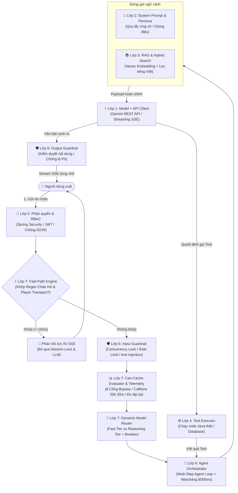

# 📘 CẨM NANG KIẾN TRÚC HỆ THỐNG AI 7 LỚP — TỪ Ý TƯỞNG ĐẾN PRODUCTION
> **Dành cho kỹ sư phần mềm & AI Engineer**  
> *Được biên soạn dựa trên phân tích chuyên sâu mã nguồn thực tế dự án Spring Boot 3 (Java 21), Google Gemini API & Android Client Kotlin.*

---

## 🗺️ TỔNG QUAN KIẾN TRÚC: HÀNH TRÌNH TỪ "CHATBOT" ĐẾN "AI AGENT"

Một ứng dụng AI thực tế không chỉ đơn giản là gọi API của OpenAI hay Google. Để hoạt động an toàn, chính xác và không bị "phá sản" vì tiền gọi API, hệ thống phải được bọc trong một **kiến trúc phòng thủ đa tầng (Defense-in-Depth)** gồm 7 lớp:



---

## 📑 MỤC LỤC CHI TIẾT
1. [Lớp 1: Model + API (Nền móng & Kết nối LLM)](#1-lớp-1-model--api)
2. [Lớp 2: System Prompt (Định hình Vai trò, Giọng điệu & Giới hạn)](#2-lớp-2-system-prompt)
3. [Lớp 3: RAG (Truy xuất Dữ liệu Nội bộ & Chống Ảo giác)](#3-lớp-3-rag---retrieval-augmented-generation)
4. [Lớp 4: Công cụ & Agent Loop (Biến Chatbot thành AI Agent)](#4-lớp-4-công-cụ--multi-step-agent-loop)
5. [Lớp 5: Phân quyền & RBAC (Bảo mật Tiền định)](#5-lớp-5-phân-quyền--kiểm-soát-truy-cập-rbac)
6. [Lớp 6: Rào chắn - Guardrails (An ninh Hai chiều & Hạn mức)](#6-lớp-6-rào-chắn-guardrails--content-moderation)
7. [Lớp 7: Cache & Model Router (Tối Ưu Độ Trễ, Chi Phí & Định Tuyến)](#7-lớp-7-cache--model-router)
8. [Bảng đối chiếu tổng kết 7 lớp](#8-bảng-đối-chiếu-tổng-kết-7-lớp)
9. [Bước tiếp theo để đạt 100% Production-Ready](#9-bước-tiếp-theo-để-đạt-100-production-ready)

---

## 1. LỚP 1: MODEL + API

### 1.1. Bản chất & Nguyên lý
* **Không sáng chế lại bánh xe:** Việc huấn luyện mô hình nền tảng (Foundation Model) tốn hàng chục triệu USD. Doanh nghiệp chỉ cần tiêu thụ qua REST API hoặc SDK.
* **Cơ chế:** Gửi HTTP POST chứa Prompt/Ngữ cảnh lên máy chủ của nhà cung cấp (Google, OpenAI), nhận về JSON kết quả hoặc luồng Stream.
* **Nguy cơ nếu chỉ có Lớp 1:**
  1. *Độ trễ cao:* Chờ 5 - 15 giây mới nhận được toàn bộ câu trả lời nếu không dùng Streaming.
  2. *Cháy tài nguyên:* Không giới hạn số kết nối đồng thời làm nghẽn máy chủ.
  3. *Không có cấu trúc:* AI trả về văn bản tự do, dễ gây lỗi parse JSON ở Backend.

### 1.2. Mã nguồn triển khai thực tế

#### A. Cấu hình Timeout chuyên biệt cho Streaming và Non-Streaming
Trong `GeminiConfig.java`:
```java
@Configuration
public class GeminiConfig {

    @Value("${gemini.base-url:https://generativelanguage.googleapis.com/v1beta}")
    private String baseUrl;

    // 1. Client cho các tác vụ ngắn (Embedding, Moderation) - Timeout ngắn 15s
    @Bean(name = "geminiRestClient")
    public RestClient geminiRestClient() {
        SimpleClientHttpRequestFactory factory = new SimpleClientHttpRequestFactory();
        factory.setConnectTimeout(5000);
        factory.setReadTimeout(15000);

        return RestClient.builder()
                .baseUrl(baseUrl)
                .requestFactory(factory)
                .defaultHeader("Content-Type", "application/json")
                .build();
    }

    // 2. Client cho Streaming SSE chat dài - Nới lỏng Timeout lên 90s
    @Bean(name = "geminiStreamRestClient")
    public RestClient geminiStreamRestClient() {
        SimpleClientHttpRequestFactory factory = new SimpleClientHttpRequestFactory();
        factory.setConnectTimeout(5000);
        factory.setReadTimeout(90000); // 90 giây

        return RestClient.builder()
                .baseUrl(baseUrl)
                .requestFactory(factory)
                .defaultHeader("Content-Type", "application/json")
                .build();
    }
}
```

#### B. Streaming SSE và Virtual Threads Java 21
Trong `AiAgentOrchestrator.java`, sử dụng Virtual Threads để xử lý luồng stream SSE với dung lượng đồng thời cao:
```java
@Bean(name = "aiStreamingExecutor")
public ExecutorService aiStreamingExecutor() {
    return Executors.newVirtualThreadPerTaskExecutor();
}
```

---

## 2. LỚP 2: SYSTEM PROMPT

### 2.1. Bản chất & Nguyên lý
* Định hình tính cách (Persona), ranh giới nghiệp vụ, phong cách xưng hô và các quy tắc cấm kỵ (Guardrail rules).
* Cấu trúc thẻ XML/Markdown giúp LLM tách biệt rõ ràng giữa hướng dẫn hệ thống, ngữ cảnh dữ liệu và tin nhắn người dùng.

### 2.2. Mã nguồn triển khai thực tế
Trong `AiPersonaPromptFactory.java`, hệ thống hỗ trợ 3 Persona âm nhạc chuyên biệt:
1. `GENZ_DJ`: Năng động, dùng từ lóng Gen Z (*"cháy"*, *"nghiện điên"*, *"bật nóc"*).
2. `MUSIC_CRITIC`: Phân tích chuyên sâu về nhạc lý, cấu trúc hòa âm, phối khí.
3. `HEALING_BUDDY`: Nhẹ nhàng, đồng cảm, gợi ý các bài hát êm dịu xoa dịu tâm hồn.

---

## 3. LỚP 3: RAG (RETRIEVAL-AUGMENTED GENERATION)

### 3.1. Bản chất & Nguyên lý
* LLM không biết dữ liệu nội bộ của ứng dụng. RAG giúp truy xuất thông tin bài hát thực tế từ Database thông qua Vector Embedding kết hợp Tìm kiếm Từ khóa (Hybrid Search).
* Ngăn chặn hoàn toàn hiện tượng Ảo giác (Hallucination) — LLM tự bịa ra bài hát hoặc ca sĩ không tồn tại.

### 3.2. Mã nguồn triển khai thực tế
* `SongEmbeddingService.java`: Gọi Gemini Embedding Model (`gemini-embedding-001`) để sinh vector 768 chiều cho bài hát và câu hỏi.
* `MusicRetrievalService.java`: Tính Cosine Similarity giữa vector câu hỏi và vector bài hát đã lưu trong bộ nhớ / Database, kết hợp lọc theo thể loại và ca sĩ.

---

## 4. LỚP 4: CÔNG CỤ & MULTI-STEP AGENT LOOP

### 4.1. Bản chất & Nguyên lý
* Biến Chatbot từ "chỉ biết nói" thành Agent "biết hành động".
* Cung cấp Function Calling cho LLM:
  1. `trigger_player_action`: Tạm dừng, tiếp tục, phát bài hát cụ thể.
  2. `propose_ai_playlist`: Đề xuất tạo danh sách phát tự động gồm các bài hát hợp lệ.
  3. `search_music_library`: Tìm kiếm tra cứu catalog bài hát.

### 4.2. Mã nguồn triển khai thực tế
* `GeminiToolDeclarationFactory.java`: Khai báo schema JSON cho các tool để Gemini hiểu tham số.
* `MusicToolExecutor.java`: Thực thi các lệnh Java thật, kèm cơ chế Anti-Hallucination Allowlist (loại bỏ bài hát không có trong thư viện).
* `AiAgentOrchestrator.java`: Quản lý vòng lặp đàm thoại tối đa 3 vòng lặp (`MAX_TOOL_ITERATIONS = 3`).

---

## 5. LỚP 5: PHÂN QUYỀN & KIỂM SOÁT TRUY CẬP (RBAC)

### 5.1. Bản chất & Nguyên lý
* Chặn đứng lỗ hổng IDOR (Insecure Direct Object References): Người dùng A không thể đọc trộm hay gửi tin nhắn vào phiên chat của người dùng B.
* Xác thực JWT token, lấy thông tin người dùng từ SecurityContext và kiểm tra quyền sở hữu `ChatSession`.

### 5.2. Mã nguồn triển khai thực tế
Trong `AiChatController.java`:
```java
ChatSession session = chatSessionRepository.findById(sessionId)
        .orElseThrow(() -> new AppException(ErrorCode.SESSION_NOT_EXISTED));

if (!session.getUser().getId().equals(currentUser.getId())) {
    log.warn("[AI Chat] Người dùng {} cố tình truy cập trái phép session {} (IDOR)", currentUser.getUsername(), sessionId);
    throw new AppException(ErrorCode.UNAUTHORIZED);
}
```

---

## 6. LỚP 6: RÀO CHẮN - GUARDRAILS & CONTENT MODERATION

### 6.1. Bản chất & Nguyên lý
* **Bảo vệ hai chiều:**
  * *Chiều vào (Input Guardrail):* Khóa đồng thời (Concurrency Lock) chống spam đa luồng trên cùng 1 session, Rate Limiting (10 req/phút), chống Prompt Injection.
  * *Chiều ra (Output Guardrail):* Kiểm duyệt ngôn từ độc hại (Hate Speech, Toxic, Cờ bạc), che giấu thông tin cá nhân PII.

### 6.2. Mã nguồn triển khai thực tế
* `AiChatGuardService.java`: Quản lý Semaphore 50 luồng toàn hệ thống và ConcurrentHashMap session lock.
* `AiModerationService.java`: Kiểm duyệt nội dung am hiểu tiếng lóng Gen Z (phân biệt giữa khen *"cháy khét lẹt"*, *"hay vcl"* là SAFE, và lăng mạ xúc phạm là AUTO_HIDE).

---

## 7. LỚP 7: CACHE & MODEL ROUTER

Lớp 7 là đỉnh cao của kiến trúc tối ưu hóa hiệu năng, giảm thiểu tối đa chi phí gọi API và độ trễ phản hồi:

### 7.1. Fast-Path Command Engine (< 10ms)
* **Vị trí trước Session Lock:** Chạy trước `checkAndLockSession` để người dùng có thể gửi lệnh *"tạm dừng"* ngay lập tức mà không bị chặn khi bot đang stream câu trả lời dài.
* **Regex 2 Tầng Siêu Tốc:** Quét có dấu (NFC) và không dấu (`stripDiacritics`), xử lý chào hỏi Turn 1 và lệnh Player Transport (`PAUSE`, `RESUME`, `NEXT` với phản hồi trung tính *"Đã gửi lệnh chuyển bài."*).
* **Độ chính xác Microsecond & Dual Tie-Breaker:**
  * Migration Flyway `V5` nâng cấp `created_at` / `updated_at` lên `DATETIME(6)`.
  * `@Transactional saveFastPathMessages` gom lưu `userMessage` và `aiMessage` (+5ms).
  * Sắp xếp đối ngẫu `ORDER BY m.createdAt ASC, m.sender DESC` (truy vấn xuôi) và `ORDER BY m.createdAt DESC, m.sender ASC` (Sliding Window) đảm bảo thứ tự USER $\rightarrow$ AI luôn bất biến.

### 7.2. Dynamic Model Router & Resilience4j Circuit Breaker
* **Định tuyến Mô hình Thông minh:**
  * Làn A (Fast Tier): Mặc định sử dụng `gemini-3.5-flash-lite` cho các câu hỏi thông thường.
  * Làn B (Reasoning Tier): Điều hướng sang `gemini-2.5-pro` khi persona là `MUSIC_CRITIC`, độ dài $> 40$ ký tự và chứa từ khóa nhạc lý không dấu (*"hoa am"*, *"phoi khi"*, *"cau truc giai dieu"*...).
* **Ngắt Mạch Resilience4j & First-Token Watchdog 8000ms:**
  * Cấu hình instance `geminiCriticRouter` (sliding window 120s, failure rate 50%, wait in open 30s).
  * Phân cấp ngoại lệ `UpstreamAiException` để Circuit Breaker ghi nhận chính xác mọi lỗi I/O của Gemini; loại trừ 400 (Safety block) và 403 khỏi `record-exceptions` chống ngắt mạch oan.
  * First-token Watchdog 8000ms thực thi qua `CompletableFuture.supplyAsync(..., aiStreamingExecutor)` trên Virtual Threads, triệt tiêu nguy cơ nghẽn thread pool.
* **Tinh chỉnh Fallback Guard (Read-only vs Side-effect):**
  * Cho phép fallback an toàn về Flash khi chỉ gọi các tool đọc (`search_music_library`).
  * Chặn đứng fallback khi đã gọi tool có tác dụng phụ (`trigger_player_action`, `propose_ai_playlist`) để ngăn lỗi Double Mutation.

### 7.3. CanCacheEvaluator & Hạ Tầng Telemetry Ngầm
* **8 Cổng Kiểm Định Cache:** Quét 2 tầng Có dấu (cờ `(?U)`) và Không dấu phân loại 8 lý do BYPASS: `EMPTY_PROMPT`, `HISTORY`, `HAS_SONG_CONTEXT`, `PERSONAL`, `PII`, `ANAPHORA`, `TEMPORAL`, `DANGLING_REF`. Khắc phục triệt để lỗi false-positive bắt nhầm "nhạc Anh" (nhạc nước Anh / tiếng Anh) thành dữ liệu cá nhân.
* **TelemetryService (Caffeine 50k, 30m & 24h):**
  * Chuẩn hóa Canonical Prompt $\rightarrow$ SHA-256 tích hợp Persona (`persona:canonical`), triệt để tuân thủ nguyên tắc Persona Isolation (Cổng 1 của Cache).
  * Phân biệt rõ rệt giữa lặp lại liên người dùng (`ai.cache.exact_repeat_hits` / `ai.cache.exact_repeat_24h_hits`) và cùng người dùng thử lại (`ai.cache.self_repeat_hits` / `ai.cache.self_repeat_24h_hits`).
  * Tách riêng người dùng ẩn danh bằng metric `ai.cache.anonymous_prompts` và không tính vào cross-user repeat cache để bảo vệ tính chính xác của tỷ lệ lặp lại tiềm năng.
  * Hoàn toàn fail-safe: Lỗi telemetry không bao giờ làm gián đoạn luồng đàm thoại.

### 7.4. Khung Quyết Định Kiến Trúc Dựa Trên Dữ Liệu 3 Nhánh
* Thu thập dữ liệu thực tế với cỡ mẫu đủ lớn $N \ge 5.000$ lượt hợp lệ (hoặc tối thiểu 3.000 lượt trên Staging/Production trong 14 ngày) để bảo đảm lực thống kê (Statistical Power) cho ngưỡng 1% và 3%:
  * **Nếu Tỷ lệ Lặp lại Độc lập $\ge 3\%$:** Triển khai Hệ thống Vector Cache 5 cổng + Event Invalidation.
  * **Nếu Tỷ lệ Lặp lại từ $1\% - 3\%$:** Kích hoạt chế độ **SHADOW MODE** trên 10% lưu lượng trong 7 ngày để đo lường độ trễ và mức tiết kiệm token thực tế trước khi cấp phát tài nguyên cho Vector DB.
  * **Nếu Tỷ lệ Lặp lại Độc lập $< 1\%$:** **Ký duyệt (Sign-off) Nghiệm thu 100% Production-Ready mà KHÔNG cần Semantic Cache**. Tiết kiệm bộ nhớ RAM, CPU và giảm chi phí vận hành (Pragmatic Engineering).

---

## 8. BẢNG ĐỐI CHIẾU TỔNG KẾT 7 LỚP

| Lớp | Tên gọi | Nhiệm vụ cốt lõi | Vấn đề giải quyết | File đại diện trong Backend |
| :---: | :--- | :--- | :--- | :--- |
| **1** | **Model + API** | Kết nối LLM qua HTTP, quản lý Timeout & SSE Streaming | Loại bỏ độ trễ chờ đợi, hỗ trợ JSON có cấu trúc | `GeminiConfig`, `GeminiClientService` |
| **2** | **System Prompt** | Định hình tính cách (Persona), ranh giới nghiệp vụ & đạo đức | Chống AI nói nhảm, lạc đề, ngăn chặn tư vấn ngoài luồng | `AiPersonaPromptFactory` |
| **3** | **RAG** | Tìm kiếm dữ liệu nội bộ bằng Vector & Từ khóa tiếng Việt | Chống Ảo giác (Hallucination), giới thiệu đúng dữ liệu thật | `SongEmbeddingService`, `MusicRetrievalService` |
| **4** | **Tools & Agent** | Cấp quyền gọi API điều khiển hệ thống, chạy vòng lặp Agent | Biến bot "chỉ biết nói" thành Agent "biết hành động" | `GeminiToolDeclarationFactory`, `AiAgentOrchestrator` |
| **5** | **Phân quyền RBAC** | Xác thực JWT, lọc Tool theo Role, khóa cứng định danh | Ngăn chặn rò rỉ dữ liệu nhạy cảm, chặn đứng IDOR | `SecurityConfig`, `AiChatController` |
| **6** | **Guardrails** | Soi chiếu dữ liệu 2 chiều, chống Prompt Injection, khóa Spam | Bảo vệ an toàn ứng dụng, kiểm duyệt nội dung, chặn nổ ví API | `AiChatGuardService`, `AiModerationService` |
| **7** | **Cache & Router** | Fast-Path < 10ms, Model Router, Resilience4j, Telemetry | Tối ưu độ trễ, tiết kiệm token, tự phục hồi lỗi upstream | `FastPathEngine`, `ModelRouterService`, `CanCacheEvaluator`, `TelemetryService` |

---

## 9. BƯỚC TIẾP THEO ĐỂ ĐẠT 100% PRODUCTION-READY

Sau khi hoàn thành xuất sắc 7 lớp trên (**104/104 Tests PASS — 75% Code-Complete + Telemetry-Validated**):
1. **Lớp 7 (Vận hành & Thu thập Telemetry Thực tế):**
   * Theo dõi chỉ số `ai.cache.exact_repeat_hits`, `ai.cache.exact_repeat_24h_hits` và `ai.latency.fastpath` trên Prometheus/Grafana với mẫu $N \ge 5.000$ lượt để ra quyết định ký duyệt hoặc triển khai Vector Cache.
2. **Lớp 8 (Observability & CI/CD Evals):**
   * *LLM Tracing:* Tích hợp OpenTelemetry / Micrometer Tracing để theo dõi từng span của Multi-step Agent.
   * *Automated Evals:* Duy trì bộ kiểm thử tự động `AiCompanionEvaluationSuiteTest` trong pipeline CI/CD mỗi khi cập nhật Prompt!
