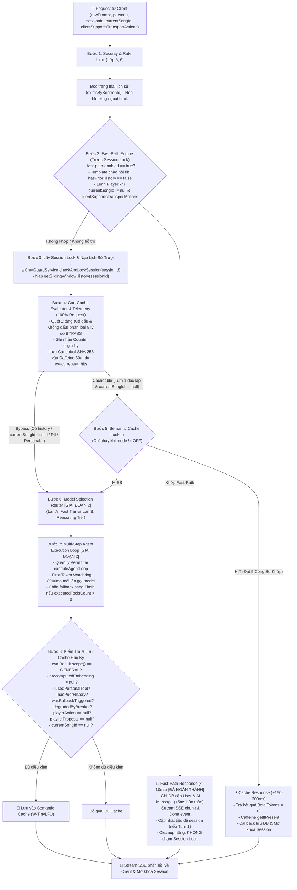

# 📐 BẢN ĐẶC TẢ THIẾT KẾ KỸ THUẬT: LỚP 7 (CACHE & MODEL ROUTER)
> **Dự án:** `identity-service-main` (Spring Boot 3 + Google Gemini) & Android Client App  
> **Chuyên đề:** Kiến trúc tối ưu hóa độ trễ, chi phí token và định tuyến mô hình  
> **Trạng thái:** 🚀 *Tài liệu đặc tả kỹ thuật hoàn thiện (Hiệu chuẩn lần 12 — Giai đoạn 1 nghiệm thu 50%, bảo vệ JPA Timestamp qua AbstractAuditEntity @PrePersist, Tie-breaker đối ngẫu Sliding Window, Canonicalize Telemetry SHA-256, bổ sung spring-boot-starter-aop & SimpleMeterRegistry)*

---

## 📑 MỤC LỤC
1. [Đánh Giá Hiện Trạng & Phân Rã Điểm Số Chuẩn Xác (50%)](#1-đánh-giá-hiện-trạng--phân-rã-điểm-số-chuẩn-xác-50)
2. [Sơ Đồ Luồng Xử Lý Chuẩn (Execution Pipeline)](#2-sơ-đồ-luồng-xử-lý-chuẩn-execution-pipeline)
3. [Module 1: Thiết Kế Fast-Path Engine & Tương Thích Client [ĐÃ HOÀN THÀNH 50%]](#3-module-1-thiết-kế-fast-path-engine--tương-thích-client-đã-hoàn-thành-50)
   - [3.1. Phân biệt lệnh Player, Ngữ cảnh Turn 1 và Phản hồi trung tính cho `NEXT`](#31-phân-biệt-lệnh-player-ngữ-cảnh-turn-1-và-phản-hồi-trung-tính-cho-next)
   - [3.2. Đàm phán Khả năng Client & Đồng bộ Android Client](#32-đàm-phán-khả-năng-client--đồng-bộ-android-client)
   - [3.3. Tách biệt Luồng Cleanup, Bẫy Direct Field Access trong JPA Auditing & Tính Đối Ngẫu Tie-Breaker](#33-tách-biệt-luồng-cleanup-bẫy-direct-field-access-trong-jpa-auditing--tính-đối-ngẫu-tie-breaker)
   - [3.4. Mã nguồn triển khai `FastPathResult` & `FastPathEngine`](#34-mã-nguồn-triển-khai-fastpathresult--fastpathengine)
4. [Module 2: Thiết Kế Model Router & Resilience4j Circuit Breaker [GIAI ĐOẠN 2 - LÊN 75%]](#4-module-2-thiết-kế-model-router--resilience4j-circuit-breaker-giai-đoạn-2---lên-75)
   - [4.1. Dependency (`aop`, `actuator`), Định danh mô hình cấu hình & Phân biệt Ngoại lệ theo Nguồn](#41-dependency-aop-actuator-định-danh-mô-hình-cấu-hình--phân-biệt-ngoại-lệ-theo-nguồn)
   - [4.2. Điều kiện phân làn, Tách cờ `degradedByBreaker` & Đối tượng `RoutingDecision`](#42-điều-kiện-phân-làn-tách-cờ-degradedbybreaker--đối-tượng-routingdecision)
   - [4.3. Sơ đồ Cây Vòng Đời Permit: First-Token Watchdog 8000ms & Chặn Fallback khi Tool đã chạy](#43-sơ-đồ-cây-vòng-đời-permit-first-token-watchdog-8000ms--chặn-fallback-khi-tool-đã-chạy)
5. [Module 3: Thiết Kế Bước Đệm Telemetry & Semantic Cache [GIAI ĐOẠN 3 - LÊN 100%]](#5-module-3-thiết-kế-bước-đệm-telemetry--semantic-cache-giai-đoạn-3---lên-100)
   - [5.1. Mã nguồn hoàn chỉnh `CanCacheEvaluator`: Quét 2 tầng Có dấu & Không dấu (8 Lý do Bypass)](#51-mã-nguồn-hoàn-chỉnh-cancacheevaluator-quét-2-tầng-có-dấu--không-dấu-8-lý-do-bypass)
   - [5.2. Telemetry First: Mã nguồn `TelemetryService` (Caffeine 30m) & Chuẩn hóa Canonical Prompt trước SHA-256](#52-telemetry-first-mã-nguồn-telemetryservice-caffeine-30m--chuẩn-hóa-canonical-prompt-trước-sha-256)
   - [5.3. Điều kiện Lưu Cache An Toàn (`isEligibleToSave`)](#53-điều-kiện-lưu-cache-an-toàn-iseligibletosave)
   - [5.4. Cơ chế Vô Hiệu Hóa Theo Sự Kiện (`SongCatalogChangedEvent`) & Hệ Thống 5 Cổng So Khớp](#54-cơ-chế-vô-hiệu-hóa-theo-sự-kiện-songcatalogchangedevent--hệ-thống-5-cổng-so-khớp)
6. [Module 4: Tích Hợp Controller & Orchestrator](#6-module-4-tích-hợp-controller--orchestrator)
   - [6.1. Triển khai `AiChatController` & Hàm `handleFastPathExecution`](#61-triển-khai-aichatcontroller--hàm-handlefastpathexecution)
   - [6.2. Tái cấu trúc `AgentTurnResult`](#62-tái-cấu-trúc-agentturnresult)
   - [6.3. Mã nguồn tích hợp luồng điều phối chính trong `AiAgentOrchestrator`](#63-mã-nguồn-tích-hợp-luồng-điều-phối-chính-trong-aiagentorchestrator)
7. [Module 5: Kế Hoạch Kiểm Thử, Đối Chuẩn Ngoại Tuyến & Metrics](#7-module-5-kế-hoạch-kiểm-thử-đối-chuẩn-ngoại-tuyến--metrics)
   - [7.1. Kế hoạch Unit Test chi tiết (56 test passed Giai đoạn 1 + Test Giai đoạn 2 & 3)](#71-kế-hoạch-unit-test-chi-tiết-56-test-passed-giai-đoạn-1--test-giai-đoạn-2--3)
   - [7.2. Chỉ số Giám sát Micrometer Metrics](#72-chỉ-số-giám-sát-micrometer-metrics)
8. [Phân Kỳ Triển Khai 3 Giai Đoạn](#8-phân-kỳ-triển-khai-3-giai-đoạn)

---

## 1. ĐÁNH GIÁ HIỆN TRẠNG & PHÂN RÃ ĐIỂM SỐ CHUẨN XÁC (50%)

Mức độ hoàn thiện của Lớp 7 đã tăng từ **25% lên 50%** sau khi nghiệm thu Giai đoạn 1:

| Thành phần kỹ thuật | Trọng số | Đạt được | Hiện trạng mã nguồn kiểm tra thực tế |
| :--- | :---: | :---: | :--- |
| **Traditional Data Cache** | 25% | **25%** | Caffeine cache cho top trending SQL, In-memory ConcurrentMap cho Vector bài hát |
| **Fast-Path Command Engine** | 25% | **25%** | **ĐÃ HOÀN THÀNH & NGHIỆM THU (56/56 tests PASS):** Regex 2 tầng, chạy trước Session Lock, emitter cách ly, đồng bộ Android Client |
| **Dynamic Model Router & Fallback** | 25% | **0%** | **Mục tiêu Giai đoạn 2 (Nâng lên 75%):** Phân làn Flash-Lite vs Pro cho Music Critic, ngắt mạch Resilience4j, watchdog 8000ms |
| **Semantic Cache & Telemetry** | 25% | **0%** | **Mục tiêu Giai đoạn 3 (Nâng lên 100%):** Bước đệm Telemetry ngầm 30m, CanCacheEvaluator 8 lý do bypass, 5 cổng so khớp |
| **TỔNG CỘNG** | **100%** | **50%** | **Đã hoàn thành xuất sắc Giai đoạn 1, sẵn sàng bước sang Giai đoạn 2** |

---

## 2. SƠ ĐỒ LUỒNG XỬ LÝ CHUẨN (EXECUTION PIPELINE)



---

## 3. MODULE 1: THIẾT KẾ FAST-PATH ENGINE & TƯƠNG THÍCH CLIENT [ĐÃ HOÀN THÀNH 50%]

### 3.1. Phân biệt lệnh Player, Ngữ cảnh Turn 1 và Phản hồi trung tính cho `NEXT`

1. **Vị trí trước Session Lock:**
   * Trong phương thức `AiChatController.streamChat`, lệnh `checkAndLockSession(session.getId())` được dùng để chống spam song song trên cùng một phiên. Nếu người dùng gửi lệnh *"tạm dừng"* trong lúc bot đang stream một câu trả lời dài, request sẽ bị quăng ngoại lệ `AI_SERVER_BUSY` (Session Locked) và không thể tạm dừng phát nhạc. Do đó, `FastPathEngine.evaluate` được thực thi **trước `checkAndLockSession`**.
2. **Đọc `hasPriorHistory` trước Session Lock & Đảm bảo Hiệu năng Index DB:**
   * `AiChatController` gọi truy vấn non-blocking `chatMessageRepository.existsBySessionId(session.getId())` để xác định Turn 1 mà không cần giữ Lock.
   * *Khảo sát Index thực tế:* Bảng `chat_message` trong [`ChatMessage.java`](file:///D:/SpringBoot/identity-service-main/identity-service-main/src/main/java/com/devteria/identityservice/entity/ChatMessage.java) đã có sẵn composite index:
     `@Index(name = "idx_chat_message_session_created", columnList = "session_id, createdAt ASC")`.
     Do `session_id` là **Leading Column** của B-Tree Index, câu query `SELECT 1 FROM chat_message WHERE session_id = ? LIMIT 1` thực hiện **Index Seek** trực tiếp tại RAM buffer cache với độ trễ $< 0.1\text{ms}$, hoàn toàn không quét bảng (Table Scan) và không gây nghẽn Connection Pool khi chạy ngoài Lock.
3. **Phân biệt lệnh Player và ngữ cảnh đàm thoại (`currentSongId != null`):**
   * Các khẩu lệnh *"tiếp tục"*, *"dừng"* chỉ kích hoạt lệnh player (`PAUSE`, `RESUME`, `NEXT`) khi `currentSongId != null`. Nếu không có bài đang phát, yêu cầu chuyển xuống LLM để xử lý theo mạch hội thoại.
4. **Chào hỏi danh tính:** Chỉ trả template nhanh khi `hasPriorHistory == false`.
5. **Phản hồi trung tính cho lệnh `NEXT`:**
   * Trong Android client, phương thức `playerManager.next(): Boolean` có thể trả về `false` nếu danh sách bài hát đã đến cuối hàng đợi (và không bật lặp).
   * Do Server không thể biết trước kết quả thực thi tại thời điểm trả SSE, việc phản hồi khẳng định *"Chuyển sang bài tiếp theo."* là không chuẩn xác.
   * **Chuẩn hóa phản hồi:** Đổi thành câu trung tính: **"Đã gửi lệnh chuyển bài."**.

---

### 3.2. Đàm phán Khả năng Client & Đồng bộ Android Client

1. **Đồng bộ mã nguồn Android Client (`AgenticPlayerDispatcher.kt`):**
   * Trong [`AgenticPlayerDispatcher.kt`](file:///c:/Users/ASUS/AndroidStudioProjects/App/app/src/main/java/com/example/app/view/ai/AgenticPlayerDispatcher.kt), các action `PAUSE`, `RESUME`, `NEXT` đã được chuyển lên xử lý trước dòng kiểm tra `songCard != null`. Client gọi tương ứng:
     * `PAUSE` $\rightarrow$ `playerManager.pause()`
     * `RESUME` $\rightarrow$ `playerManager.resume()`
     * `NEXT` $\rightarrow$ `playerManager.next()`
   * Ngay cả khi `actionDto.song == null`, app Android vẫn lập tức điều khiển trình phát nhạc mượt mà.
2. **Cờ năng lực client (`clientSupportsTransportActions`):**
   * Trong [`AiChatModels.kt`](file:///c:/Users/ASUS/AndroidStudioProjects/App/app/src/main/java/com/example/app/model/ai/AiChatModels.kt), `AiChatStreamRequest` đã được bổ sung `val clientSupportsTransportActions: Boolean = true` mặc định.
   * Phía Backend Java, `AiChatStreamRequest` có constructor 3 tham số nạp chồng để tương thích ngược 100% với các test cũ:
     ```java
     public AiChatStreamRequest(String sessionId, String message, String currentSongId) {
         this(sessionId, message, currentSongId, false);
     }
     ```

---

### 3.3. Tách biệt Luồng Cleanup, Bẫy Direct Field Access trong JPA Auditing & Tính Đối Ngẫu Tie-Breaker

1. **Tách biệt đường dọn dẹp Emitter (Lock Isolation):**
   * Fast-Path có phương thức xử lý riêng `handleFastPathExecution()` với Emitter riêng và **tuyệt đối không gọi `releaseSessionLock()` trong callback**, tránh nhả lock nhầm của luồng stream đang chạy song song.
2. **Bẫy Direct Field Access của Spring Data JPA (`@CreatedDate`):**
   * Trong [`AbstractAuditEntity.java`](file:///D:/SpringBoot/identity-service-main/identity-service-main/src/main/java/com/devteria/identityservice/entity/AbstractAuditEntity.java), biến `createdAt` được khai báo là Field-level: `private LocalDateTime createdAt;` kèm annotation `@CreatedDate`.
   * *Nguy cơ Reflection:* `PersistentPropertyAccessor` của Spring Data Commons sẽ dùng Reflection chọc thẳng vào trường private của lớp cha (`field.setAccessible(true); field.set(...)`). Nó **hoàn toàn bỏ qua hàm setter `setCreatedAt`** của lớp con `ChatMessage`!
   * *Giải pháp triệt để:* Bỏ `@CreatedDate` và `@LastModifiedDate` trên trường thời gian trong `AbstractAuditEntity.java`, thay bằng chuẩn JPA `@PrePersist` và `@PreUpdate` thuần:
     ```java
     @MappedSuperclass
     public abstract class AbstractAuditEntity {
         @Column(updatable = false)
         private LocalDateTime createdAt;

         private LocalDateTime updatedAt;

         @PrePersist
         protected void onPrePersist() {
             // Nếu createdAt đã được gán thủ công (như Fast-Path +5ms), bảo toàn 100% không ghi đè
             if (this.createdAt == null) {
                 this.createdAt = LocalDateTime.now();
             }
             if (this.updatedAt == null) {
                 this.updatedAt = LocalDateTime.now();
             }
         }

         @PreUpdate
         protected void onPreUpdate() {
             this.updatedAt = LocalDateTime.now();
         }
         ...
     ```
     Giải pháp này loại bỏ hoàn toàn sự can thiệp của `AuditingEntityListener` vào trường thời gian, không phụ thuộc reflection và bảo toàn khoảng lệch `+5ms` cho tin nhắn AI Fast-Path.
3. **Tính Đối Ngẫu Tie-Breaker cho `@Enumerated(EnumType.STRING)` (Khắc phục UUIDv4):**
   * *Vấn đề với UUIDv4:* Khóa chính `id` là UUIDv4 ngẫu nhiên (non-monotonic). So sánh chuỗi `id ASC` có xác suất 50% đảo ngược AI lên trước USER nếu trùng timestamp!
   * *Bản chất Enum:* Trường `sender` là `@Enumerated(EnumType.STRING)` (VARCHAR trong DB). Ký tự `'U'` (`USER` - ASCII 85) lớn hơn ký tự `'A'` (`AI` - ASCII 65).
   * *Tính Đối Ngẫu Toán Học bắt buộc giữa 2 loại Query:*
     * **Query ASC (Lấy từ cũ đến mới):**
       `ORDER BY m.createdAt ASC, m.sender DESC`  
       *(Khi trùng timestamp, `'USER'` đứng trước `'AI'` vì sắp xếp giảm dần `DESC`).*
     * **Query DESC (Lấy N tin nhắn mới nhất trong `ConversationMemoryManager.getSlidingWindowHistory`):**
       `ORDER BY m.createdAt DESC, m.sender ASC`  
       *(Lấy AI đứng trước USER, để sau khi `Collections.reverse(selectedMessages)` lật ngược lại thì USER đứng trước AI!).*
   * *Cập nhật trong [`ChatMessageRepository.java`](file:///D:/SpringBoot/identity-service-main/identity-service-main/src/main/java/com/devteria/identityservice/repository/ChatMessageRepository.java):*
     ```java
     List<ChatMessage> findBySessionOrderByCreatedAtAscSenderDesc(ChatSession session);

     @Query("SELECT m FROM ChatMessage m WHERE m.session.id = :sessionId AND m.status = :status ORDER BY m.createdAt DESC, m.sender ASC")
     List<ChatMessage> findRecentMessagesBySessionIdAndStatus(
             @Param("sessionId") String sessionId,
             @Param("status") MessageStatus status,
             Pageable pageable);
     ```

---

### 3.4. Mã nguồn triển khai `FastPathResult` & `FastPathEngine`

```java
public record FastPathResult(
    FastPathType type,              // TEXT_ONLY, PLAYER_ACTION
    String responseText,
    PlayerActionDto playerAction
) {
    public enum FastPathType {
        TEXT_ONLY,
        PLAYER_ACTION
    }

    public static FastPathResult textMessage(String text) {
        return new FastPathResult(FastPathType.TEXT_ONLY, text, null);
    }

    public static FastPathResult playerAction(String action, String text) {
        PlayerActionDto actionDto = PlayerActionDto.builder()
                .action(action)
                .autoExecute(true)
                .song(null)
                .build();
        return new FastPathResult(FastPathType.PLAYER_ACTION, text, actionDto);
    }
}
```

```java
public final class FastPathEngine {

    public static final class ActionType {
        public static final String PAUSE = "PAUSE";
        public static final String RESUME = "RESUME";
        public static final String NEXT = "NEXT";
        public static final String PLAY = "PLAY";
        public static final String QUEUE = "QUEUE";
    }

    // Regex có dấu (Tier 1) - Chỉ nhận khi currentSongId != null
    private static final Pattern STOP_ACCENTED = Pattern.compile(
        "^(?:tạm dừng|dừng|tắt|dừng lại|ngừng phát)(?: nhạc)?(?: (?:đi|nhé|giúp|ạ|với|mình|cho mình|giùm|hộ|nào|nha))*$",
        Pattern.CASE_INSENSITIVE);
    private static final Pattern RESUME_ACCENTED = Pattern.compile(
        "^(?:tiếp tục|phát tiếp)(?: nhạc)?(?: (?:đi|nhé|giúp|ạ|với|mình|cho mình|giùm|hộ|nào|nha))*$",
        Pattern.CASE_INSENSITIVE);
    private static final Pattern NEXT_ACCENTED = Pattern.compile(
        "^(?:bài tiếp|qua bài|chuyển bài|next bài|bài sau|bài kế tiếp)(?: (?:đi|nhé|ạ|với|mình|cho mình|giùm|hộ|nào|nha))*$",
        Pattern.CASE_INSENSITIVE);

    // Regex không dấu (Tier 2) - Phân nhóm dứt khoát, hỗ trợ đầy đủ 'tam dung nhac', 'tat', 'tat nhac'
    private static final Pattern STOP_UNACCENTED = Pattern.compile(
        "^(?:tam dung(?: nhac)?|tat(?: nhac)?|dung lai|ngung phat|stop|pause)(?: (?:di|nhe|giup|a|voi|minh|cho minh|dum|ho|nao|nha))*$",
        Pattern.CASE_INSENSITIVE);
    private static final Pattern RESUME_UNACCENTED = Pattern.compile(
        "^(?:tiep tuc(?: nhac)?|phat tiep(?: nhac)?|resume)(?: (?:di|nhe|giup|a|voi|minh|cho minh|dum|ho|nao|nha))*$",
        Pattern.CASE_INSENSITIVE);
    private static final Pattern NEXT_UNACCENTED = Pattern.compile(
        "^(?:bai tiep|next|qua bai|chuyen bai|next bai|bai sau|bai ke tiep)(?: (?:di|nhe|a|voi|minh|cho minh|dum|ho|nao|nha))*$",
        Pattern.CASE_INSENSITIVE);

    // Khớp chào hỏi và danh tính
    private static final Pattern GREETING_PATTERN = Pattern.compile(
        "^(?:chào|chao|hi|hello|xin chào|xin chao|helo|chào bạn|chao ban|chào bot|chao bot|hai bot|hai ban)(?: (?:nhé|nhe|ạ|a|nha))*$", 
        Pattern.CASE_INSENSITIVE);
    private static final Pattern IDENTITY_PATTERN = Pattern.compile(
        "^(?:bạn là ai|ban la ai|bạn tên gì|ban ten gi|tên bạn là gì|ten ban la gi|giới thiệu về bạn|gioi thieu ve ban)$", 
        Pattern.CASE_INSENSITIVE);

    private static final Pattern TRAILING_PUNCTUATION = Pattern.compile("[!?.,;:]+$");
    private static final Pattern VIETNAMESE_DIACRITICS = Pattern.compile(
        "[àáạảãâầấậẩẫăằắặẳẵèéẹẻẽêềếệểễìíịỉĩòóọỏõôồốộổỗơờớợởỡùúụủũưừứựửữỳýỵỷỹđ]", 
        Pattern.CASE_INSENSITIVE);

    private FastPathEngine() {}

    public static Optional<FastPathResult> evaluate(
            String rawPrompt, 
            AiPersona persona, 
            String currentSongId, 
            boolean hasPriorHistory,
            boolean clientSupportsTransportActions) {
            
        if (rawPrompt == null || rawPrompt.isBlank()) {
            return Optional.empty();
        }

        // 1. Chuẩn hóa NFC, gộp khoảng trắng và cắt dấu câu cuối
        String nfcPrompt = Normalizer.normalize(rawPrompt.trim(), Normalizer.Form.NFC);
        String singleSpaced = nfcPrompt.replaceAll("\\s+", " ");
        String lowerRaw = TRAILING_PUNCTUATION.matcher(singleSpaced.toLowerCase(Locale.ROOT)).replaceAll("").trim();

        // 2. Chặn triệt để các câu phủ định (ở đầu, giữa hoặc đứng độc lập) - Phòng thủ chiều sâu
        if (lowerRaw.startsWith("đừng ") || lowerRaw.startsWith("không ") || lowerRaw.startsWith("chớ ")
                || lowerRaw.contains(" đừng ") || lowerRaw.contains(" không ") || lowerRaw.contains(" chớ ")
                || lowerRaw.equals("đừng") || lowerRaw.equals("không") || lowerRaw.equals("chớ")) {
            return Optional.empty();
        }

        // 3. Giới hạn độ dài an toàn và chặn định danh bài hát/ca sĩ
        if (lowerRaw.length() > 60 || lowerRaw.contains(" ca khúc ") || lowerRaw.contains(" ca sĩ ") || lowerRaw.contains(" của ")) {
            return Optional.empty();
        }

        // 4. Khớp câu chào hỏi / danh tính (Chỉ áp dụng khi hasPriorHistory == false)
        if (!hasPriorHistory) {
            if (IDENTITY_PATTERN.matcher(lowerRaw).matches()) {
                return Optional.of(FastPathResult.textMessage(resolveIdentityResponse(persona)));
            }
            if (GREETING_PATTERN.matcher(lowerRaw).matches()) {
                return Optional.of(FastPathResult.textMessage(resolveGreetingResponse(persona)));
            }
        }

        // 5. Khớp lệnh Player Control:
        // ĐIỀU KIỆN 1: Phải có bài đang phát (currentSongId != null)
        // ĐIỀU KIỆN 2: Client phải hỗ trợ Transport Actions (clientSupportsTransportActions == true)
        if (currentSongId == null || currentSongId.isBlank() || !clientSupportsTransportActions) {
            return Optional.empty();
        }

        boolean hasDiacritics = VIETNAMESE_DIACRITICS.matcher(lowerRaw).find();

        if (hasDiacritics) {
            if (STOP_ACCENTED.matcher(lowerRaw).matches()) {
                return Optional.of(FastPathResult.playerAction(ActionType.PAUSE, "Đã tạm dừng phát nhạc."));
            }
            if (RESUME_ACCENTED.matcher(lowerRaw).matches()) {
                return Optional.of(FastPathResult.playerAction(ActionType.RESUME, "Tiếp tục phát nhạc."));
            }
            if (NEXT_ACCENTED.matcher(lowerRaw).matches()) {
                return Optional.of(FastPathResult.playerAction(ActionType.NEXT, "Đã gửi lệnh chuyển bài."));
            }
        } else {
            if (STOP_UNACCENTED.matcher(lowerRaw).matches()) {
                return Optional.of(FastPathResult.playerAction(ActionType.PAUSE, "Đã tạm dừng phát nhạc."));
            }
            if (RESUME_UNACCENTED.matcher(lowerRaw).matches()) {
                return Optional.of(FastPathResult.playerAction(ActionType.RESUME, "Tiếp tục phát nhạc."));
            }
            if (NEXT_UNACCENTED.matcher(lowerRaw).matches()) {
                return Optional.of(FastPathResult.playerAction(ActionType.NEXT, "Đã gửi lệnh chuyển bài."));
            }
        }

        return Optional.empty();
    }

    private static String resolveIdentityResponse(AiPersona persona) {
        return switch (persona != null ? persona : AiPersona.GENZ_DJ) {
            case GENZ_DJ -> "Mình là GenZ DJ - trợ lý âm nhạc AI siêu nhiệt huyết của bạn! Mình có thể bật nhạc, mix playlist và trò chuyện cực cuốn.";
            case MUSIC_CRITIC -> "Tôi là Chuyên gia Phê bình Âm nhạc (Music Critic). Tôi đồng hành cùng quý vị để phân tích cấu trúc, hòa âm và giá trị nghệ thuật tác phẩm.";
            case HEALING_FRIEND -> "Mình là Người bạn Chữa lành (Healing Friend). Mình ở đây để lắng nghe tâm sự và xoa dịu tâm hồn bạn bằng những giai điệu bình yên.";
        };
    }

    private static String resolveGreetingResponse(AiPersona persona) {
        return switch (persona != null ? persona : AiPersona.GENZ_DJ) {
            case GENZ_DJ -> "Yo! GenZ DJ đây, hôm nay bạn muốn lên dây cót tinh thần bằng giai điệu nào? Bật mí ngay nhé!";
            case MUSIC_CRITIC -> "Kính chào quý thính giả. Hôm nay chúng ta cùng khám phá và thưởng thức tác phẩm âm nhạc nào?";
            case HEALING_FRIEND -> "Chào bạn, mình luôn ở đây để lắng nghe bạn. Hôm nay tâm trạng của bạn cảm thấy thế nào?";
        };
    }
}
```

---

## 4. MODULE 2: THIẾT KẾ MODEL ROUTER & RESILIENCE4J CIRCUIT BREAKER [GIAI ĐOẠN 2 - LÊN 75%]

### 4.1. Dependency (`aop`, `actuator`), Định danh mô hình cấu hình & Phân biệt Ngoại lệ theo Nguồn

1. **Bổ sung Dependency vào `pom.xml`:**
   ```xml
   <dependency>
       <groupId>io.github.resilience4j</groupId>
       <artifactId>resilience4j-spring-boot3</artifactId>
       <version>2.2.0</version>
   </dependency>
   <dependency>
       <groupId>org.springframework.boot</groupId>
       <artifactId>spring-boot-starter-aop</artifactId>
   </dependency>
   <dependency>
       <groupId>org.springframework.boot</groupId>
       <artifactId>spring-boot-starter-actuator</artifactId>
   </dependency>
   ```
   *Lưu ý:* `spring-boot-starter-aop` là điều kiện bắt buộc để `resilience4j-spring-boot3` tự động cấu hình proxy aspect và `CircuitBreakerRegistry` từ file YAML.
2. **Bảo toàn Model Cấu hình:**
   * Fast Tier: `${GEMINI_FAST_MODEL:${gemini.model:gemini-3.5-flash-lite}}`.
   * Reasoning Tier: `${GEMINI_REASONING_MODEL:gemini-2.5-pro}`.
   * Embedding Model: `${GEMINI_EMBEDDING_MODEL:gemini-embedding-001}`.
3. **Phân biệt Ngoại lệ theo Nguồn (Origin-based Error Handling):**
   * **Lỗi Ghi Client (Downstream):** `ClientAbortException`, `AsyncRequestNotUsableException` (client tắt app/đứt cáp).
     * *Xử lý:* Hủy socket upstream tới Google, gọi `circuitBreaker.releasePermission()`, gán `resultRecorded = true`, **không tính lỗi vào Breaker**.
   * **Lỗi Đọc Upstream (Upstream Read Error):** HTTP 5xx, HTTP 429 Quota, timeout chunk đầu tiên (`FirstTokenTimeoutException`).
     * *Xử lý:* Ghi nhận lỗi vào Breaker qua `circuitBreaker.onError(...)`.
   * **Lỗi HTTP 400 Bad Request / Safety Policy Google:**
     * *Xử lý:* Gọi `circuitBreaker.releasePermission()`, không tính lỗi cho upstream.

```yaml
ai:
  router:
    fast-path-enabled: ${AI_FAST_PATH_ENABLED:true}
    reasoning-tier-enabled: ${AI_REASONING_TIER_ENABLED:true}
    fast-tier-model: ${GEMINI_FAST_MODEL:${gemini.model:gemini-3.5-flash-lite}}
    reasoning-tier-model: ${GEMINI_REASONING_MODEL:gemini-2.5-pro}
    first-token-timeout-ms: 8000

resilience4j:
  circuitbreaker:
    instances:
      geminiCriticRouter:
        sliding-window-type: TIME_BASED
        sliding-window-size: 120
        minimum-number-of-calls: 4
        failure-rate-threshold: 50.0
        wait-duration-in-open-state: 30s
        permitted-number-of-calls-in-half-open-state: 2
        record-exceptions:
          - org.springframework.web.client.HttpClientErrorException$TooManyRequests
          - org.springframework.web.client.HttpServerErrorException
          - org.springframework.web.client.ResourceAccessException
          - com.devteria.identityservice.exception.FirstTokenTimeoutException
        ignore-exceptions:
          - org.apache.catalina.connector.ClientAbortException
          - org.springframework.web.context.request.async.AsyncRequestNotUsableException
```

---

### 4.2. Điều kiện phân làn, Tách cờ `degradedByBreaker` & Đối tượng `RoutingDecision`

* **Điều kiện phân làn REASONING_TIER:**
  1. `reasoning-tier-enabled == true`.
  2. Persona là `AiPersona.MUSIC_CRITIC`.
  3. Prompt dài $> 40$ ký tự VÀ chứa ít nhất một từ khóa nhạc lý không dấu (ranh giới từ):
     `"hoa am"`, `"phoi khi"`, `"cau truc giai dieu"`, `"phan tich nghe thuat"`, `"thu phap sang tac"`, `"so sanh phong cach"`, `"vocal technique"`.
* **Tách bạch 2 cờ hạ cấp:**
  * `degradedByBreaker`: `true` khi Breaker OPEN hoặc nảy lỗi 429 $\rightarrow$ **CẤM lưu cache** (tránh lưu câu trả lời hạ cấp).
  * `reasoningTierDisabled`: `true` khi admin chủ động tắt cấu hình $\rightarrow$ **CHO PHÉP lưu cache**.

```java
public record RoutingDecision(
    ModelTier tier,
    String targetModel,
    boolean degradedByBreaker,      // true nếu bị ép sang Flash do Breaker OPEN (Chặn cache)
    boolean reasoningTierDisabled   // true nếu do cấu hình admin tắt (Không chặn cache)
) {}

public enum ModelTier {
    FAST_TIER,
    REASONING_TIER
}
```

---

### 4.3. Sơ đồ Cây Vòng Đời Permit: First-Token Watchdog 8000ms & Chặn Fallback khi Tool đã chạy

```
[Cuộc gọi Critic trong executeAgentLoop & reasoningTierDisabled == false]
       │
       ▼
circuitBreaker.tryAcquirePermission() ?
       │
       ├── FALSE (Breaker OPEN / HALF_OPEN đầy)
       │     └── Chuyển sang Flash ngay; gán degradedByBreaker = true (Chặn lưu cache)
       │
       └── TRUE (Đã giữ 1 Permit - Quản lý bởi cờ boolean resultRecorded = false)
             │
             ├── [Nhánh 1: Lỗi kết nối tức thì: 429 Quota hoặc 5xx Server Error]
             │     ├── Ghi nhận circuitBreaker.onError(duration, httpEx); resultRecorded = true;
             │     └── KIỂM TRA: executedToolsCount == 0 ?
             │           ├── CÓ: Fallback sang Flash an toàn (wasFallbackTriggered = true)
             │           └── KHÔNG (Tool đã chạy): CẤM FALLBACK -> Dừng an toàn với AI_SERVER_BUSY
             │
             ├── [Nhánh 2: Client ngắt kết nối / ClientAbortException / Emitter Write Error]
             │     ├── HỦY NGAY luồng HTTP upstream (streamResponse.close() / future.cancel(true))
             │     ├── Gọi circuitBreaker.releasePermission(); resultRecorded = true;
             │     └── Không tính lỗi cho upstream Google
             │
             ├── [Nhánh 3: Khởi chạy Streaming với First-Token Watchdog 8000ms]
             │     ├── Chunk hợp lệ đầu tiên đến (Text hoặc FunctionCall):
             │     │     ├── Hủy Watchdog Timer
             │     │     └── Tiếp tục stream...
             │     │           ├── Stream hoàn tất trọn vẹn: circuitBreaker.onSuccess(...); resultRecorded = true;
             │     │           └── Lỗi đọc upstream giữa stream: circuitBreaker.onError(...); resultRecorded = true;
             │     │                 └── CẤM FALLBACK -> Gửi STREAM_INTERRUPTED (Tránh lặp nội dung)
             │     │
             │     └── Quá 8000ms chưa có chunk đầu:
             │           ├── Watchdog đóng kết nối Socket upstream
             │           ├── Ghi nhận circuitBreaker.onError(duration, timeoutEx); resultRecorded = true;
             │           └── KIỂM TRA: executedToolsCount == 0 ?
             │                 ├── CÓ: Fallback sang Flash an toàn (wasFallbackTriggered = true)
             │                 └── KHÔNG (Tool đã chạy): CẤM FALLBACK -> Dừng an toàn với AI_SERVER_BUSY
             │
             ├── [Nhánh 4: HTTP 400 Bad Request / Vi phạm Safety Policy Google]
             │     ├── Gọi circuitBreaker.releasePermission(); resultRecorded = true;
             │     └── Gửi thông báo từ chối an toàn tới client (Không tính lỗi ngắt mạch)
             │
             └── finally:
                   // Chống Double-Release: Chỉ giải phóng nếu chưa có nhánh nào ghi nhận
                   if (!resultRecorded) {
                       circuitBreaker.releasePermission();
                   }
```

---

## 5. MODULE 3: THIẾT KẾ BƯỚC ĐỆM TELEMETRY & SEMANTIC CACHE [GIAI ĐOẠN 3 - LÊN 100%]

### 5.1. Mã nguồn hoàn chỉnh `CanCacheEvaluator`: Quét 2 tầng Có dấu & Không dấu (8 Lý do Bypass)

```java
package com.devteria.identityservice.service;

import org.springframework.stereotype.Component;

import java.text.Normalizer;
import java.util.Locale;
import java.util.regex.Pattern;

@Component
public class CanCacheEvaluator {

    public enum CacheScope {
        GENERAL,
        BYPASS
    }

    public enum BypassReason {
        NONE,               // Đủ điều kiện cache GENERAL
        EMPTY_PROMPT,       // Câu hỏi rỗng hoặc khoảng trắng
        HISTORY,            // Có lịch sử chat trước đó (hasPriorHistory == true)
        HAS_SONG_CONTEXT,   // Đang phát nhạc (currentSongId != null)
        PERSONAL,           // Quan hệ sở hữu ("gu của mình", "playlist của tôi", "gu minh", "lịch sử nghe")
        PII,                // SĐT, Email
        ANAPHORA,           // Câu hỏi phụ thuộc ngữ cảnh ("còn bài nào", "tiếp đi", "con bai nao")
        TEMPORAL,           // Yêu cầu thời gian thực ("hôm nay", "đang hot", "moi ra hom nay")
        DANGLING_REF        // Quy chiếu rỗng ("bài này", "bai nay" khi currentSongId == null)
    }

    public record CacheEvaluationResult(CacheScope scope, BypassReason bypassReason) {}

    // Pattern có dấu (Unicode (?U))
    private static final Pattern PERSONAL_ACCENTED = Pattern.compile(
        "(?U)\\b(?:của (?:tôi|mình|em|anh)|gu của|playlist của|danh sách của|nhạc của tôi|bài hát yêu thích của|gu mình|bài tôi yêu thích|tôi hay nghe|mình hay nghe|tôi đã nghe|mình đã nghe|lịch sử nghe)\\b",
        Pattern.CASE_INSENSITIVE);

    // Pattern không dấu đối xứng hoàn toàn
    private static final Pattern PERSONAL_UNACCENTED = Pattern.compile(
        "\\b(?:cua (?:toi|minh|em|anh)|gu cua|playlist cua|danh sach cua|nhac cua toi|bai hat yeu thich cua|gu minh|bai toi yeu thich|toi hay nghe|minh hay nghe|toi da nghe|minh da nghe|lich su nghe)\\b",
        Pattern.CASE_INSENSITIVE);

    private static final Pattern PII_PATTERN = Pattern.compile(
        "(?:\\b0[35789]\\d{8}\\b|[a-zA-Z0-9._%+-]+@[a-zA-Z0-9.-]+\\.[a-zA-Z]{2,})");

    private static final Pattern ANAPHORA_ACCENTED = Pattern.compile(
        "(?U)\\b(?:còn bài nào|tiếp đi|bài khác đi|thêm bài nữa|bài lúc nãy|ca sĩ đó|ông ấy|cô ấy)\\b",
        Pattern.CASE_INSENSITIVE);
    private static final Pattern ANAPHORA_UNACCENTED = Pattern.compile(
        "\\b(?:con bai nao|tiep di|bai khac di|them bai nua|bai luc nay|ca si do|ong ay|co ay)\\b",
        Pattern.CASE_INSENSITIVE);

    private static final Pattern TEMPORAL_ACCENTED = Pattern.compile(
        "(?U)\\b(?:hôm nay|bây giờ|hiện tại|vừa ra|mới ra hôm nay|đang hot|tháng này|năm nay)\\b",
        Pattern.CASE_INSENSITIVE);
    private static final Pattern TEMPORAL_UNACCENTED = Pattern.compile(
        "\\b(?:hom nay|bay gio|hien tai|vua ra|moi ra hom nay|dang hot|thang nay|nam nay)\\b",
        Pattern.CASE_INSENSITIVE);

    private static final Pattern DANGLING_REF_ACCENTED = Pattern.compile(
        "(?U)\\b(?:bài này|ca khúc này|bài hát này|track này)\\b",
        Pattern.CASE_INSENSITIVE);
    private static final Pattern DANGLING_REF_UNACCENTED = Pattern.compile(
        "\\b(?:bai nay|ca khuc nay|bai hat nay|track nay)\\b",
        Pattern.CASE_INSENSITIVE);

    public CacheEvaluationResult evaluate(String rawPrompt, String currentSongId, boolean hasPriorHistory) {
        // Ưu tiên 1: Lịch sử chat (Multi-turn không lưu Semantic Cache)
        if (hasPriorHistory) {
            return new CacheEvaluationResult(CacheScope.BYPASS, BypassReason.HISTORY);
        }

        // Ưu tiên 2: Đang phát nhạc (Chứa <song_context>)
        if (currentSongId != null && !currentSongId.isBlank()) {
            return new CacheEvaluationResult(CacheScope.BYPASS, BypassReason.HAS_SONG_CONTEXT);
        }

        // Ưu tiên 3: Câu hỏi rỗng / khoảng trắng
        if (rawPrompt == null || rawPrompt.isBlank()) {
            return new CacheEvaluationResult(CacheScope.BYPASS, BypassReason.EMPTY_PROMPT);
        }

        String nfcPrompt = Normalizer.normalize(rawPrompt.trim(), Normalizer.Form.NFC);
        String unaccentedPrompt = stripDiacritics(nfcPrompt);

        // Ưu tiên 4: Quy chiếu rỗng ("bài này" / "bai nay" khi currentSongId == null)
        if (DANGLING_REF_ACCENTED.matcher(nfcPrompt).find() || DANGLING_REF_UNACCENTED.matcher(unaccentedPrompt).find()) {
            return new CacheEvaluationResult(CacheScope.BYPASS, BypassReason.DANGLING_REF);
        }

        // Ưu tiên 5: Dữ liệu cá nhân & PII (Quét cả 2 tầng)
        if (PERSONAL_ACCENTED.matcher(nfcPrompt).find() || PERSONAL_UNACCENTED.matcher(unaccentedPrompt).find()) {
            return new CacheEvaluationResult(CacheScope.BYPASS, BypassReason.PERSONAL);
        }
        if (PII_PATTERN.matcher(nfcPrompt).find()) {
            return new CacheEvaluationResult(CacheScope.BYPASS, BypassReason.PII);
        }

        // Ưu tiên 6: Ngữ cảnh bắc cầu & Thời gian thực (Quét cả 2 tầng)
        if (ANAPHORA_ACCENTED.matcher(nfcPrompt).find() || ANAPHORA_UNACCENTED.matcher(unaccentedPrompt).find()) {
            return new CacheEvaluationResult(CacheScope.BYPASS, BypassReason.ANAPHORA);
        }
        if (TEMPORAL_ACCENTED.matcher(nfcPrompt).find() || TEMPORAL_UNACCENTED.matcher(unaccentedPrompt).find()) {
            return new CacheEvaluationResult(CacheScope.BYPASS, BypassReason.TEMPORAL);
        }

        // Đủ điều kiện GENERAL
        return new CacheEvaluationResult(CacheScope.GENERAL, BypassReason.NONE);
    }

    public static String stripDiacritics(String text) {
        String nfd = Normalizer.normalize(text, Normalizer.Form.NFD);
        String withoutMarks = nfd.replaceAll("\\p{M}", "");
        return withoutMarks.replace('đ', 'd').replace('Đ', 'D').toLowerCase(Locale.ROOT);
    }
}
```

---

### 5.2. Telemetry First: Mã nguồn `TelemetryService` (Caffeine 30m) & Chuẩn hóa Canonical Prompt trước SHA-256

```java
package com.devteria.identityservice.service;

import com.github.benmanes.caffeine.cache.Cache;
import com.github.benmanes.caffeine.cache.Caffeine;
import io.micrometer.core.instrument.MeterRegistry;
import org.springframework.beans.factory.annotation.Autowired;
import org.springframework.stereotype.Service;

import java.nio.charset.StandardCharsets;
import java.security.MessageDigest;
import java.security.NoSuchAlgorithmException;
import java.util.HexFormat;
import java.util.concurrent.TimeUnit;

@Service
public class TelemetryService {

    private final MeterRegistry meterRegistry;
    private final Cache<String, Boolean> repeat30mCache;

    public TelemetryService(@Autowired(required = false) MeterRegistry meterRegistry) {
        this.meterRegistry = meterRegistry;
        this.repeat30mCache = Caffeine.newBuilder()
                .expireAfterWrite(30, TimeUnit.MINUTES)
                .maximumSize(10_000)
                .build();
    }

    public void recordPromptTelemetry(String rawPrompt, boolean isGeneralScope) {
        if (!isGeneralScope || meterRegistry == null || rawPrompt == null || rawPrompt.isBlank()) {
            return;
        }

        meterRegistry.counter("ai.cache.semantic.eligibility").increment();

        // Chuẩn hóa Canonical Prompt: Bỏ dấu, cắt dấu câu cuối, gộp khoảng trắng thừa
        String canonical = CanCacheEvaluator.stripDiacritics(rawPrompt.trim())
                .replaceAll("[!?.,;:]+$", "")
                .replaceAll("\\s+", " ")
                .trim();

        String sha256 = computeSha256(canonical);
        if (repeat30mCache.getIfPresent(sha256) != null) {
            meterRegistry.counter("ai.cache.exact_repeat_hits").increment();
        } else {
            repeat30mCache.put(sha256, Boolean.TRUE);
        }
    }

    private String computeSha256(String text) {
        try {
            MessageDigest digest = MessageDigest.getInstance("SHA-256");
            byte[] hash = digest.digest(text.getBytes(StandardCharsets.UTF_8));
            return HexFormat.of().formatHex(hash);
        } catch (NoSuchAlgorithmException e) {
            return Integer.toHexString(text.hashCode());
        }
    }
}
```

---

### 5.3. Điều kiện Lưu Cache An Toàn (`isEligibleToSave`)

```java
boolean isEligibleToSave = evalResult.scope() == CacheScope.GENERAL   // BẮT BUỘC: Đạt GENERAL
                        && precomputedEmbedding != null               // BẮT BUỘC: Có vector sẵn
                        && !turnResult.wasFallbackTriggered()         // Không bị fallback
                        && !turnResult.degradedByBreaker()           // Không bị hạ cấp do Breaker
                        && !turnResult.usedPersonalTool()            // Không dùng tool cá nhân
                        && !hasPriorHistory                          // Lượt đầu độc lập
                        && turnResult.playerAction() == null         // Không có lệnh player
                        && turnResult.playlistProposal() == null     // Không có đề xuất playlist
                        && currentSongId == null;                    // Không có bài đang phát
```

---

### 5.4. Cơ chế Vô Hiệu Hóa Theo Sự Kiện (`SongCatalogChangedEvent`) & Hệ Thống 5 Cổng So Khớp

1. **Event-Driven Invalidation:** Khi xóa hoặc sửa bài hát trong `SongService`, phát `SongCatalogChangedEvent(songId, changeType)` để `SemanticCacheInvalidator` dọn dẹp các entry cache chứa bài hát bị sửa/xóa.
2. **Hệ thống 5 Cổng So Khớp:**
   * *Cổng 1 (Cosine Gate):* $\text{Cosine} \ge 0.94$.
   * *Cổng 2 (Sentiment Gate):* Đối xứng 2 chiều (Lofi/Chill thuộc Calm_Healing).
   * *Cổng 3 (Quantity & Year Gate):* Khớp số lượng bài (phân biệt rõ số bài vs năm phát hành).
   * *Cổng 4 (Entity Gate):* Aho-Corasick dual-indexing (chuỗi có dấu và không dấu).
   * *Cổng 5 (Attribute Gate):* Từ điển đồng nghĩa ngữ cảnh (*"nhạc tiếng anh"* $\equiv$ *"nhạc us-uk"*).

---

## 6. MODULE 4: TÍCH HỢP CONTROLLER & ORCHESTRATOR

### 6.1. Triển khai `AiChatController` & Hàm `handleFastPathExecution`

```java
@PostMapping(value = "/stream", produces = MediaType.TEXT_EVENT_STREAM_VALUE)
public SseEmitter streamChat(@RequestBody @Valid AiChatStreamRequest request) {
    User currentUser = getAuthenticatedUser();

    ChatSession session = chatSessionRepository.findById(request.sessionId())
            .orElseThrow(() -> new AppException(ErrorCode.SESSION_NOT_EXISTED));

    if (!session.getUser().getId().equals(currentUser.getId())) {
        throw new AppException(ErrorCode.UNAUTHORIZED);
    }

    aiChatGuardService.validateAndRecordUserRequest(currentUser.getId());

    Song currentSong = (request.currentSongId() != null && !request.currentSongId().isBlank())
            ? songRepository.findById(request.currentSongId()).orElse(null)
            : null;

    boolean hasPriorHistory = chatMessageRepository.existsBySessionId(session.getId());
    boolean clientSupportsTransportActions = Boolean.TRUE.equals(request.clientSupportsTransportActions());

    if (fastPathEnabled) {
        Optional<FastPathResult> fastOpt = FastPathEngine.evaluate(
                request.message(), session.getPersona(), request.currentSongId(),
                hasPriorHistory, clientSupportsTransportActions
        );

        if (fastOpt.isPresent()) {
            FastPathResult fastResult = fastOpt.get();
            if (meterRegistry != null) {
                meterRegistry.counter("ai.fastpath.hits", "type", fastResult.type().name().toLowerCase(Locale.ROOT)).increment();
            }
            return handleFastPathExecution(session, currentUser, currentSong, fastResult, request, hasPriorHistory);
        }
    }

    aiChatGuardService.checkAndLockSession(session.getId());
    ...
```

```java
private SseEmitter handleFastPathExecution(
        ChatSession session,
        User currentUser,
        Song currentSong,
        FastPathResult fastResult,
        AiChatStreamRequest request,
        boolean hasPriorHistory) {

    Timer.Sample sample = (meterRegistry != null) ? Timer.start(meterRegistry) : null;

    if (!hasPriorHistory) {
        aiChatSessionService.updateSessionTitleIfDefault(session.getId(), request.message());
    }

    LocalDateTime userTimestamp = LocalDateTime.now();
    ChatMessage userMessage = ChatMessage.builder()
            .session(session)
            .sender(MessageSender.USER)
            .status(MessageStatus.COMPLETE)
            .content(request.message().trim())
            .currentSong(currentSong)
            .tokenCount(0)
            .build();
    userMessage.setCreatedAt(userTimestamp);
    chatMessageRepository.save(userMessage);

    ChatMessage aiMessage = ChatMessage.builder()
            .session(session)
            .sender(MessageSender.AI)
            .status(MessageStatus.COMPLETE)
            .content(fastResult.responseText())
            .currentSong(currentSong)
            .tokenCount(0)
            .build();
    aiMessage.setCreatedAt(userTimestamp.plus(5, ChronoUnit.MILLIS));
    chatMessageRepository.save(aiMessage);

    SseEmitter fastEmitter = new SseEmitter(10_000L);
    try {
        Map<String, Object> chunkPacket = Map.of(
                "delta", fastResult.responseText(),
                "done", false
        );
        fastEmitter.send(SseEmitter.event().data(objectMapper.writeValueAsString(chunkPacket)));

        Map<String, Object> completePacket = new LinkedHashMap<>();
        completePacket.put("delta", "");
        completePacket.put("done", true);
        completePacket.put("status", "COMPLETE");
        completePacket.put("totalTokens", 0);
        completePacket.put("suggestedSongs", Collections.emptyList());
        completePacket.put("playerAction", fastResult.playerAction());
        completePacket.put("playlistProposal", null);

        fastEmitter.send(SseEmitter.event().data(objectMapper.writeValueAsString(completePacket)));
        fastEmitter.complete();
    } catch (IOException e) {
        fastEmitter.completeWithError(e);
    } finally {
        if (sample != null) {
            sample.stop(meterRegistry.timer("ai.latency.fastpath"));
        }
    }
    return fastEmitter;
}
```

---

### 6.2. Tái cấu trúc `AgentTurnResult`

```java
public record AgentTurnResult(
    String fullText,
    int totalTokens,
    MessageStatus status,
    List<SongCardDto> suggestedSongs,
    PlayerActionDto playerAction,
    PlaylistProposalDto playlistProposal,
    String errorMessage,
    boolean usedPersonalTool,
    boolean wasFallbackTriggered,
    boolean degradedByBreaker,
    String actualModelUsed
) {
    public static AgentTurnResult forCacheHit(String text, List<SongCardDto> songs) {
        return new AgentTurnResult(
            text, 0, MessageStatus.COMPLETE, songs != null ? songs : Collections.emptyList(),
            null, null, null, false, false, false, "semantic-cache"
        );
    }

    public static AgentTurnResult failed(String errorCode) {
        return new AgentTurnResult("", 0, MessageStatus.FAILED, Collections.emptyList(), null, null, errorCode, false, false, false, "none");
    }

    public static AgentTurnResult interrupted(String fullText, int totalTokens, String errorMessage) {
        MessageStatus status = (fullText != null && !fullText.isBlank()) ? MessageStatus.INTERRUPTED : MessageStatus.FAILED;
        return new AgentTurnResult(fullText != null ? fullText : "", totalTokens, status, Collections.emptyList(), null, null, errorMessage, false, false, false, "unknown");
    }

    public static AgentTurnResult success(
            String fullText, int totalTokens, List<SongCardDto> songs,
            PlayerActionDto playerAction, PlaylistProposalDto proposal,
            String modelUsed, boolean usedPersonalTool, boolean wasFallbackTriggered, boolean degradedByBreaker) {
        return new AgentTurnResult(
            fullText, totalTokens, MessageStatus.COMPLETE, songs, playerAction, proposal, null,
            usedPersonalTool, wasFallbackTriggered, degradedByBreaker, modelUsed
        );
    }
}
```

---

### 6.3. Mã nguồn tích hợp luồng điều phối chính trong `AiAgentOrchestrator`

```java
public void orchestrateTurn(
        String currentUsername,
        String userRawPrompt,
        List<Map<String, Object>> initialContents,
        String systemInstruction,
        AiPersona currentPersona,
        String currentSongId,
        boolean hasPriorHistory,
        SseEmitter emitter,
        Consumer<AgentTurnResult> onCompleteCallback) {

    aiStreamingExecutor.submit(() -> {
        // -------------------------------------------------------------
        // BƯỚC 4: Can-Cache Evaluation & Telemetry (100% Request)
        // -------------------------------------------------------------
        CacheEvaluationResult evalResult = canCacheEvaluator.evaluate(userRawPrompt, currentSongId, hasPriorHistory);
        boolean isGeneral = evalResult.scope() == CacheScope.GENERAL;
        telemetryService.recordPromptTelemetry(userRawPrompt, isGeneral);

        if (!isGeneral && meterRegistry != null) {
            meterRegistry.counter("ai.cache.semantic.bypasses", "reason", evalResult.bypassReason().name().toLowerCase(Locale.ROOT)).increment();
        }

        // -------------------------------------------------------------
        // BƯỚC 5: Semantic Cache Lookup (Chỉ chạy khi mode != OFF và scope == GENERAL)
        // -------------------------------------------------------------
        float[] precomputedEmbedding = null;
        if (cacheProperties.getMode() != CacheMode.OFF && isGeneral) {
            // Khi Giai đoạn 3 kích hoạt, thực hiện lookup tại đây
        }

        // -------------------------------------------------------------
        // BƯỚC 6: Model Routing Decision
        // -------------------------------------------------------------
        RoutingDecision routingDecision = modelRouterService.resolveDecision(userRawPrompt, currentPersona);

        // -------------------------------------------------------------
        // BƯỚC 7: Multi-Step Agent Execution Loop
        // -------------------------------------------------------------
        executeAgentLoop(routingDecision, precomputedEmbedding, emitter, turnResult -> {
            // BƯỚC 8: Lưu Cache hậu kỳ an toàn
            if (cacheProperties.getMode() != CacheMode.OFF && turnResult.status() == MessageStatus.COMPLETE) {
                boolean isEligibleToSave = evalResult.scope() == CacheScope.GENERAL
                                        && precomputedEmbedding != null
                                        && !turnResult.wasFallbackTriggered()
                                        && !turnResult.degradedByBreaker()
                                        && !turnResult.usedPersonalTool()
                                        && !hasPriorHistory
                                        && turnResult.playerAction() == null
                                        && turnResult.playlistProposal() == null
                                        && currentSongId == null;

                if (isEligibleToSave) {
                    semanticCacheService.saveIfCacheable(userRawPrompt, currentPersona, precomputedEmbedding, turnResult);
                }
            }
            
            // Bàn giao kết quả duy nhất cho Controller lưu DB & Mở khóa Session
            if (onCompleteCallback != null) onCompleteCallback.accept(turnResult);
        });
    });
}
```

---

## 7. MODULE 5: KẾ HOẠCH KIỂM THỬ, ĐỐI CHUẨN NGOẠI TUYẾN & METRICS

### 7.1. Kế hoạch Unit Test chi tiết (56 test passed Giai đoạn 1 + Test Giai đoạn 2 & 3)

1. **`FastPathEngineTest` [✅ 47/47 PASS]:**
   * Lệnh PAUSE/RESUME/NEXT có dấu và không dấu.
   * Lệnh có từ đệm dài (> 30 ký tự): `"tạm dừng nhạc giúp mình với nha"`.
   * Phản hồi trung tính NEXT: *"Đã gửi lệnh chuyển bài."*.
   * Chặn câu phủ định ở đầu và giữa câu: `"đừng phát nữa"`, `"thôi đừng tắt"`, `"đang nghe đừng dừng"`.
   * Chống va chạm dấu tên riêng: `"Dũng"`, `"Dụng"`.
   * Chào hỏi Turn 1 vs Turn 2+; Lệnh player khi `currentSongId == null` hoặc client cũ.
2. **`AiChatControllerTest` [✅ 9/9 PASS]:**
   * Stream LLM chuẩn qua Orchestrator.
   * Fast-Path Greeting Turn 1 (phản hồi tức thì, cập nhật title, không lock session).
   * Fast-Path Greeting Turn 2+ (fallthrough xuống LLM).
   * Fast-Path Player Action (bài đang phát + client hỗ trợ $\rightarrow$ PAUSE tức thì).
   * Fast-Path Player Action Legacy Client (fallback xuống LLM).
   * Chặn IDOR, Session Busy (409), Rate Limit (429), Session Not Existed.
   * *Lưu ý testing:* Khởi tạo `@Spy private MeterRegistry meterRegistry = new SimpleMeterRegistry();` trong test để bảo đảm 9 unit test luôn độc lập và không dính `NullPointerException`.
3. **`CircuitBreakerLifecycleTest` [Kế hoạch Giai đoạn 2 - 6 kịch bản]:**
   * Giải phóng permit khi client hủy request (`ClientAbortException`).
   * Ghi nhận `onError` khi gặp lỗi 429/5xx, fallback sang Flash khi `executedToolsCount == 0`.
   * Chặn fallback khi `executedToolsCount > 0`, trả lỗi `AI_SERVER_BUSY`.
   * Khối `finally` chống double-release.
   * Không tính lỗi cho Breaker khi socket client đóng.
   * Lỗi I/O upstream được ghi nhận vào Breaker.
4. **`CanCacheEvaluatorTest` [Kế hoạch Giai đoạn 3 - 10 kịch bản]:**
   * Bao phủ câu rỗng (`EMPTY_PROMPT`), lịch sử (`HISTORY`), đang phát nhạc (`HAS_SONG_CONTEXT`), dữ liệu cá nhân (`PERSONAL`), PII, anaphora (`ANAPHORA`), thời gian thực (`TEMPORAL`), quy chiếu rỗng (`DANGLING_REF`) và câu `GENERAL` hợp lệ.

---

### 7.2. Chỉ số Giám sát Micrometer Metrics

```java
// 1. Fast-Path & Circuit Breaker Metrics
meterRegistry.counter("ai.fastpath.hits", "type", type);
Timer.builder("ai.latency.fastpath").register(meterRegistry); // SLO < 10ms
meterRegistry.counter("ai.router.routing", "tier", tier.name(), "model", targetModel);
meterRegistry.counter("ai.router.fallbacks", "from", fromModel, "to", toModel);
Timer.builder("ai.latency.ttft").tag("model", targetModel).register(meterRegistry);
Gauge.builder("ai.router.circuitbreaker.state", circuitBreaker, cb -> cb.getState().getOrder()).register(meterRegistry);

// 2. Semantic Cache & Telemetry 30m Metrics
meterRegistry.counter("ai.cache.semantic.hits", "persona", persona);
meterRegistry.counter("ai.cache.semantic.misses", "persona", persona);
meterRegistry.counter("ai.cache.semantic.bypasses", "reason", reason);
meterRegistry.counter("ai.cache.semantic.eligibility"); // Trần khả dụng Turn 1
meterRegistry.counter("ai.cache.exact_repeat_hits");    // Cận dưới lặp chính xác cửa sổ 30m
```

---

## 8. PHÂN KỲ TRIỂN KHAI 3 GIAI ĐOẠN

```
GIAI ĐOẠN 1: Fast-Path Engine & Unit Tests [✅ ĐÃ HOÀN THÀNH - NÂNG LÊN 50%]
  ├── [x] Tích hợp FastPathEngine trong AiChatController TRƯỚC dòng checkAndLockSession
  ├── [x] Định nghĩa FastPathResult, ActionType và phản hồi trung tính cho NEXT ("Đã gửi lệnh chuyển bài.")
  ├── [x] Kiểm tra tồn tại lịch sử nhẹ nhàng (existsBySessionId) ngoài Lock để phân định Turn 1
  ├── [x] Hỗ trợ cờ clientSupportsTransportActions kèm constructor nạp chồng bảo toàn chữ ký record AiChatStreamRequest
  ├── [x] Thiết lập luồng dọn dẹp riêng cho Fast-Path Emitter (KHÔNG giải phóng Session Lock của stream khác)
  ├── [x] Cập nhật tiêu đề session khi là câu đầu tiên (updateSessionTitleIfDefault)
  ├── [x] Cập nhật Android Client: AiChatModels.kt và AgenticPlayerDispatcher.kt (hỗ trợ PAUSE/RESUME/NEXT khi song == null)
  ├── [x] Viết FastPathEngineTest bao phủ 47 ca biên ("tam dung nhac", "tat", "tat nhac", "Dũng", phủ định giữa câu...)
  ├── [x] Viết AiChatControllerTest bao phủ 9 ca kiểm thử tích hợp (Fast-Path Turn 1, Turn 2+, Player, Legacy client, IDOR, Lock)
  └── [x] Nghiệm thu toàn bộ 56/56 unit test với Maven và JDK 21 (BUILD SUCCESS)

HẬU GIAI ĐOẠN 1: Tinh chỉnh Database & Kích hoạt Metrics [✅ ĐÃ HOÀN THÀNH]
  ├── [x] Cập nhật AbstractAuditEntity: Dùng @PrePersist/@PreUpdate thuần bảo toàn createdAt khi đã có giá trị (+5ms)
  ├── [x] Cập nhật ChatMessageRepository: Sắp xếp đối ngẫu (ASC sender DESC cho query xuôi; DESC sender ASC cho Sliding Window)
  └── [x] Khai báo spring-boot-starter-actuator & spring-boot-starter-aop trong pom.xml, gắn Timer.Sample cho Fast-Path

GIAI ĐOẠN 2: Model Router & Circuit Breaker [✅ ĐÃ HOÀN THÀNH - NÂNG LÊN 75%]
  ├── [x] Khai báo io.github.resilience4j:resilience4j-spring-boot3:2.2.0 trong pom.xml
  ├── [x] Khai báo AiRouterProperties (ai.router.*) và cấu hình instance geminiCriticRouter trong application.yaml
  ├── [x] Xây dựng ModelRouterService sinh RoutingDecision độc lập (phân làn Music Critic với regex nhạc lý không dấu)
  ├── [x] Tách bạch 2 cờ hạ cấp: degradedByBreaker (chặn lưu cache) và reasoningTierDisabled (cho phép lưu cache)
  ├── [x] Quản lý Permit tại executeAgentLoop với cờ resultRecorded chống double release
  ├── [x] Áp dụng First-Token Watchdog 8000ms cho từng cuộc gọi model; chặn fallback sang Flash khi executedToolsCount > 0
  ├── [x] Phân loại ngoại lệ theo nguồn: ClientAbortException (hủy upstream + nhả permit) vs Upstream error (ghi nhận vào Breaker)
  └── [x] Cập nhật AgentTurnResult và viết CircuitBreakerLifecycleTest (6/6 kịch bản mở/đóng mạch và nhả permit passed)

GIAI ĐOẠN 3: Bước Đệm Telemetry & Đánh Giá Semantic Cache [NÂNG LÊN 100%]
  ├── [ ] Xây dựng CanCacheEvaluator quét 2 tầng có dấu và không dấu phân loại 8 lý do BYPASS & CanCacheEvaluatorTest
  ├── [ ] Xây dựng TelemetryService (Caffeine 30m) chuẩn hóa Canonical Prompt trước khi băm SHA-256
  ├── [ ] Chạy ngầm thu thập số liệu ở chế độ ai.cache.semantic.mode: OFF
  ├── [ ] Đánh giá tỷ lệ lặp nguyên văn 30 phút trên tập mẫu N >= 1.000 lượt:
  │     ├── Nếu >= 3%: Xây dựng Token-based Aho-Corasick Trie, Event-Driven Invalidation và Hệ Thống 5 Cổng So Khớp
  │     ├── Nếu 1% - 3%: Chạy thử nghiệm SHADOW mode trên 10% mẫu trong 1 tuần
  │     └── Nếu < 1%: Dừng triển khai Semantic Cache để bảo toàn RAM và CPU
  └── [ ] Chạy bộ kiểm thử hồi quy 150 cặp câu ngoại tuyến để hiệu chuẩn ngưỡng θ
```

---

> [!TIP]
> **Tóm tắt trạng thái:** Lớp 7 đã đạt mốc **50%**. Bản thiết kế chi tiết đã tích hợp đầy đủ giải pháp triệt tiêu Direct Field Access qua `AbstractAuditEntity @PrePersist`, tính đối ngẫu tie-breaker của Sliding Window, và Canonical SHA-256 trong `TelemetryService`.
