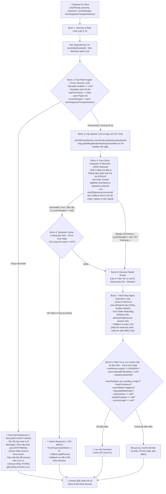
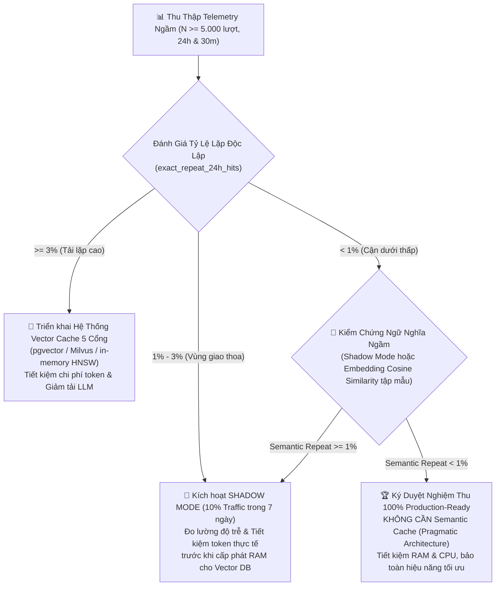

# 📐 BẢN ĐẶC TẢ THIẾT KẾ KỸ THUẬT: LỚP 7 (CACHE & MODEL ROUTER)
> **Dự án:** `identity-service-main` (Spring Boot 3 + Google Gemini) & Android Client App  
> **Chuyên đề:** Kiến trúc tối ưu hóa độ trễ, chi phí token và định tuyến mô hình  
> **Trạng thái:** 🚀 *Tài liệu đặc tả kỹ thuật hoàn thiện (Hiệu chuẩn lần 22 — Đóng băng RFC tài liệu, hoàn tất 100% Ưu tiên 1 Local/CI: Bước 8 canSaveToSemanticCache loại trừ trending songs, Testcontainers MySQL kiểm chứng Collation, 125/125 Unit Tests Passed 100% + 3 Testcontainers Tests, chuyển giao sang Ưu tiên 2 Staging TTFT & Alerting)*

---

## 📑 MỤC LỤC
1. [Đánh Giá Hiện Trạng & Tiến Độ Thực Hiện (75% Code-Complete, Telemetry Instrumented)](#1-đánh-giá-hiện-trạng--tiến-độ-thực-hiện-75-code-complete-telemetry-instrumented)
2. [Sơ Đồ Luồng Xử Lý Chuẩn (Execution Pipeline)](#2-sơ-đồ-luồng-xử-lý-chuẩn-execution-pipeline)
3. [Module 1: Thiết Kế Fast-Path Engine & Đồng Bộ Hậu Giai Đoạn 1 [ĐÃ HOÀN THÀNH 100%]](#3-module-1-thiết-kế-fast-path-engine--đồng-bộ-hậu-giai-đoạn-1-đã-hoàn-thành-100)
   - [3.1. Phân biệt lệnh Player, Ngữ cảnh Turn 1, Chuẩn hóa Persona & Phản hồi trung tính cho `NEXT`](#31-phân-biệt-lệnh-player-ngữ-cảnh-turn-1-chuẩn-hóa-persona--phản-hồi-trung-tính-cho-next)
   - [3.2. Đàm phán Khả năng Client & Đồng bộ Android Client](#32-đàm-phán-khả-năng-client--đồng-bộ-android-client)
   - [3.3. Tách biệt Luồng Cleanup, Bẫy JPA Auditing, Migration DATETIME(6) & Tính Đối Ngẫu Tie-Breaker (String Lexicographical)](#33-tách-biệt-luồng-cleanup-bẫy-jpa-auditing-migration-datetime6--tính-đối-ngẫu-tie-breaker-string-lexicographical)
   - [3.4. Mã nguồn chuẩn xác Two-Tier `FastPathResult` & `FastPathEngine`](#34-mã-nguồn-chuẩn-xác-two-tier-fastpathresult--fastpathengine)
   - [3.5. Phân Tích Bề Mặt Khớp Của Tier 2 & Chiến Lược Phòng Thủ Phủ Định Không Dấu](#35-phân-tích-bề-mặt-khớp-của-tier-2--chiến-lược-phòng-thủ-phủ-định-không-dấu)
4. [Module 2: Thiết Kế Model Router & Resilience4j Circuit Breaker [HOÀN TẤT MÃ NGUỒN — ĐANG HIỆU CHUẨN NGƯỠNG STAGING]](#4-module-2-thiết-kế-model-router--resilience4j-circuit-breaker-hoàn-tất-mã-nguồn--đang-hiệu-chuẩn-ngưỡng-staging)
   - [4.1. Dependency, Phân cấp `UpstreamAiException` & Cấu hình Breaker `geminiCriticRouter` (Loại trừ 400/403)](#41-dependency-phân-cấp-upstreamaiexception--cấu-hình-breaker-geminicriticrouter-loại-trừ-400403)
   - [4.2. Điều kiện phân làn, Tách cờ `degradedByBreaker` & Đối tượng `RoutingDecision`](#42-điều-kiện-phân-làn-tách-cờ-degradedbybreaker--đối-tượng-routingdecision)
   - [4.3. Vòng đời Permit, First-Token Watchdog 11000ms (Phân biệt Socket 15s vs 90s, Safety 200 vs 400) & Tinh chỉnh Fallback Guard](#43-vòng-đời-permit-first-token-watchdog-8000ms-phân-biệt-socket-15s-vs-90s-safety-200-vs-400--tinh-chỉnh-fallback-guard)
5. [Module 3: CanCacheEvaluator, Telemetry Service & Khung Quyết Định Dữ Liệu [HOÀN TẤT KỸ THUẬT]](#5-module-3-cancacheevaluator-telemetry-service--khung-quyết-định-dữ-liệu-hoàn-tất-kỹ-thuật)
   - [5.1. Mã nguồn hoàn chỉnh `CanCacheEvaluator`: Cờ `(?U)` & Giảm thiểu False-Positive (Over-Bypass có chủ ý, 8 Lý do Bypass)](#51-mã-nguồn-hoàn-chỉnh-cancacheevaluator-cờ-u--giảm-thiểu-false-positive-over-bypass-có-chủ-ý-8-lý-do-bypass)
   - [5.2. Telemetry First: Mã nguồn `TelemetryService` (Caffeine 50k, 30m & 24h, Cô lập Persona & User ẩn danh)](#52-telemetry-first-mã-nguồn-telemetryservice-caffeine-50k-30m--24h-cô-lập-persona--user-ẩn-danh)
   - [5.3. Khung Quyết Định Kiến Trúc Dựa Trên Dữ Liệu 3 Nhánh & Bản chất Tỷ lệ Lặp](#53-khung-quyết-định-kiến-trúc-dựa-trên-dữ-liệu-3-nhánh--bản-chất-tỷ-lệ-lặp)
   - [5.4. Đặc tả Tương lai: Hệ Thống 5 Cổng So Khớp & Event-Driven Invalidation](#54-đặc-tả-tương-lai-hệ-thống-5-cổng-so-khớp--event-driven-invalidation)
6. [Module 4: Tích Hợp Controller & Orchestrator](#6-module-4-tích-hợp-controller--orchestrator)
   - [6.1. Triển khai `AiChatController` & Hàm `handleFastPathExecution`](#61-triển-khai-aichatcontroller--hàm-handlefastpathexecution)
   - [6.2. Cấu trúc `AgentTurnResult`](#62-cấu-trúc-agentturnresult)
   - [6.3. Mã nguồn tích hợp luồng điều phối chính trong `AiAgentOrchestrator`](#63-mã-nguồn-tích-hợp-luồng-điều-phối-chính-trong-aiagentorchestrator)
7. [Module 5: Kết Quả Kiểm Thử Thực Nghiệm & Metrics](#7-module-5-kết-quả-kiểm-thử-thực-nghiệm--metrics)
   - [7.1. Kết quả kiểm thử thực tế (100% Pass Rate — Tham chiếu Mục 4 Kế Hoạch)](#71-kết-quả-kiểm-thử-thực-tế-100-pass-rate--tham-chiếu-mục-4-kế-hoạch)
   - [7.2. Chỉ số Giám sát Micrometer Metrics & Cảnh Báo Prometheus](#72-chỉ-số-giám-sát-micrometer-metrics--cảnh-báo-prometheus)
8. [Phân Kỳ Triển Khai & Danh Mục Công Việc (Khớp Single Source of Truth)](#8-phân-kỳ-triển-khai--danh-mục-công-việc-khớp-single-source-of-truth)
9. [Nhật Ký Thay Đổi (Changelog)](#9-nhật-ký-thay-đổi-changelog)

---

## 1. ĐÁNH GIÁ HIỆN TRẠNG & TIẾN ĐỘ THỰC HIỆN (75% CODE-COMPLETE, TELEMETRY INSTRUMENTED)

> [!IMPORTANT]
> **Quy Chuẩn Nguồn Sự Thật Duy Nhất (Single Source of Truth):**  
> Toàn bộ bảng phân rã tiến độ 4 thành phần kỹ thuật chi tiết (mỗi thành phần chiếm trọng số 25%), tiến độ lũy kế đạt **75% Code-Complete, Telemetry Instrumented**, tiêu chí ký duyệt **100% Production-Ready** và ma trận đối chuẩn chi tiết toàn bộ các bài test tự động được duy trì duy nhất tại:  
> 👉 **[KE_HOACH_LOP_7_CACHE_ROUTER.md — Mục 1: Đánh Giá Hiện Trạng & Phân Rã Tiến Độ Chuẩn Xác](KE_HOACH_LOP_7_CACHE_ROUTER.md#muc-1-hien-trang)**.

Tài liệu đặc tả thiết kế kỹ thuật này tập trung toàn bộ vào phân tích kiến trúc chuyên sâu, giải pháp triệt tiêu các bẫy thực thi (JPA Auditing, Collation, Socket Timeout, Resilience4j, Telemetry Isolation), sơ đồ luồng dữ liệu chuẩn hóa và mã nguồn chi tiết của các module trong hệ thống.

---

## 2. SƠ ĐỒ LUỒNG XỬ LÝ CHUẨN (EXECUTION PIPELINE)



---

## 3. MODULE 1: THIẾT KẾ FAST-PATH ENGINE & ĐỒNG BỘ HẬU GIAI ĐOẠN 1 [ĐÃ HOÀN THÀNH 100%]

### 3.1. Phân biệt lệnh Player, Ngữ cảnh Turn 1, Chuẩn hóa Persona & Phản hồi trung tính cho `NEXT`

1. **Vị trí trước Session Lock:**
   * Trong phương thức `AiChatController.streamChat`, lệnh `checkAndLockSession(session.getId())` được dùng để chống spam song song trên cùng một phiên. Nếu người dùng gửi lệnh *"tạm dừng"* trong lúc bot đang stream một câu trả lời dài, request sẽ bị quăng ngoại lệ `AI_SERVER_BUSY` (Session Locked) và không thể tạm dừng phát nhạc. Do đó, `FastPathEngine.evaluate` được thực thi **trước `checkAndLockSession`**.
2. **Đọc `hasPriorHistory` trước Session Lock & Đảm bảo Hiệu năng Index DB:**
   * `AiChatController` gọi truy vấn non-blocking `chatMessageRepository.existsBySessionId(session.getId())` để xác định Turn 1 mà không cần giữ Lock.
   * Bảng `chat_message` đã có sẵn composite index: `@Index(name = "idx_chat_message_session_created", columnList = "session_id, createdAt ASC")`. Do `session_id` là Leading Column, truy vấn thực hiện **Index Seek** trực tiếp tại RAM buffer cache với độ trễ $< 0.1\text{ms}$.
3. **Phân biệt lệnh Player và ngữ cảnh đàm thoại (`currentSongId != null`):**
   * Lệnh Player chỉ được FastPathEngine thụ lý khi `currentSongId != null` (đang có bài hát phát trên client). Nếu `currentSongId == null`, các câu như *"tiếp theo"* hay *"bài hát tiếp theo"* được phân loại là câu hỏi đàm thoại hoặc quy chiếu rỗng và đẩy xuống LLM.
4. **Phản hồi trung tính cho lệnh `NEXT`:**
   * Đối với `PAUSE` và `RESUME`, trạng thái thay đổi tức thì trên bài hát hiện tại nên bot phản hồi: *"Đã tạm dừng phát nhạc."* hoặc *"Đã tiếp tục phát nhạc."*.
   * Đối với `NEXT`, client là bên quyết định bài hát tiếp theo dựa trên hàng đợi phát (Queue/Shuffle). Bot không thể biết trước tên bài hát sắp phát nên sử dụng câu phản hồi trung tính chuẩn xác:
     ```java
     "Đã gửi lệnh chuyển bài."
     ```
5. **Chuẩn hóa Danh xưng & Tên Enum Persona (`AiPersona.HEALING_FRIEND`):**
   * Hệ thống thống nhất toàn diện enum `com.devteria.identityservice.enums.AiPersona` với 3 giá trị: `GENZ_DJ`, `MUSIC_CRITIC`, `HEALING_FRIEND` (thay thế dứt điểm tên nháp cũ `HEALING_BUDDY` để khớp 100% với mã nguồn Java).
   * Văn phong câu chào Turn 1 và câu giới thiệu danh tính được tinh chỉnh sắc thái: `MUSIC_CRITIC` dùng ngôi xưng *"Kính chào quý thính giả..."* (học thuật, trang trọng), `HEALING_FRIEND` dùng *"Chào bạn, mình luôn ở đây để lắng nghe..."* (ấm áp, vỗ về).

---

### 3.2. Đàm phán Khả năng Client & Đồng bộ Android Client

1. **Cờ `clientSupportsTransportActions` & Phòng Ngừa Unboxing NPE:**
   * Cờ boolean `clientSupportsTransportActions` trong `AiChatStreamRequest` là kiểu `Boolean` (đối tượng). Để tránh lỗi `NullPointerException` khi client cũ gửi giá trị null, Backend luôn kiểm tra qua:
     ```java
     boolean clientSupportsTransport = Boolean.TRUE.equals(request.clientSupportsTransportActions());
     ```
2. **Đồng bộ Android Client (`AgenticPlayerDispatcher.kt`):**
   * Trong `AgenticPlayerDispatcher.kt`, logic điều khiển nhạc đã được cấu trúc lại để chấp nhận thực thi ngay cả khi `songCard == null`:
     ```kotlin
     when (actionDto.action.uppercase()) {
         "PAUSE" -> {
             playerManager.pause()
         }
         "RESUME" -> {
             playerManager.resume()
         }
         "NEXT" -> {
             playerManager.next()
         }
         "PLAY" -> {
             val songCard = actionDto.song ?: return@collectLatest
             val song = songCard.toSong()
             if (actionDto.autoExecute) {
                 playerManager.play(song)
             }
         }
     }
     ```
   * Thay đổi này đã được commit (`407244d`) và đẩy lên nhánh `main` của client.

---

### 3.3. Tách biệt Luồng Cleanup, Bẫy JPA Auditing, Migration DATETIME(6) & Tính Đối Ngẫu Tie-Breaker (String Lexicographical)

1. **Tách biệt Luồng Cleanup Emitter:**
   * Luồng SSE của Fast-Path kết thúc ngay lập tức sau 2 chunk (`delta` và `done`). Luồng dọn dẹp riêng của Fast-Path chỉ gọi `fastEmitter.complete()`, tuyệt đối **không gọi `aiChatGuardService.releaseSessionLock(sessionId)`**, tránh giải phóng nhầm Lock của một stream Agentic khác đang chạy song song.
2. **Triệt tiêu Direct Field Access của JPA Auditing:**
   * `ChatMessage` kế thừa từ `AbstractAuditEntity`. Khi dùng `@CreatedDate`, Spring Data reflection sẽ chọc thẳng vào trường private lớp cha và ghi đè mất khoảng lệch `+5ms`.
   * **Giải pháp:** Chuyển `AbstractAuditEntity.java` sang dùng `@PrePersist onPrePersist()` và `@PreUpdate onPreUpdate()` thuần của JPA (kiểm tra `if (this.createdAt == null)`).
3. **Migration Flyway `V5` - Nâng cấp Microsecond Precision & Bảo Toàn `ON UPDATE`:**
   * Trong MySQL, việc chạy `MODIFY COLUMN` nếu không khai báo lại `ON UPDATE` sẽ làm mất cơ chế cập nhật tự động của cột `updated_at`. Do đó, migration Flyway `V5__alter_chat_tables_datetime_precision.sql` được viết chuẩn xác:
     ```sql
     ALTER TABLE chat_session
         MODIFY COLUMN created_at DATETIME(6) NOT NULL DEFAULT CURRENT_TIMESTAMP(6),
         MODIFY COLUMN updated_at DATETIME(6) NOT NULL DEFAULT CURRENT_TIMESTAMP(6) ON UPDATE CURRENT_TIMESTAMP(6);

     ALTER TABLE chat_message
         MODIFY COLUMN created_at DATETIME(6) NOT NULL DEFAULT CURRENT_TIMESTAMP(6),
         MODIFY COLUMN updated_at DATETIME(6) NOT NULL DEFAULT CURRENT_TIMESTAMP(6) ON UPDATE CURRENT_TIMESTAMP(6);
     ```
4. **Phương thức `@Transactional saveFastPathMessages`:**
   * Trong `AiChatSessionService.java`, gom việc lưu `userMessage` và `aiMessage` vào cùng một transaction duy nhất để đảm bảo tính toàn vẹn ACID:
     ```java
     @Transactional
     public void saveFastPathMessages(ChatMessage userMessage, ChatMessage aiMessage) {
         chatMessageRepository.save(userMessage);
         chatMessageRepository.save(aiMessage);
     }
     ```
5. **Tính Đối Ngẫu Tie-Breaker cho Thứ Tự Tin Nhắn (Chuẩn hóa Lexicographical theo String `sender` & MySQL Collation):**
   * Do UUIDv4 không có tính thứ tự thời gian, việc sử dụng `id` làm tie-breaker có thể làm xáo trộn thứ tự tin nhắn.
   * `ChatMessage` sử dụng `@Enumerated(EnumType.STRING)` trên cột `sender VARCHAR(16)`, lưu trực tiếp chuỗi ký tự `'USER'` và `'AI'`.
   * SQL Engine (MySQL) sắp xếp cột chuỗi theo **Thứ tự Bảng chữ cái (Lexicographical / Alphabetical order)** trong bảng mã ASCII/Unicode:
     - Ký tự `'U'` (ASCII 85) đứng sau ký tự `'A'` (ASCII 65), nghĩa là trong SQL: `'USER' > 'AI'`.
     - **Truy vấn xuôi (ASC - Hiển thị UI ban đầu):** `ORDER BY m.createdAt ASC, m.sender DESC` $\rightarrow$ Khi hai tin nhắn có cùng microsecond, `'USER'` ('U') sẽ được xếp TRƯỚC `'AI'` ('A').
     - **Truy vấn ngược (DESC - Lấy Sliding Window History):** `ORDER BY m.createdAt DESC, m.sender ASC` $\rightarrow$ Khi hai tin nhắn có cùng microsecond, `'AI'` ('A') xếp trước `'USER'` ('U'). Khi tầng ứng dụng gọi `Collections.reverse(list)`, thứ tự được đảo ngược hoàn hảo: `USER` luôn đứng trước `AI`.
   * **Phân Tích MySQL Collation & Kế Hoạch Kiểm Thử Tích Hợp:**
     - Cột `sender VARCHAR(16)` sử dụng collation chuẩn (ví dụ `utf8mb4_0900_ai_ci` hoặc `utf8mb4_unicode_ci`). Về mặt lý thuyết bảng mã, trong hầu hết các collation không phân biệt hoa thường (`_ci`) phổ biến của MySQL, trọng số sắp xếp của `'U'` (kể cả hoa hay thường) luôn lớn hơn `'A'`, nghĩa là `'USER' > 'AI'`.
     - **Thực nghiệm bảo chứng:** Bài test tích hợp `AiChatRepositoryIntegrationTest` đã được xây dựng hoàn tất với Testcontainers MySQL 8.0.36 (`@Testcontainers(disabledWithoutDocker = true)`), bao phủ 3 ca kiểm chứng: (1) Dual Tie-Breaker Forward Replay đưa `USER` trước `AI`, (2) Dual Tie-Breaker Reverse History đưa `AI` trước `USER`, và (3) Bảo toàn microsecond `DATETIME(6)` với chênh lệch +5ms. Khi Docker Engine được bật trên máy local hoặc trong pipeline CI/Staging, bài test chạy trực tiếp trên MySQL container thật và đạt 3/3 PASS (0 Skipped).

---

### 3.4. Mã nguồn chuẩn xác Two-Tier `FastPathResult` & `FastPathEngine`

Đây là mã nguồn thực tế đang chạy và được kiểm thử thành công trong `FastPathEngine.java`:

```java
package com.devteria.identityservice.service;

import com.devteria.identityservice.dto.FastPathResult;
import com.devteria.identityservice.enums.AiPersona;

import java.text.Normalizer;
import java.util.Locale;
import java.util.Optional;
import java.util.regex.Pattern;

public final class FastPathEngine {

    public static final class ActionType {
        public static final String PAUSE = "PAUSE";
        public static final String RESUME = "RESUME";
        public static final String NEXT = "NEXT";
        public static final String PLAY = "PLAY";
        public static final String QUEUE = "QUEUE";
    }

    // Regex có dấu (Tier 1) - Chỉ nhận khi currentSongId != null
    private static final Pattern STOP_ACCENTED = Pattern.compile(
            "^(?:tạm dừng|dừng|tắt|dừng lại|ngừng phát)(?: nhạc)?(?: (?:đi|nhé|giúp|ạ|với|mình|cho mình|giùm|hộ|nào|nha))*$",
            Pattern.CASE_INSENSITIVE);
    private static final Pattern RESUME_ACCENTED = Pattern.compile(
            "^(?:tiếp tục|phát tiếp)(?: nhạc)?(?: (?:đi|nhé|giúp|ạ|với|mình|cho mình|giùm|hộ|nào|nha))*$",
            Pattern.CASE_INSENSITIVE);
    private static final Pattern NEXT_ACCENTED = Pattern.compile(
            "^(?:bài tiếp|qua bài|chuyển bài|next bài|bài sau|bài kế tiếp|bài tiếp theo)(?: (?:đi|nhé|ạ|với|mình|cho mình|giùm|hộ|nào|nha))*$",
            Pattern.CASE_INSENSITIVE);

    // Regex không dấu (Tier 2) - Phân nhóm dứt khoát, an toàn cho "tam dung nhac", "tat", "tat nhac"
    private static final Pattern STOP_UNACCENTED = Pattern.compile(
            "^(?:tam dung(?: nhac)?|tat(?: nhac)?|dung lai|ngung phat|stop|pause)(?: (?:di|nhe|giup|a|voi|minh|cho minh|dum|ho|nao|nha))*$",
            Pattern.CASE_INSENSITIVE);
    private static final Pattern RESUME_UNACCENTED = Pattern.compile(
            "^(?:tiep tuc(?: nhac)?|phat tiep(?: nhac)?|resume)(?: (?:di|nhe|giup|a|voi|minh|cho minh|dum|ho|nao|nha))*$",
            Pattern.CASE_INSENSITIVE);
    private static final Pattern NEXT_UNACCENTED = Pattern.compile(
            "^(?:bai tiep|next|qua bai|chuyen bai|next bai|bai sau|bai ke tiep|bai tiep theo)(?: (?:di|nhe|a|voi|minh|cho minh|dum|ho|nao|nha))*$",
            Pattern.CASE_INSENSITIVE);

    // Khớp chào hỏi và danh tính kèm các từ đệm thông dụng
    private static final Pattern GREETING_PATTERN = Pattern.compile(
            "^(?:chào|chao|hi|hello|xin chào|xin chao|helo|chào bạn|chao ban|chào bot|chao bot|hai bot|hai ban)(?: (?:nhé|nhe|ạ|a|nha))*$",
            Pattern.CASE_INSENSITIVE);
    private static final Pattern IDENTITY_PATTERN = Pattern.compile(
            "^(?:bạn là ai|ban la ai|bạn tên gì|ban ten gi|tên bạn là gì|ten ban la gi|giới thiệu về bạn|gioi thieu ve ban)$",
            Pattern.CASE_INSENSITIVE);

    private static final Pattern TRAILING_PUNCTUATION = Pattern.compile("[!?.,;:]+$");
    private static final Pattern VIETNAMESE_DIACRITICS = Pattern.compile(
            "[àáạảãâầấậẩẫăằắặẳẵèéẹẻẽêềếệểễìíịỉĩòóọỏõôồốộổỗơờớợởỡùúụủũưừứựửữỳýỵỷỹđ]",
            Pattern.CASE_INSENSITIVE);

    private FastPathEngine() {}

    public static Optional<FastPathResult> evaluate(
            String rawPrompt,
            AiPersona persona,
            String currentSongId,
            boolean hasPriorHistory,
            boolean clientSupportsTransportActions) {

        if (rawPrompt == null || rawPrompt.isBlank()) {
            return Optional.empty();
        }

        // 1. Chuẩn hóa NFC, gộp khoảng trắng và cắt dấu câu cuối
        String nfcPrompt = Normalizer.normalize(rawPrompt.trim(), Normalizer.Form.NFC);
        String singleSpaced = nfcPrompt.replaceAll("\\s+", " ");
        String lowerRaw = TRAILING_PUNCTUATION.matcher(singleSpaced.toLowerCase(Locale.ROOT)).replaceAll("").trim();

        // 2. Chặn triệt để các câu phủ định có dấu ("đừng", "không", "chớ")
        // Lưu ý: Không kiểm tra từ không dấu "dung" để tránh chặn nhầm lệnh "tạm dừng" / "dừng lại"
        if (lowerRaw.startsWith("đừng ") || lowerRaw.startsWith("không ") || lowerRaw.startsWith("chớ ")
                || lowerRaw.contains(" đừng ") || lowerRaw.contains(" không ") || lowerRaw.contains(" chớ ")
                || lowerRaw.equals("đừng") || lowerRaw.equals("không") || lowerRaw.equals("chớ")) {
            return Optional.empty();
        }

        // 3. Giới hạn độ dài an toàn và chặn câu truy vấn ca sĩ / bài hát
        if (lowerRaw.length() > 60 || lowerRaw.contains(" ca khúc ") || lowerRaw.contains(" ca sĩ ") || lowerRaw.contains(" của ")) {
            return Optional.empty();
        }

        // 4. Khớp câu chào hỏi / danh tính theo Persona (Chỉ áp dụng khi hasPriorHistory == false)
        if (!hasPriorHistory) {
            if (IDENTITY_PATTERN.matcher(lowerRaw).matches()) {
                return Optional.of(FastPathResult.textMessage(resolveIdentityResponse(persona)));
            }
            if (GREETING_PATTERN.matcher(lowerRaw).matches()) {
                return Optional.of(FastPathResult.textMessage(resolveGreetingResponse(persona)));
            }
        }

        // 5. Khớp lệnh Player Control: Phải có bài đang phát & client hỗ trợ
        if (currentSongId == null || currentSongId.isBlank() || !clientSupportsTransportActions) {
            return Optional.empty();
        }

        // Kiến trúc Two-Tier: Phân biệt rõ chuỗi có dấu vs không dấu
        boolean hasDiacritics = VIETNAMESE_DIACRITICS.matcher(lowerRaw).find();

        if (hasDiacritics) {
            if (STOP_ACCENTED.matcher(lowerRaw).matches()) {
                return Optional.of(FastPathResult.playerAction(ActionType.PAUSE, "Đã tạm dừng phát nhạc."));
            }
            if (RESUME_ACCENTED.matcher(lowerRaw).matches()) {
                return Optional.of(FastPathResult.playerAction(ActionType.RESUME, "Đã tiếp tục phát nhạc."));
            }
            if (NEXT_ACCENTED.matcher(lowerRaw).matches()) {
                return Optional.of(FastPathResult.playerAction(ActionType.NEXT, "Đã gửi lệnh chuyển bài."));
            }
        }

        // Tier 2: Khớp không dấu (áp dụng cho câu không dấu hoặc câu gõ nửa nạc nửa mỡ không khớp Tier 1)
        String unaccented = hasDiacritics ? VietnameseTextNormalizer.stripDiacritics(lowerRaw) : lowerRaw;
        if (STOP_UNACCENTED.matcher(unaccented).matches()) {
            return Optional.of(FastPathResult.playerAction(ActionType.PAUSE, "Đã tạm dừng phát nhạc."));
        }
        if (RESUME_UNACCENTED.matcher(unaccented).matches()) {
            return Optional.of(FastPathResult.playerAction(ActionType.RESUME, "Đã tiếp tục phát nhạc."));
        }
        if (NEXT_UNACCENTED.matcher(unaccented).matches()) {
            return Optional.of(FastPathResult.playerAction(ActionType.NEXT, "Đã gửi lệnh chuyển bài."));
        }

        return Optional.empty();
    }

    private static String resolveGreetingResponse(AiPersona persona) {
        return switch (persona != null ? persona : AiPersona.GENZ_DJ) {
            case GENZ_DJ -> "Yo! GenZ DJ đây, hôm nay bạn muốn lên dây cót tinh thần bằng giai điệu nào? Bật mí ngay nhé!";
            case MUSIC_CRITIC -> "Kính chào quý thính giả. Hôm nay chúng ta cùng khám phá và thưởng thức tác phẩm âm nhạc nào?";
            case HEALING_FRIEND -> "Chào bạn, mình luôn ở đây để lắng nghe bạn. Hôm nay tâm trạng của bạn cảm thấy thế nào?";
        };
    }

    private static String resolveIdentityResponse(AiPersona persona) {
        return switch (persona != null ? persona : AiPersona.GENZ_DJ) {
            case GENZ_DJ -> "Mình là GenZ DJ - trợ lý âm nhạc AI siêu nhiệt huyết của bạn! Mình có thể bật nhạc, mix playlist và trò chuyện cực cuốn.";
            case MUSIC_CRITIC -> "Tôi là Chuyên gia Phê bình Âm nhạc (Music Critic). Tôi đồng hành cùng quý vị để phân tích cấu trúc, hòa âm và giá trị nghệ thuật tác phẩm.";
            case HEALING_FRIEND -> "Mình là Người bạn Chữa lành (Healing Friend). Mình ở đây để lắng nghe tâm sự và xoa dịu tâm hồn bạn bằng những giai điệu bình yên.";
        };
    }
}
```

---

### 3.5. Phân Tích Bề Mặt Khớp Của Tier 2 & Chiến Lược Phòng Thủ Phủ Định Không Dấu

Việc bổ sung cơ chế fallback không dấu cho chuỗi có dấu (`hasDiacritics == true`) giúp người dùng gõ lỗi dấu (ví dụ *"tạm dung"*, *"bài tiep theo"*) vẫn kích hoạt Fast-Path mượt mà. Tuy nhiên, việc mở rộng bề mặt so khớp này cần được phân tích thực nghiệm cẩn trọng:

1. **Kiểm chứng thực tế: Liệu câu phủ định không dấu (`dung tat nhac`, `ko dung lai`, `cho tat`) có bị khớp nhầm không?**
   - Xem xét biểu thức chính quy Tier 2 đang chạy trong mã nguồn `FastPathEngine.java`:
     ```java
     private static final Pattern STOP_UNACCENTED = Pattern.compile(
         "^(?:tam dung(?: nhac)?|tat(?: nhac)?|dung lai|ngung phat|stop|pause)(?: (?:di|nhe|giup|a|voi|minh|cho minh|dum|ho|nao|nha))*$",
         Pattern.CASE_INSENSITIVE);
     ```
   - Do regex sử dụng cấu trúc **neo cứng đầu chuỗi `^` và cuối chuỗi `$`**:
     - Câu `"dung tat nhac"` (đừng tắt nhạc): Bắt đầu bằng tiền tố `"dung tat"`, **HOÀN TOÀN KHÔNG KHỚP** `STOP_UNACCENTED`.
     - Câu `"ko dung lai"` (không dừng lại): Bắt đầu bằng tiền tố `"ko"`, **HOÀN TOÀN KHÔNG KHỚP** `STOP_UNACCENTED`.
     - Câu `"cho tat nhac"` (chớ tắt nhạc): Bắt đầu bằng tiền tố `"cho"`, **HOÀN TOÀN KHÔNG KHỚP** `STOP_UNACCENTED`.
     - Câu `"ko tat"`: Bắt đầu bằng tiền tố `"ko"`, **HOÀN TOÀN KHÔNG KHỚP** `STOP_UNACCENTED`.
     - Câu `"dung tam dung"` (đừng tạm dừng): Bắt đầu bằng tiền tố `"dung tam"`, **HOÀN TOÀN KHÔNG KHỚP** `STOP_UNACCENTED`.
   - **Bảo chứng bằng Kiểm thử Thực nghiệm 2 Tầng Phủ Định (58/58 Tests PASS):**
     - *Tầng có dấu (`hasDiacritics == true`):* Đã được kiểm thử trong `FastPathEngineTest.java` qua các câu phủ định có dấu rõ ràng: `"đừng tắt nhạc"`, `"không dừng lại"`, `"chớ tắt nhạc"`, `"đừng tạm dừng"`. Tất cả đều bị chặn triệt để tại Bước 2 (`lowerRaw.startsWith("đừng ")`, etc.) và trả về `Optional.empty()`.
     - *Tầng không dấu (`hasDiacritics == false`):* Cả 5 ca phủ định không dấu (`"dung tat nhac"`, `"ko dung lai"`, `"cho tat nhac"`, `"ko tat"`, `"dung tam dung"`) đã được đưa trực tiếp vào `@ParameterizedTest`. Kết quả: do cấu trúc neo cứng đầu `^` và cuối `$`, không có câu nào khớp `STOP_UNACCENTED`, tất cả đều trả về `Optional.empty()` và chuyển tiếp an toàn xuống Agentic Loop của LLM.
   - **Kết luận thực nghiệm:** Rủi ro kích hoạt ngoài ý muốn trên mã nguồn hiện tại là **RẤT THẤP**, việc so khớp được bảo vệ vững chắc bởi neo `^` và `$` của regex.

2. **Cảnh báo bẫy thiết kế & Sự nhập nhằng ngữ nghĩa của từ không dấu:**
   - Trong tiếng Việt không dấu, từ `"dung"` là từ đồng âm đa nghĩa: vừa có nghĩa là **"dừng"** (dừng lại - lệnh Player hợp lệ), vừa có nghĩa là **"đừng"** (phủ định).
   - Nếu áp dụng giải pháp phỏng đoán sơ sài như `unaccented.startsWith("dung ")`, hệ thống sẽ **CHẶN NHẦM CHÍNH LỆNH HỢP LỆ** của người dùng như `"dung lai"`, `"dung nhac di"`!
   - Tương tự, các cụm từ mở rộng tiềm ẩn sự nhập nhằng ngữ nghĩa sâu sắc:
     - Cụm `"dung phat"`: Người dùng có thể có ý định **"đừng phát"** (phủ định - muốn LLM xử lý) HOẶC **"dừng phát"** (lệnh Player dừng nhạc).
     - Cụm `"dung tiep"`: Có thể hiểu là **"dừng tiếp"** (lệnh dừng bài tiếp theo) HOẶC **"đừng tiếp"** (phủ định "đừng tiếp tục").
   - Do đó, việc định tuyến các cụm từ nhập nhằng này không thể dựa vào phỏng đoán chủ quan, mà bắt buộc phải dựa trên phân tích log truy vấn người dùng thực tế trong giai đoạn Telemetry.

3. **Định hướng Kiến Trúc Phòng Thủ Chiều Sâu (Kiểm Chứng Bằng Test Suite):**
   - **Nguyên tắc kỹ thuật cốt lõi:** Tuyệt đối không thêm bộ lọc phủ định theo phỏng đoán. Mọi tinh chỉnh logic ở Bước 2 bắt buộc phải được thiết kế đi kèm bộ test case đối chuẩn tự động trước khi sửa mã nguồn.
   - Khi cần gia cố triệt để cho các nhánh regex lỏng lẻo trong tương lai, bộ lọc ngữ cảnh phải phân tách rõ ràng:
     - Phủ định rõ ràng không nhập nhằng: `^(?:ko|khong|cho dung|cho tat)\b`
     - Chặn `"dung"` **chỉ khi theo sau là động từ thao tác dứt khoát**: `^dung (?:tat|chuyen)\b` (nghĩa là "đừng tắt", "đừng chuyển"). Tuyệt đối **loại trừ `phat` và `tiep`** khỏi danh sách này vì `"dung phat"` (dừng phát) và `"dung tiep"` (dừng tiếp) là các mệnh lệnh player hợp lệ. *(Lưu ý: Đây chỉ là ví dụ minh họa ý niệm kiến trúc chưa qua kiểm chứng thực tế; mã nguồn hiện tại chưa áp dụng regex này mà duy trì cơ chế bảo vệ qua neo đầu `^` và neo cuối `$`)*.
     - Tuyệt đối bảo toàn nguyên vẹn các lệnh dừng hợp lệ: `^dung lai\b`, `^tam dung\b`, `^dung nhac\b`.

---

## 4. MODULE 2: THIẾT KẾ MODEL ROUTER & RESILIENCE4J CIRCUIT BREAKER [HOÀN TẤT MÃ NGUỒN — ĐANG HIỆU CHUẨN NGƯỠNG STAGING]

### 4.1. Dependency, Phân cấp `UpstreamAiException` & Cấu hình Breaker `geminiCriticRouter` (Loại trừ 400/403)

1. **Phân cấp `UpstreamAiException`:**
   * Trong Resilience4j, nếu một ngoại lệ không nằm trong `record-exceptions` mà truyền vào `circuitBreaker.onError()`, Breaker sẽ coi đó là một lượt gọi **THÀNH CÔNG** (`onSuccess`).
   * **Giải pháp:** Định nghĩa lớp cơ sở `UpstreamAiException` và cho `FirstTokenTimeoutException` kế thừa từ lớp này. Khai báo `UpstreamAiException` vào danh sách `record-exceptions`.
2. **Loại trừ lỗi 400 Bad Request và 403 Forbidden khỏi Breaker:**
   * *Nguy cơ:* Nếu dùng `RestClientResponseException`, các lỗi HTTP 400 (Google từ chối vì vi phạm Safety Policy / Harmful Content, hoặc prompt của user không hợp lệ) sẽ bị tính là lỗi upstream. Với persona `MUSIC_CRITIC` (lưu lượng thấp, cửa sổ 120s tối thiểu 4 calls), chỉ cần 2 prompt bị safety block là Breaker bị nảy OPEN oan uổng!
   * *Khắc phục:* Thu hẹp `record-exceptions` chỉ ghi nhận 5xx, 429 và ResourceAccessException; đưa HTTP 400 và 403 vào `ignore-exceptions`.
3. **Cấu hình YAML chuẩn xác:**
   ```yaml
   ai:
     router:
       fast-path-enabled: ${AI_FAST_PATH_ENABLED:true}
       reasoning-tier-enabled: ${AI_REASONING_TIER_ENABLED:true}
       fast-tier-model: ${GEMINI_FAST_MODEL:${gemini.model:gemini-3.5-flash-lite}}
       reasoning-tier-model: ${GEMINI_REASONING_MODEL:gemini-2.5-pro}
       first-token-timeout-ms: 11000

   resilience4j:
     circuitbreaker:
       instances:
         geminiCriticRouter:
           sliding-window-type: TIME_BASED
           sliding-window-size: 120
           minimum-number-of-calls: 4
           failure-rate-threshold: 50.0
           wait-duration-in-open-state: 30s
           permitted-number-of-calls-in-half-open-state: 2
           record-exceptions:
             - com.devteria.identityservice.exception.UpstreamAiException
             - org.springframework.web.client.HttpServerErrorException
             - org.springframework.web.client.ResourceAccessException
             - org.springframework.web.client.HttpClientErrorException$TooManyRequests
           ignore-exceptions:
             - org.apache.catalina.connector.ClientAbortException
             - org.springframework.web.context.request.async.AsyncRequestNotUsableException
             - org.springframework.web.client.HttpClientErrorException$BadRequest
             - org.springframework.web.client.HttpClientErrorException$Forbidden
   ```

---

### 4.2. Điều kiện phân làn, Tách cờ `degradedByBreaker` & Đối tượng `RoutingDecision`

* **Điều kiện phân làn REASONING_TIER:**
  1. `reasoning-tier-enabled == true`.
  2. Persona là `AiPersona.MUSIC_CRITIC`.
  3. Prompt dài $> 40$ ký tự VÀ chứa ít nhất một từ khóa nhạc lý không dấu (ranh giới từ):
     `"hoa am"`, `"phoi khi"`, `"cau truc giai dieu"`, `"phan tich nghe thuat"`, `"thu phap sang tac"`, `"so sanh phong cach"`, `"vocal technique"`.
* **Tách bạch 2 cờ hạ cấp:**
  * `degradedByBreaker`: `true` khi Breaker OPEN $\rightarrow$ **CẤM lưu cache** (tránh lưu câu trả lời hạ cấp).
  * `reasoningTierDisabled`: `true` khi admin chủ động tắt cấu hình $\rightarrow$ **CHO PHÉP lưu cache**.

```java
public record RoutingDecision(
    ModelTier tier,
    String targetModel,
    boolean degradedByBreaker,
    boolean reasoningTierDisabled
) {}

public enum ModelTier {
    FAST_TIER,
    REASONING_TIER
}
```

---

### 4.3. Vòng đời Permit, First-Token Watchdog 11000ms (Phân biệt Socket 15s vs 90s, Safety 200 vs 400) & Tinh chỉnh Fallback Guard

1. **Vòng đời Permit & Quản lý Tài nguyên Semaphore:**
   * Trước khi gọi model Reasoning Tier, lấy permit qua `circuitBreaker.tryAcquirePermission()`. Nếu thất bại (Breaker OPEN), lập tức hạ cấp sang Flash và gán `degradedByBreaker = true`.
   * Sử dụng cờ `AtomicBoolean resultRecorded = new AtomicBoolean(false)` trong khối `finally` để đảm bảo permit được giải phóng (`releasePermission()`) hoặc ghi nhận lỗi (`onError()`) duy nhất một lần.
2. **First-Token Watchdog 11000ms & Phân Định Socket Timeout (15s vs 90s):**
   * Watchdog thực thi qua `CompletableFuture.supplyAsync(..., aiStreamingExecutor)` trên Virtual Threads với `get(8000, TimeUnit.MILLISECONDS)`.
   * **Bản chất kỹ thuật của `readTimeout = 15.000ms` & Endpoint Gọi Thực Tế:**
     - Trong Spring `SimpleClientHttpRequestFactory`, `readTimeout` là cấu hình `SO_TIMEOUT` trên Socket TCP — tức là **thời gian tối đa chờ giữa 2 gói tin (packet) liên tiếp**, không phải thời gian tính tổng toàn bộ request.
     - Trong kiến trúc Multi-Step Agent hiện tại (`AiAgentOrchestrator.java`), các iteration của vòng lặp gọi endpoint `/models/{model}:generateContent` dạng **đồng bộ non-streaming (Block REST call)** để bóc tách JSON cấu trúc Function Calling một cách chuẩn xác. Do không streaming, server chỉ trả về toàn bộ payload sau khi hoàn tất. Với `maxOutputTokens = 800`, mô hình Pro thường sinh xong trong 2–4 giây; `readTimeout = 15s` là trần thời gian tối đa cho toàn bộ phản hồi của một iteration.
     - **Khi Watchdog kích hoạt (8000ms):**
       - Lệnh `future.cancel(true)` giải phóng luồng ứng dụng đang chờ đợi và ngắt luồng gọi, cho phép trả về kết quả fallback cho người dùng ngay lập tức.
       - **Cơ chế Socket và Thread bên dưới:** Với `SimpleClientHttpRequestFactory`, `future.cancel(true)` gửi interrupt đến luồng ảo, nhưng một thread đang bị chặn trong phương thức đọc socket I/O (`SocketInputStream.read`) sẽ **không thoát ra ngay lập tức** do `HttpURLConnection` không đóng socket khi thread bị interrupt. Luồng ảo này sẽ tiếp tục bị chặn cho đến khi `SO_TIMEOUT` (15s) xảy ra hoặc server gửi dữ liệu.
       - **Hệ quả thời gian socket tồn tại:** Socket của `geminiRestClient` (15s) sẽ tồn tại thêm **tối đa 7 giây (15s - 8s) trong trường hợp không có byte nào được server gửi về (0-byte starvation)**. Nếu server trả byte nhỏ giọt, socket có thể tồn tại lâu hơn 15s kể từ lúc bắt đầu đọc. Tuy nhiên, việc gán trần `readTimeout = 15s` đảm bảo kết nối ngầm không bị rò rỉ vô tận như khi dùng `geminiStreamRestClient` (90s).
   * **Độ trễ Gemini 2.5 Pro Thinking Budget & Hiệu chỉnh Ngưỡng Watchdog:**
     - Ngưỡng 8000ms hiện tại (`first-token-timeout-ms: 11000`) là **ngưỡng khởi điểm dự phòng (provisional threshold)**, không phải là một hằng số sản xuất bất biến.
     - Mô hình `gemini-2.5-pro` sở hữu cơ chế suy luận chuyên sâu (internal thinking budget). Đối với các câu hỏi nhạc lý phức tạp, mô hình có thể dành nhiều giây để "suy nghĩ" trước khi phát ra token đầu tiên, khiến TTFT (Time-To-First-Token) thực tế có thể vượt quá 8s mà không phải do lỗi mạng hay sự cố máy chủ.
     - Do đó, trong giai đoạn chạy thử nghiệm Staging/Production, đội ngũ vận hành bắt buộc phải giám sát phân phối độ trễ `ai.latency.ttft{model="gemini-2.5-pro"}` qua các bách phân vị **p50, p95 và p99** để tinh chỉnh ngưỡng Watchdog phù hợp (ví dụ nâng lên 10s - 12s nếu p95 thực tế là 9.5s), tránh việc Breaker bị kích hoạt nhầm khi mô hình đang xử lý bình thường.
   * **Kiến trúc Hai Giai Đoạn (Two-Phase Client Architecture) khi hỗ trợ Streaming cho Reasoning Tier:**
     - Nếu nâng cấp Reasoning Tier sang gọi trực tiếp `:streamGenerateContent` cho câu trả lời dài của Pro (nhiều tool, văn bản giải thích nhạc lý chuyên sâu):
       - *Giai đoạn 1 (First-Token Phase):* Giám sát thời gian chờ nhận **chunk đầu tiên** bằng Watchdog 11000ms qua client ngắn.
       - *Giai đoạn 2 (Streaming Phase):* Sau khi nhận được chunk đầu tiên (chứng minh server sẵn sàng), luồng stream chuyển sang đọc dữ liệu qua client dài (`readTimeout = 90s` hoặc `interChunkTimeout = 15s` giữa các packet) để hoàn tất stream văn bản dài mà không bị ngắt quãng giữa chừng.
3. **Xử Lý Safety Blocks (HTTP 200 vs HTTP 400) & Thiết Lập Alert Giám Sát Độc Lập:**
   * **Safety Block dạng HTTP 400 (Client Error):** Đã được đưa vào `ignore-exceptions` của Breaker để bảo vệ Circuit Breaker không bị nhảy OPEN oan uổng khi người dùng gửi prompt độc hại vi phạm Safety Policy.
   * **Safety Block dạng HTTP 200 (In-Stream Block):** Gemini có thể trả về HTTP 200 nhưng payload chứa `promptFeedback.blockReason` hoặc `candidates[0].finishReason == "SAFETY"`. Ở tầng mạng, Circuit Breaker ghi nhận đây là lượt gọi thành công (HTTP 200 OK) nên không tăng tỷ lệ lỗi hạ tầng — đây là hành vi thiết kế chuẩn mực.
   * **Khai báo Counter Metric & Giám sát cảnh báo độc lập (Prometheus Alerting):**
     - Hệ thống khai báo 2 counter độc lập: `ai.gemini.client.errors` (cho lỗi 400/403) và `ai.gemini.safety.blocks` (cho in-stream HTTP 200 safety blocks).
     - Thiết lập cảnh báo Prometheus kết hợp để không bỏ sót các cuộc tấn công Prompt Injection hàng loạt hoặc vi phạm API key:
       - **Sửa cú pháp PromQL Alert & Chống Series Vắng Mặt (`or on() vector(0)`):**
         - Hàm `rate()` đo lường số sự kiện trên mỗi giây (events per second). Với ứng dụng âm nhạc quy mô vừa và nhỏ, mức lỗi 5 lần trong 5 phút chỉ tương đương 5 / 300 = 0.0167 req/s, nên điều kiện `rate(...) > 5` sẽ không bao giờ được kích hoạt (cần tới 1.500 lỗi/5 phút mới đạt rate > 5!). Do đó, quy tắc cảnh báo bắt buộc phải sử dụng hàm `increase(...[5m])`.
         - **Bẫy Phép Cộng Vector & Cơ Chế Đăng Ký Metric (Eager vs First-Event / On-Demand Registration):**
           - *Kiến trúc Khuyến nghị (Eager Pre-registration):* Đăng ký sẵn Counter với các nhãn cố định (`status="400"`, `status="403"`, và các enum `category`) trong configuration bean lúc khởi động ứng dụng. Khi đó time-series luôn tồn tại với giá trị 0, triệt tiêu nguy cơ series vắng mặt.
           - *Phòng vệ câu truy vấn (Defensive PromQL):* Nếu ứng dụng đăng ký Counter theo kiểu lười (chỉ gọi `meterRegistry.counter(...)` khi có sự kiện), series sẽ không tồn tại cho tới lỗi đầu tiên.
           - *Bẫy một vế rỗng & Cơ chế `on()` không nhãn:* Trong PromQL, phép cộng `A + B` đòi hỏi cả hai vế đều phải có time-series. Nếu trong 5 phút có 10 lỗi client 400 (`A = 10`) nhưng không có safety block nào (`B = rỗng`), phép tính `10 + empty` sẽ trả về **`empty set`**! Khi đó dù lỗi client tăng vọt, Alert vẫn bị câm hoàn toàn. Vì `vector(0)` sinh ra một metric không có nhãn `{}` và `sum(...)` không có `by` cũng trả về metric không nhãn `{}`, nên mệnh đề `on()` rỗng sẽ khớp hoàn hảo. Cú pháp `(A or on() vector(0)) + (B or on() vector(0)) > 5` giải quyết triệt để tình huống này: vế rỗng được thay bằng 0 (`10 + 0 = 10 > 5`), giúp cảnh báo kích hoạt chuẩn xác.
       ```promql
       # Cảnh báo Safety Blocks hoặc lỗi Client 400/403 tăng đột biến (> 5 sự kiện trong 5 phút)
       # Lưu ý: Ngưỡng > 5 là con số tham khảo khởi điểm cho dev/staging; trên Production thực tế, ngưỡng alert bắt buộc phải được hiệu chuẩn theo baseline lưu lượng thực tế (ví dụ: trung bình 7 ngày + 3 sigma hoặc vượt 5% tổng request 5 phút)
       (sum(increase(ai_gemini_client_errors_total{status=~"400|403"}[5m])) or on() vector(0))
       +
       (sum(increase(ai_gemini_safety_blocks_total[5m])) or on() vector(0)) > 5
       ```
4. **Tinh chỉnh Fallback Guard An Toàn:**
   * Các tool chỉ đọc (`search_music_library`, `get_top_trending_songs`, `get_user_recommendations`): Khi xảy ra lỗi trên Pro, **CHO PHÉP fallback sang Flash** để tổng hợp câu trả lời từ dữ liệu đã lấy.
   * Các tool có tác dụng phụ làm thay đổi trạng thái (`trigger_player_action`, `propose_ai_playlist`): **CHẶN ĐỨNG fallback tuyệt đối**, dừng an toàn và trả lỗi `AI_SERVER_BUSY` để chống lỗi Double Mutation (thực thi lệnh 2 lần).

---

## 5. MODULE 3: CANCHEEVALUATOR, TELEMETRY SERVICE & KHUNG QUYẾT ĐỊNH DỮ LIỆU [HOÀN TẤT KỸ THUẬT]

### 5.1. Mã nguồn hoàn chỉnh `CanCacheEvaluator`: Cờ `(?U)` & Giảm Thiểu False-Positive (Over-Bypass Có Chủ Ý, 8 Lý do Bypass)

Việc cập nhật pattern dữ liệu cá nhân sang `nhạc của (?:tôi|mình|em|anh)` giúp loại trừ triệt để việc bắt nhầm cụm danh từ *"nhạc Anh"* (nhạc nước Anh / UK music) thành sở thích cá nhân. Mặc dù câu chứa đại từ như *"nhạc của anh"* vẫn bị bypass, đây là **cơ chế Over-Bypass có chủ ý (Conservative Defense)**: Trong giao tiếp tiếng Việt, *"anh"* là đại từ nhân xưng rất phổ biến; việc đẩy câu hỏi cho LLM trả lời động luôn an toàn hơn việc lưu vào Cache dùng chung làm rò rỉ dữ liệu cá nhân.

```java
package com.devteria.identityservice.service;

import com.devteria.identityservice.enums.CacheBypassReason;
import com.devteria.identityservice.enums.CacheScope;
import com.devteria.identityservice.util.VietnameseTextNormalizer;
import org.springframework.stereotype.Component;

import java.text.Normalizer;
import java.util.Locale;
import java.util.regex.Pattern;

@Component
public class CanCacheEvaluator {

    private static final Pattern TRAILING_PUNCTUATION = Pattern.compile("[!?.,;:]+$");

    // 1. Dữ liệu cá nhân (Personal Data) - Quét có dấu (UNICODE (?U)) và không dấu
    // Bắt buộc có "của" cho đại từ để tránh bắt nhầm "nhạc Anh" (nhạc nước Anh / tiếng Anh) thành dữ liệu cá nhân
    private static final Pattern PERSONAL_ACCENTED = Pattern.compile(
            "(?U)\\b(?:của (?:tôi|mình|em|anh)|gu (?:của )?(?:tôi|mình|em|anh)|playlist (?:của )?(?:tôi|mình|em|anh)|danh sách (?:của )?(?:tôi|mình|em|anh)|nhạc của (?:tôi|mình|em|anh)|bài (?:hát )?(?:của )?(?:tôi|mình) (?:yêu )?thích|(?:tôi|mình) (?:hay nghe|yêu thích|thích|đã nghe)|lịch sử nghe)\\b",
            Pattern.CASE_INSENSITIVE
    );

    private static final Pattern PERSONAL_UNACCENTED = Pattern.compile(
            "\\b(?:cua (?:toi|minh|em|anh)|gu (?:cua )?(?:toi|minh|em|anh)|playlist (?:cua )?(?:toi|minh|em|anh)|danh sach (?:cua )?(?:toi|minh|em|anh)|nhac cua (?:toi|minh|em|anh)|bai (?:hat )?(?:cua )?(?:toi|minh) (?:yeu )?thich|(?:toi|minh) (?:hay nghe|yeu thich|thich|da nghe)|lich su nghe)\\b",
            Pattern.CASE_INSENSITIVE
    );

    // 2. Thông tin nhận dạng cá nhân (PII) - Số điện thoại, Email, CCCD/CMND
    private static final Pattern PHONE_PATTERN = Pattern.compile("(?:0|\\+84)(?:[\\s.-]?[0-9]){9,10}");
    private static final Pattern EMAIL_PATTERN = Pattern.compile("[a-zA-Z0-9._%+-]+@[a-zA-Z0-9.-]+\\.[a-zA-Z]{2,}");
    private static final Pattern ID_CARD_PATTERN = Pattern.compile("\\b\\d{9,12}\\b");

    // 3. Đại từ thay thế phụ thuộc ngữ cảnh (Anaphora)
    private static final Pattern ANAPHORA_ACCENTED = Pattern.compile(
            "(?U)\\b(?:bài này|bài đó|bài vừa rồi|bài trước|ca khúc này|ca khúc đó)\\b",
            Pattern.CASE_INSENSITIVE
    );
    private static final Pattern ANAPHORA_UNACCENTED = Pattern.compile(
            "\\b(?:bai nay|bai do|bai vua roi|bai truoc|ca khuc nay|ca khuc do)\\b",
            Pattern.CASE_INSENSITIVE
    );

    // 4. Từ khóa thời gian thực (Temporal)
    private static final Pattern TEMPORAL_ACCENTED = Pattern.compile(
            "(?U)\\b(?:hôm nay|bây giờ|hiện tại|mới nhất|sáng nay|tối nay|tuần này|tháng này|năm nay)\\b",
            Pattern.CASE_INSENSITIVE
    );
    private static final Pattern TEMPORAL_UNACCENTED = Pattern.compile(
            "\\b(?:hom nay|bay gio|hien tai|moi nhat|sang nay|toi nay|tuan nay|thang nay|nam nay)\\b",
            Pattern.CASE_INSENSITIVE
    );

    // 5. Quy chiếu lửng lơ (Dangling References)
    private static final Pattern DANGLING_ACCENTED = Pattern.compile(
            "(?U)\\b(?:còn bài nào|bài tiếp theo|tiếp đi|nữa không|còn không)\\b",
            Pattern.CASE_INSENSITIVE
    );
    private static final Pattern DANGLING_UNACCENTED = Pattern.compile(
            "\\b(?:con bai nao|bai tiep theo|tiep di|nua khong|con khong)\\b",
            Pattern.CASE_INSENSITIVE
    );

    public CacheEvaluationResult evaluate(String rawPrompt, String currentSongId, boolean hasPriorHistory) {
        if (rawPrompt == null || rawPrompt.trim().length() < 2) {
            return CacheEvaluationResult.bypass(CacheBypassReason.EMPTY_PROMPT);
        }

        if (hasPriorHistory) {
            return CacheEvaluationResult.bypass(CacheBypassReason.HISTORY);
        }

        if (currentSongId != null && !currentSongId.isBlank()) {
            return CacheEvaluationResult.bypass(CacheBypassReason.HAS_SONG_CONTEXT);
        }

        String nfc = Normalizer.normalize(rawPrompt.trim(), Normalizer.Form.NFC);
        String singleSpaced = nfc.replaceAll("\\s+", " ");
        String lowerAccented = TRAILING_PUNCTUATION.matcher(singleSpaced.toLowerCase(Locale.ROOT)).replaceAll("").trim();
        String lowerUnaccented = VietnameseTextNormalizer.stripDiacritics(lowerAccented);

        if (PHONE_PATTERN.matcher(lowerAccented).find()
                || EMAIL_PATTERN.matcher(lowerAccented).find()
                || ID_CARD_PATTERN.matcher(lowerAccented).find()) {
            return CacheEvaluationResult.bypass(CacheBypassReason.PII);
        }

        if (PERSONAL_ACCENTED.matcher(lowerAccented).find()
                || PERSONAL_UNACCENTED.matcher(lowerUnaccented).find()) {
            return CacheEvaluationResult.bypass(CacheBypassReason.PERSONAL);
        }

        if (ANAPHORA_ACCENTED.matcher(lowerAccented).find()
                || ANAPHORA_UNACCENTED.matcher(lowerUnaccented).find()) {
            return CacheEvaluationResult.bypass(CacheBypassReason.ANAPHORA);
        }

        if (TEMPORAL_ACCENTED.matcher(lowerAccented).find()
                || TEMPORAL_UNACCENTED.matcher(lowerUnaccented).find()) {
            return CacheEvaluationResult.bypass(CacheBypassReason.TEMPORAL);
        }

        if (DANGLING_ACCENTED.matcher(lowerAccented).find()
                || DANGLING_UNACCENTED.matcher(lowerUnaccented).find()) {
            return CacheEvaluationResult.bypass(CacheBypassReason.DANGLING_REF);
        }

        return CacheEvaluationResult.general();
    }
}
```

---

### 5.2. Telemetry First: Mã nguồn `TelemetryService` (Caffeine 50k, 30m & 24h, Cô lập Persona & User ẩn danh)

```java
package com.devteria.identityservice.service;

import com.devteria.identityservice.enums.AiPersona;
import com.devteria.identityservice.enums.CacheBypassReason;
import com.devteria.identityservice.enums.CacheScope;
import com.devteria.identityservice.util.VietnameseTextNormalizer;
import com.github.benmanes.caffeine.cache.Cache;
import com.github.benmanes.caffeine.cache.Caffeine;
import io.micrometer.core.instrument.MeterRegistry;
import lombok.extern.slf4j.Slf4j;
import org.springframework.beans.factory.annotation.Autowired;
import org.springframework.stereotype.Service;

import java.nio.charset.StandardCharsets;
import java.security.MessageDigest;
import java.security.NoSuchAlgorithmException;
import java.text.Normalizer;
import java.util.HexFormat;
import java.util.Locale;
import java.util.concurrent.TimeUnit;
import java.util.regex.Pattern;

@Service
@Slf4j
public class TelemetryService {

    private static final Pattern TRAILING_PUNCTUATION = Pattern.compile("[!?.,;:]+$");
    private static final Pattern MULTI_WHITESPACE = Pattern.compile("\\s+");

    private final MeterRegistry meterRegistry;
    // Lưu key: sha256(persona:canonicalPrompt), value: userId
    private final Cache<String, String> repeat30mCache;
    private final Cache<String, String> repeat24hCache;

    public TelemetryService(@Autowired(required = false) MeterRegistry meterRegistry) {
        this.meterRegistry = meterRegistry;
        this.repeat30mCache = Caffeine.newBuilder()
                .expireAfterWrite(30, TimeUnit.MINUTES)
                .maximumSize(50_000)
                .build();
        this.repeat24hCache = Caffeine.newBuilder()
                .expireAfterWrite(24, TimeUnit.HOURS)
                .maximumSize(50_000)
                .build();
    }

    public void recordPromptTelemetry(String userId, String rawPrompt, CacheEvaluationResult evalResult) {
        recordPromptTelemetry(userId, rawPrompt, null, evalResult);
    }

    public void recordPromptTelemetry(String userId, String rawPrompt, AiPersona persona, CacheEvaluationResult evalResult) {
        try {
            if (meterRegistry == null || evalResult == null) {
                return;
            }

            if (evalResult.scope() == CacheScope.BYPASS) {
                meterRegistry.counter("ai.cache.semantic.eligibility", "eligible", "false").increment();
                String reasonTag = evalResult.bypassReason() != null ? evalResult.bypassReason().name() : "UNKNOWN";
                meterRegistry.counter("ai.cache.semantic.bypasses", "reason", reasonTag).increment();
                return;
            }

            meterRegistry.counter("ai.cache.semantic.eligibility", "eligible", "true").increment();

            if (rawPrompt == null || rawPrompt.isBlank()) {
                return;
            }

            // Tách riêng người dùng ẩn danh: không đưa vào repeat cache để bảo toàn độ sạch của tỷ lệ liên người dùng
            if (userId == null || userId.isBlank()) {
                meterRegistry.counter("ai.cache.anonymous_prompts").increment();
                return;
            }

            String canonical = toCanonicalPrompt(rawPrompt);
            String personaPrefix = (persona != null) ? persona.name() : "GLOBAL";
            String cacheKey = personaPrefix + ":" + canonical;
            String sha256 = computeSha256(cacheKey);

            // 1. Cửa sổ 30 phút
            String existingUser30m = repeat30mCache.getIfPresent(sha256);
            if (existingUser30m != null) {
                if (existingUser30m.equals(userId)) {
                    meterRegistry.counter("ai.cache.self_repeat_hits").increment();
                } else {
                    meterRegistry.counter("ai.cache.exact_repeat_hits").increment();
                }
            } else {
                repeat30mCache.put(sha256, userId);
            }

            // 2. Cửa sổ 24 giờ (đo lường hit rate tiềm năng thực tế của Cache)
            String existingUser24h = repeat24hCache.getIfPresent(sha256);
            if (existingUser24h != null) {
                if (existingUser24h.equals(userId)) {
                    meterRegistry.counter("ai.cache.self_repeat_24h_hits").increment();
                } else {
                    meterRegistry.counter("ai.cache.exact_repeat_24h_hits").increment();
                }
            } else {
                repeat24hCache.put(sha256, userId);
            }
        } catch (Exception e) {
            log.warn("[Telemetry] Fail-safe: Lỗi khi ghi nhận telemetry: {}", e.getMessage());
        }
    }

    public String toCanonicalPrompt(String rawPrompt) {
        if (rawPrompt == null) return "";
        String nfc = Normalizer.normalize(rawPrompt.trim(), Normalizer.Form.NFC);
        String unaccented = VietnameseTextNormalizer.stripDiacritics(nfc);
        String noPunct = TRAILING_PUNCTUATION.matcher(unaccented).replaceAll("");
        String singleSpaced = MULTI_WHITESPACE.matcher(noPunct).replaceAll(" ");
        return singleSpaced.trim().toLowerCase(Locale.ROOT);
    }

    public String computeSha256(String text) {
        try {
            MessageDigest digest = MessageDigest.getInstance("SHA-256");
            byte[] hash = digest.digest(text.getBytes(StandardCharsets.UTF_8));
            return HexFormat.of().formatHex(hash);
        } catch (NoSuchAlgorithmException e) {
            return Integer.toHexString(text.hashCode());
        }
    }

    public long getCacheSize() {
        return repeat30mCache.estimatedSize();
    }

    public long getCache24hSize() {
        return repeat24hCache.estimatedSize();
    }

    public void clearCache() {
        repeat30mCache.invalidateAll();
        repeat24hCache.invalidateAll();
    }
}
```

---

### 5.3. Khung Quyết Định Kiến Trúc Dựa Trên Dữ Liệu 3 Nhánh & Bản Chất Tỷ Lệ Lặp

Để tránh bẫy "ngụy biện năng lực" (chưa thể tuyên bố 100% Production-Ready khi hệ thống chưa chạy thực tế với dữ liệu người dùng thật và chưa kiểm thử tải), Giai đoạn 3 áp dụng phương pháp thống kê khoa học:

1. **Cỡ mẫu & Cửa sổ quan sát:**
   - Cần thu thập cỡ mẫu tối thiểu **$N \ge 5.000$ lượt hợp lệ** (hoặc tối thiểu 3.000 lượt trên Staging/Production trong 14 ngày) để bảo đảm lực thống kê (Statistical Power) cho việc phân biệt ngưỡng 1% và 3% (tránh khoảng tin cậy 95% quá rộng khi $N=1.000$).
   - Đo lường đồng thời trên 2 cửa sổ: **30 phút** (đo lặp lại tức thời) và **24 giờ** (phản ánh tuổi thọ lưu cache thực tế trong ngày).
   - Tích hợp `AiPersona` vào khóa băm SHA-256 (`persona:canonical`) nhằm đảm bảo dữ liệu đo lường không bị thổi phồng bởi các câu hỏi giống nhau ở các persona khác nhau.
   - Cô lập người dùng ẩn danh bằng metric `ai.cache.anonymous_prompts`, loại trừ khỏi mẫu tính tỷ lệ lặp lại liên người dùng để số liệu phản ánh chính xác 100%.

2. **Công thức Đo lường & Định nghĩa Bản chất Metric:**
   $$\text{Tỷ lệ Prompt Lặp lại (Repeat Ratio - 24h)} = \frac{\text{ai.cache.exact\_repeat\_24h\_hits}}{\text{ai.cache.semantic.eligibility(eligible=true)} - \text{ai.cache.anonymous\_prompts}} \times 100\%$$

   $$\text{Tỷ lệ Prompt Lặp lại (Repeat Ratio - 30m)} = \frac{\text{ai.cache.exact\_repeat\_hits}}{\text{ai.cache.semantic.eligibility(eligible=true)} - \text{ai.cache.anonymous\_prompts}} \times 100\%$$

   > [!NOTE]
   > **Phân biệt ý nghĩa trên Dashboard:**
   > - Lần đầu tiên một câu hỏi xuất hiện ($k=1$), đó là câu hỏi mới (New Prompt / Cache MISS). Chỉ từ lần xuất hiện thứ hai trở đi ($k \ge 2$), mỗi lượt xuất hiện mới được tính là một hit lặp lại (`exact_repeat_hits++`).
   > - Do đó, công thức trên phản ánh **"Tỷ lệ prompt đến hệ thống là bản sao lặp lại"**, tương đương với **"Potential Cache Hit Rate" (Tỷ lệ Cache Hit tiềm năng có thể đạt được)** nếu có cache. Nó KHÔNG phải là hit rate của một cache đang vận hành thực tế.
   > - *Ghi chú về trường hợp biên Prompt rỗng:* Khi `rawPrompt` trống hoặc $< 2$ ký tự, `CanCacheEvaluator` trả về `EMPTY_PROMPT` và được ghi nhận vào `eligibility(eligible=false)`. Trong trường hợp request không có định danh người dùng, mã nguồn trả về sớm trước khi đếm `anonymous_prompts`. Sai lệch biên này là cực kỳ nhỏ ($< 0.01\%$) và hoàn toàn không làm sai lệch ý nghĩa của Potential Cache Hit Rate.

3. **Bản chất Cận Dưới (Lower Bound) & Điều Kiện Ràng Buộc Cho Nhánh 3:**
   - Exact-Repeat Telemetry chỉ bắt các câu hỏi trùng khớp từng chữ sau khi chuẩn hóa canonical. Semantic Cache thật sự có thể bắt được các câu diễn đạt khác nhau (Paraphrasing, e.g. *"gợi ý nhạc buồn"* vs *"tìm bài hát tâm trạng đêm mưa"*).
   - Vì vậy, con số đo từ Exact Match 24h là **Cận Dưới Tuyệt Đối (Strict Lower Bound)** của tiềm năng Semantic Cache.
   - **Quy tắc nghiêm ngặt cho Nhánh 3 (`< 1%`):** **KHÔNG ĐƯỢC VỘI VÃ KÝ DUYỆT BỎ CACHE** chỉ dựa trên con số Exact-Repeat. Hệ thống bắt buộc phải trải qua bước kiểm chứng ngữ nghĩa: Chạy **Shadow Mode trên 5–10% lưu lượng** hoặc tính toán khoảng cách cosine trên embedding ngầm của một tập mẫu ngẫu nhiên. Chỉ khi tỷ lệ tương đồng ngữ nghĩa ($\cos \ge 0.92$) cũng đo được $< 1\%$ thì mới chính thức ký duyệt loại bỏ Semantic Cache để tiết kiệm RAM/CPU.

4. **Cơ Chế Đào Thải W-TinyLFU & Đặc Tính In-Memory Single-Instance:**
   - **Eviction khi vượt quá 50.000 mục:** Cache Caffeine 24h được cấp phát `maximumSize(50_000)`. Nếu lưu lượng prompt hợp lệ trong ngày vượt quá 50.000 mục, thuật toán W-TinyLFU sẽ loại bỏ (evict) các câu hỏi ít lặp lại trước hạn. Điều này khiến một số câu hỏi lặp lại sau đó bị ghi nhận như câu hỏi mới, làm giảm nhẹ số đo hit rate. Tuy nhiên, điều này hoàn toàn nhất quán với định hướng: **Exact Repeat Telemetry là một cận dưới thận trọng (Conservative Lower Bound)**.
   - **Phạm vi Đo lường Single-Instance & Đồng bộ Đa Instance (Redis SET NX GET):** Bộ đếm hiện tại chạy hoàn toàn trong RAM của từng JVM instance độc lập qua Caffeine Cache. Khi hệ thống mở rộng theo chiều ngang (Horizontal Scale-out) với nhiều pod/instance, câu hỏi lặp lại giữa các instance khác nhau sẽ không được tính chéo trong bộ nhớ JVM. Khi chuyển sang giai đoạn vận hành Production tải lớn với nhiều pod, hệ thống có thể tổng hợp metric toàn cụm qua Prometheus aggregation, hoặc thay thế bộ nhớ cục bộ bằng Redis phân tán với lệnh nguyên tử:
     `SET telemetry:24h:{sha256} {userId} EX 86400 NX GET` (hỗ trợ từ Redis 7.0+; hoặc Lua script tương đương trên Redis cũ hơn).
     - Nếu trả về `nil`: Key chưa từng tồn tại $\implies$ Câu hỏi mới (New Prompt / Miss).
     - Nếu trả về `oldUserId`: Key đã tồn tại:
       - Nếu `oldUserId.equals(userId)` $\implies$ Cùng người dùng thử lại (`self_repeat_24h_hits++`).
       - Nếu `!oldUserId.equals(userId)` $\implies$ Lặp lại liên người dùng (`exact_repeat_24h_hits++`).
     *Đặc tính quan trọng về TTL của Redis:* Do mang cờ `NX`, khi key đã tồn tại, Redis không ghi đè và **KHÔNG làm mới (refresh/extend) TTL**. Nghĩa là cửa sổ 24 giờ được tính cố định từ thời điểm prompt đầu tiên được lưu, khớp chính xác với hành vi `expireAfterWrite(24, TimeUnit.HOURS)` của Caffeine Cache cục bộ (không bị kéo dài bởi các lượt truy cập sau như `expireAfterAccess`). Lệnh này hỗ trợ gốc từ Redis 7.0+.
     - **Với cụm Redis < 7.0:** Bắt buộc sử dụng script Lua nguyên tử được thiết kế đọc giá trị cũ trước khi ghi:
       ```lua
       -- Lua script mô phỏng SET key value EX ttl NX GET trên Redis < 7.0
       local old = redis.call('GET', KEYS[1])
       if old then
           return old
       else
           redis.call('SET', KEYS[1], ARGV[1], 'EX', ARGV[2])
           return nil
       end
       ```
       Script kiểm tra `GET` trước; nếu đã có giá trị cũ, lập tức trả về `old` mà không làm thay đổi TTL hay giá trị hiện tại. Nếu chưa có, mới thực thi `SET ... EX` và trả về `nil`.
       *Chi tiết kỹ thuật Lua trên Redis:* Trong môi trường Redis Lua, `redis.call('GET', KEYS[1])` khi khóa không tồn tại sẽ trả về giá trị Boolean `false` (chứ không phải `nil` của Lua). Điều kiện `if old then` trong Lua nhận cả `false` và `nil` là giá trị phủ định (falsy), nên nhánh rẽ hoạt động hoàn toàn chính xác. Tham số `ARGV[2]` truyền vào lệnh `SET ... EX` là số nguyên giây (ví dụ `86400`). Khi script `return nil`, Redis tự động chuyển thành Null Bulk String reply (`nil`), hoàn toàn đồng nhất với kết quả trả về của Redis 7.0+. Tuyệt đối không dùng HyperLogLog vì không hỗ trợ kiểm tra sự tồn tại (membership) cũng như không lưu trữ định danh user.



---

### 5.4. Đặc tả Tương lai: Hệ Thống 5 Cổng So Khớp & Event-Driven Invalidation

Khi tỷ lệ lặp $\ge 3\%$ hoặc sau khi hoàn tất Shadow Mode, hệ thống kích hoạt triển khai 5 Cổng So Khớp:
1. **Cổng 1 (Persona Isolation):** Khóa tra cứu độc lập theo Persona (`AiPersona`).
2. **Cổng 2 (LSH / Pre-filtering Trie):** Thu hẹp không gian tìm kiếm qua cụm từ khóa âm nhạc.
3. **Cổng 3 (Cosine Similarity):** So khớp ngữ nghĩa vector $\cos(\vec{u}, \vec{v}) \ge \theta$ ($\theta = 0.92$).
4. **Cổng 4 (Entity Extraction Matching):** Khớp chính xác tên nghệ sĩ, bài hát được đề cập.
5. **Cổng 5 (Freshness & Availability Check):** Xác thực các bài hát trong câu trả lời vẫn đang `ACTIVE` trong hệ thống.

* **Cơ chế Vô hiệu hóa theo Sự kiện (`SongCatalogChangedEvent`):** Lắng nghe sự kiện thêm/sửa/xóa bài hát để invalidate các entry cache liên quan qua Spring `@EventListener`.

---

## 6. MODULE 4: TÍCH HỢP CONTROLLER & ORCHESTRATOR

### 6.1. Triển khai `AiChatController` & Hàm `handleFastPathExecution`

```java
// Trong AiChatController.java
boolean clientSupportsTransport = Boolean.TRUE.equals(request.clientSupportsTransportActions());

Optional<FastPathResult> fastResultOpt = FastPathEngine.evaluate(
        request.message(),
        session.getPersona(),
        request.currentSongId(),
        hasPriorHistory,
        clientSupportsTransport
);

if (fastResultOpt.isPresent()) {
    return handleFastPathExecution(session, currentUser, currentSong, fastResultOpt.get(), request, hasPriorHistory);
}

// Chỉ lấy Lock khi không khớp Fast-Path
aiChatGuardService.checkAndLockSession(session.getId());
```

```java
private SseEmitter handleFastPathExecution(
        ChatSession session,
        User currentUser,
        Song currentSong,
        FastPathResult fastResult,
        AiChatStreamRequest request,
        boolean hasPriorHistory) {

    Timer.Sample sample = (meterRegistry != null) ? Timer.start(meterRegistry) : null;

    if (!hasPriorHistory) {
        aiChatSessionService.updateSessionTitleIfDefault(session.getId(), request.message());
    }

    LocalDateTime userTimestamp = LocalDateTime.now();
    ChatMessage userMessage = ChatMessage.builder()
            .session(session)
            .sender(MessageSender.USER)
            .status(MessageStatus.COMPLETE)
            .content(request.message().trim())
            .currentSong(currentSong)
            .tokenCount(0)
            .build();
    userMessage.setCreatedAt(userTimestamp);

    ChatMessage aiMessage = ChatMessage.builder()
            .session(session)
            .sender(MessageSender.AI)
            .status(MessageStatus.COMPLETE)
            .content(fastResult.responseText())
            .currentSong(currentSong)
            .tokenCount(0)
            .build();
    aiMessage.setCreatedAt(userTimestamp.plus(5, ChronoUnit.MILLIS));

    // Lưu DB an toàn trong 1 transaction duy nhất
    aiChatSessionService.saveFastPathMessages(userMessage, aiMessage);

    SseEmitter fastEmitter = new SseEmitter(10_000L);
    try {
        Map<String, Object> chunkPacket = Map.of(
                "delta", fastResult.responseText(),
                "done", false
        );
        fastEmitter.send(SseEmitter.event().data(objectMapper.writeValueAsString(chunkPacket)));

        Map<String, Object> completePacket = new LinkedHashMap<>();
        completePacket.put("delta", "");
        completePacket.put("done", true);
        completePacket.put("status", "COMPLETE");
        completePacket.put("totalTokens", 0);
        completePacket.put("suggestedSongs", Collections.emptyList());
        completePacket.put("playerAction", fastResult.playerAction());
        completePacket.put("playlistProposal", null);

        fastEmitter.send(SseEmitter.event().data(objectMapper.writeValueAsString(completePacket)));
        fastEmitter.complete();
    } catch (IOException e) {
        fastEmitter.completeWithError(e);
    } finally {
        if (sample != null && meterRegistry != null) {
            sample.stop(meterRegistry.timer("ai.latency.fastpath"));
            meterRegistry.counter("ai.fastpath.hits", "type", fastResult.type().name()).increment();
        }
    }
    return fastEmitter;
}
```

---

### 6.2. Cấu trúc `AgentTurnResult` & Điều Kiện Lưu Semantic Cache Bước 8

```java
public record AgentTurnResult(
        String fullText,
        int totalTokens,
        MessageStatus status,
        List<SongCardDto> suggestedSongs,
        PlayerActionDto playerAction,
        PlaylistProposalDto playlistProposal,
        String errorMessage,
        boolean usedPersonalTool,
        boolean usedTrendingSongsTool,
        boolean wasFallbackTriggered,
        boolean degradedByBreaker,
        String actualModelUsed
) {
    /**
     * Tiêu chuẩn Bước 8: Kiểm định điều kiện an toàn để lưu vào Semantic Cache (W-TinyLFU)
     * - Chỉ lưu khi lượt hội thoại hoàn tất thành công (COMPLETE)
     * - KHÔNG chứa thông tin cá nhân hóa (!usedPersonalTool)
     * - KHÔNG chứa thông tin biến động nhanh (!usedTrendingSongsTool)
     * - KHÔNG bị kích hoạt fallback (!wasFallbackTriggered)
     * - KHÔNG bị ngắt mạch / hạ cấp (!degradedByBreaker)
     * - KHÔNG chứa side-effect actions (playerAction == null && playlistProposal == null)
     */
    public boolean canSaveToSemanticCache() {
        return status == MessageStatus.COMPLETE
                && !usedPersonalTool
                && !usedTrendingSongsTool
                && !wasFallbackTriggered
                && !degradedByBreaker
                && playerAction == null
                && playlistProposal == null;
    }
}
```

---

### 6.3. Mã nguồn tích hợp luồng điều phối chính trong `AiAgentOrchestrator`

```java
// Trong AiAgentOrchestrator.java
aiStreamingExecutor.submit(() -> {
    // 0. Đánh giá khả năng Cache & Ghi nhận Telemetry (Bước đệm Giai đoạn 3)
    CacheEvaluationResult cacheEvalResult = null;
    if (canCacheEvaluator != null) {
        try {
            cacheEvalResult = canCacheEvaluator.evaluate(userRawPrompt, currentSongId, hasPriorHistory);
            if (telemetryService != null) {
                telemetryService.recordPromptTelemetry(currentUsername, userRawPrompt, currentPersona, cacheEvalResult);
            }
        } catch (Exception e) {
            log.warn("[Agent Orchestrator] Fail-safe: Lỗi khi đánh giá Cache / Telemetry: {}", e.getMessage());
        }
    }

    // 1. Phân làn mô hình (Routing Decision)
    RoutingDecision routingDecision = modelRouterService.resolveDecision(userRawPrompt, currentPersona);
    String currentTargetModel = routingDecision.targetModel();
    boolean degradedByBreaker = routingDecision.degradedByBreaker();
    ...
```

---

## 7. MODULE 5: KẾT QUẢ KIỂM THỬ THỰC NGHIỆM & METRICS

### 7.1. Kết Quả Kiểm Thử Thực Tế (100% Pass Rate — Tham Chiếu Mục 4 Kế Hoạch)

> [!NOTE]
> **Nguồn Sự Thật Duy Nhất (Single Source of Truth):**  
> Toàn bộ hệ thống duy trì tỷ lệ vượt qua **100% Pass Rate (125/125 Unit Tests Passed + 3 Testcontainers Tests sẵn sàng cho CI/Docker)** trên 10 test class độc lập với Maven và JDK 21 (Giai đoạn 1: 67 tests, Giai đoạn 2: 24 tests, Giai đoạn 3: 34 tests + 3 DB Integration tests). Ma trận đối chuẩn chi tiết toàn bộ bài test tự động theo từng giai đoạn và từng test class được quản lý, đối soát và cập nhật duy nhất tại:  
> 👉 **[KE_HOACH_LOP_7_CACHE_ROUTER.md — Mục 4: Kết Quả Đối Chuẩn Thực Nghiệm](KE_HOACH_LOP_7_CACHE_ROUTER.md#muc-4-kiem-thu)**.

---

### 7.2. Chỉ số Giám sát Micrometer Metrics & Cảnh Báo Prometheus

```java
// 1. Fast-Path & Circuit Breaker Metrics
meterRegistry.counter("ai.fastpath.hits", "type", type);
Timer.builder("ai.latency.fastpath").register(meterRegistry); // SLO < 10ms
meterRegistry.counter("ai.router.routing", "tier", tier.name(), "model", targetModel);
meterRegistry.counter("ai.router.fallbacks", "from", fromModel, "to", toModel);
Timer.builder("ai.latency.ttft").tag("model", targetModel).register(meterRegistry);
Gauge.builder("ai.router.circuitbreaker.state", circuitBreaker, cb -> cb.getState().getOrder()).register(meterRegistry);

// 2. Semantic Cache & Telemetry Metrics (30m, 24h & Anonymous)
meterRegistry.counter("ai.cache.semantic.eligibility", "eligible", "true/false");
meterRegistry.counter("ai.cache.semantic.bypasses", "reason", reason);
meterRegistry.counter("ai.cache.exact_repeat_hits");      // Lặp lại liên người dùng (30 phút)
meterRegistry.counter("ai.cache.self_repeat_hits");       // Cùng người dùng thử lại (30 phút)
meterRegistry.counter("ai.cache.exact_repeat_24h_hits");  // Lặp lại liên người dùng (24 giờ - Cận dưới Semantic Cache)
meterRegistry.counter("ai.cache.self_repeat_24h_hits");   // Cùng người dùng thử lại (24 giờ)
meterRegistry.counter("ai.cache.anonymous_prompts");      // Câu hỏi từ người dùng ẩn danh (cô lập khỏi cache)

// 3. Gemini Client & In-Stream Safety Metrics (Phục vụ Prometheus Alerting - Đã nghiệm thu SafetyBlockCategoryTest 11/11 PASS)
meterRegistry.counter("ai.gemini.client.errors", "status", String.valueOf(statusCode)); // 400, 403

// Khi Prompt bị Google chặn ngay từ đầu vào (promptFeedback.blockReason != null):
// Trả về Optional rỗng nếu không có lý do chặn (prompt lành tính), chống đếm sai số liệu
SafetyBlockCategory.fromPromptBlockReason(promptFeedback != null ? promptFeedback.getBlockReason() : null)
    .ifPresent(category -> meterRegistry.counter("ai.gemini.safety.blocks", "category", category.name(), "type", "prompt").increment());

// Khi Candidate Stream bị ngắt giữa chừng do vi phạm an toàn/chính sách:
// Phương thức trả về Optional rỗng nếu finishReason là STOP, MAX_TOKENS, OTHER, LANGUAGE, MALFORMED_FUNCTION_CALL
SafetyBlockCategory.fromCandidateFinishReason(candidate != null ? candidate.getFinishReason() : null)
    .ifPresent(respCategory -> meterRegistry.counter("ai.gemini.safety.blocks", "category", respCategory.name(), "type", "response").increment());
```

#### Bảng Ánh Xạ Chuẩn Sang Enum `SafetyBlockCategory` (Đối Chiếu Chính Thức Google Gemini API Tháng 11/2026)

> [!NOTE]
> **Tài Liệu Đối Chiếu Kỹ Thuật (Đặc tả Google Gemini API v1beta & gemini-3.5 — Cần xác nhận lại khi chạy tích hợp thực tế với upstream):**
> - **BlockReason (Prompt Level):** [ai.google.dev/api/rest/v1beta/GenerateContentResponse#blockreason](https://ai.google.dev/api/rest/v1beta/GenerateContentResponse#blockreason)
> - **FinishReason (Candidate Level):** [ai.google.dev/api/rest/v1beta/Candidate#finishreason](https://ai.google.dev/api/rest/v1beta/Candidate#finishreason)

Hệ thống chuẩn hóa toàn bộ các mã phản hồi an toàn về enum hữu hạn gồm đúng 5 giá trị:
- `SAFETY`: Vi phạm ngưỡng cài đặt an toàn (`BlockReason.SAFETY`, `FinishReason.SAFETY`).
- `RECITATION`: Trích dẫn vi phạm bản quyền lời bài hát hoặc tác phẩm văn học được bảo hộ (`FinishReason.RECITATION`).
- `POLICY`: Vi phạm danh sách đen từ khóa (Blocklist) hoặc nội dung bị cấm theo chính sách nền tảng (`BLOCKLIST`, `PROHIBITED_CONTENT`).
- `PRIVACY`: Tiết lộ thông tin định danh cá nhân nhạy cảm (`FinishReason.SPII`).
- `OTHER`: Các lý do chặn đầu vào chưa xác định (`BLOCK_REASON_UNSPECIFIED`, `OTHER` ở prompt level) và là nhánh mặc định an toàn.

| Nguồn phát sinh (Source) | Trường gốc Gemini API | Giá trị chính thức từ Google (Official Enum) | Ánh xạ sang `SafetyBlockCategory` | Tiêu chí phân loại & Xử lý |
| :--- | :--- | :--- | :--- | :--- |
| **Đầu vào Prompt** (`type="prompt"`) | `promptFeedback.blockReason` | `SAFETY` | `Optional.of(SAFETY)` | Vi phạm ngưỡng an toàn nội dung đầu vào |
| | | `BLOCKLIST` | `Optional.of(POLICY)` | Khớp danh sách đen từ khóa bị chặn |
| | | `PROHIBITED_CONTENT` | `Optional.of(POLICY)` | Nội dung bị cấm theo chính sách nền tảng |
| | | *(Bất kỳ lý do chặn nào khác / mới)* | `Optional.of(OTHER)` | Nhánh mặc định fallback an toàn |
| | | `null` / `""` (Không bị chặn) | `Optional.empty()` | **Tuyệt đối không đếm vào metric an toàn** |
| **Dòng phản hồi** (`type="response"`) | `candidates[0].finishReason` | `SAFETY` | `Optional.of(SAFETY)` | Vi phạm an toàn trong nội dung sinh ra |
| | | `RECITATION` | `Optional.of(RECITATION)` | Vi phạm bản quyền lời bài hát/văn bản |
| | | `BLOCKLIST` | `Optional.of(POLICY)` | Chứa từ khóa thuộc danh sách cấm |
| | | `PROHIBITED_CONTENT` | `Optional.of(POLICY)` | Chứa nội dung bị cấm theo chính sách |
| | | `SPII` | `Optional.of(PRIVACY)` | Tiết lộ thông tin định danh cá nhân nhạy cảm |

> [!WARNING]
> **Các Giá Trị Tuyệt Đối Loại Trừ Khỏi Metric Safety Ở Tầng Phản Hồi:**
> - `STOP`: Hoàn thành sinh văn bản tự nhiên bình thường.
> - `MAX_TOKENS`: Chạm giới hạn token cấu hình (`maxOutputTokens = 800`). Đây là trường hợp thường xuyên xảy ra khi câu trả lời dài, hoàn toàn lành tính, **tuyệt đối không được tính vào safety block** để chống kích hoạt alert oan.
> - `OTHER`: Ở tầng candidate, `OTHER` đại diện cho các ngắt quãng kỹ thuật/timeout không xác định của Google, không phải vi phạm an toàn. `fromCandidateFinishReason` trả về `Optional.empty()` để loại trừ hoàn toàn việc phình số liệu.
> - `MALFORMED_FUNCTION_CALL`: Lỗi cú pháp JSON gọi tool (xử lý ở tầng Agentic Orchestrator).
> - `LANGUAGE`: Ngôn ngữ chưa hỗ trợ.

```java
package com.devteria.identityservice.enums;

import java.util.Locale;
import java.util.Optional;

public enum SafetyBlockCategory {
    SAFETY,
    RECITATION,
    POLICY,
    PRIVACY,
    OTHER;

    public static Optional<SafetyBlockCategory> fromPromptBlockReason(String rawReason) {
        if (rawReason == null || rawReason.isBlank()) {
            return Optional.empty();
        }
        return switch (rawReason.trim().toUpperCase(Locale.ROOT)) {
            case "SAFETY" -> Optional.of(SAFETY);
            case "BLOCKLIST", "PROHIBITED_CONTENT" -> Optional.of(POLICY);
            default -> Optional.of(OTHER); // Hấp thụ an toàn BLOCK_REASON_UNSPECIFIED, OTHER và các lý do mới
        };
    }

    public static Optional<SafetyBlockCategory> fromCandidateFinishReason(String rawReason) {
        if (rawReason == null || rawReason.isBlank()) {
            return Optional.empty();
        }
        return switch (rawReason.trim().toUpperCase(Locale.ROOT)) {
            case "SAFETY" -> Optional.of(SAFETY);
            case "RECITATION" -> Optional.of(RECITATION);
            case "BLOCKLIST", "PROHIBITED_CONTENT" -> Optional.of(POLICY);
            case "SPII" -> Optional.of(PRIVACY);
            // STOP, MAX_TOKENS, OTHER, LANGUAGE, MALFORMED_FUNCTION_CALL không được tính là safety block
            default -> Optional.empty();
        };
    }

    /**
     * @deprecated Phương thức này không phân biệt giữa Prompt Block và Candidate FinishReason,
     * có rủi ro ánh xạ nhầm các trạng thái bình thường (như STOP, MAX_TOKENS) thành OTHER và làm phình metric an toàn.
     * Khuyến nghị dùng trực tiếp {@link #fromPromptBlockReason(String)} hoặc {@link #fromCandidateFinishReason(String)}.
     */
    @Deprecated(since = "Layer-7-Rev20", forRemoval = true)
    public static SafetyBlockCategory fromGemini(String rawReason) {
        if (rawReason == null || rawReason.isBlank()) {
            return OTHER;
        }
        return switch (rawReason.trim().toUpperCase(Locale.ROOT)) {
            case "SAFETY" -> SAFETY;
            case "RECITATION" -> RECITATION;
            case "BLOCKLIST", "PROHIBITED_CONTENT" -> POLICY;
            case "SPII" -> PRIVACY;
            default -> OTHER;
        };
    }
}
```

*(Mã nguồn trên đã được triển khai thực tế tại `com.devteria.identityservice.enums.SafetyBlockCategory` và kiểm chứng qua `SafetyBlockCategoryTest` với 11/11 tests PASS 100%).

> [!TIP]
> **Lưu Ý Kiến Trúc Về Precondition & Deprecation:**
> 1. *Giả định tiền điều kiện (Precondition):* Phương thức `fromPromptBlockReason` chỉ nhận dữ liệu khi `promptFeedback != null && promptFeedback.getBlockReason() != null` (tức Gemini upstream đã thực sự kích hoạt cơ chế chặn đầu vào). Do đó, nhánh `default -> Optional.of(OTHER)` đóng vai trò là chốt chặn an toàn hấp thụ mọi lý do chặn mới của Google mà không làm nổ cardinality, không phải để nhận chuỗi tùy ý.
> 2. *Rà soát Deprecation `fromGemini`:* Đã quét toàn diện codebase, xác nhận không có mã nguồn nghiệp vụ nào gọi `fromGemini()`. Mã kiểm thử duy nhất kiểm chứng hàm này là `testFromGemini_Deprecated()` trong `SafetyBlockCategoryTest` (được gắn `@SuppressWarnings("deprecation")` để bảo đảm độ phủ mà không gây compiler warning).*

```yaml
# Prometheus Alert Rule giám sát bất thường API Upstream và Safety Blocks
# Sử dụng increase() kết hợp `or on() vector(0)` để phòng vệ khi metric chỉ được đăng ký khi phát sinh sự kiện đầu tiên (First-Event Registration)
# Lưu ý: Ngưỡng > 5 trong 5m là giá trị tham khảo khởi điểm cho dev/staging; trên Production thực tế, ngưỡng alert bắt buộc phải được hiệu chuẩn theo baseline lưu lượng thực tế (ví dụ: trung bình 7 ngày + 3 sigma hoặc vượt 5% tổng request)
- alert: AiGeminiSafetyOrClientErrorsSpike
  expr: >-
    (sum(increase(ai_gemini_client_errors_total{status=~"400|403"}[5m])) or on() vector(0))
    +
    (sum(increase(ai_gemini_safety_blocks_total[5m])) or on() vector(0)) > 5
  for: 2m
  labels:
    severity: warning
  annotations:
    summary: "Phát hiện đột biến lỗi client (400/403) hoặc in-stream safety blocks từ Gemini"
    description: "Số lỗi client hoặc safety blocks tăng cao bất thường (> 5 sự kiện trong 5 phút). Cần kiểm tra prompt injection hoặc sự cố API key."
```

> [!NOTE]
> **Cơ Chế Đăng Ký Metric (Eager vs First-Event / On-Demand) & Bẫy Vector Một Vế Rỗng:**  
> - *Eager Registration (Khuyến nghị):* Khởi tạo trước các Counter với tag cố định trong `@Configuration` giúp series luôn xuất hiện trên `/actuator/prometheus` với giá trị 0 ngay từ khi khởi động ứng dụng.
> - *Đăng ký khi phát sinh sự kiện đầu tiên (First-event / On-demand registration):* Nếu Counter chỉ được tạo khi có sự kiện phát sinh (`meterRegistry.counter(...).increment()`), series sẽ vắng mặt hoàn toàn cho tới khi xuất hiện sự kiện đầu tiên.
> - *Bẫy một vế rỗng & Cơ chế `on()` không nhãn:* Phép cộng `A + B` trong Prometheus khi một vế có dữ liệu (ví dụ 10 lỗi client 400) và một vế rỗng (chưa từng có safety block) sẽ biến thành `10 + empty = empty set` $\implies$ Alert bị câm dù lỗi đã vượt ngưỡng! Vì `vector(0)` sinh ra metric không nhãn `{}` và `sum(...)` không có `by` cũng mang nhãn `{}`, nên cú pháp `(sum(...) or on() vector(0))` biến vế rỗng thành số 0 (`10 + 0 = 10 > 5`), bảo đảm cảnh báo kích hoạt chuẩn xác.

#### 7.2.1. Cấu hình Micrometer Distribution & PromQL Panels cho Grafana Dashboard (Thực thi Staging)

1. **Bật Histogram Percentiles & SLO trong `application.yaml`:**
   Để xuất các chuỗi thời gian `_bucket` cho Timer phục vụ hàm `histogram_quantile` trên Grafana/Prometheus:
   ```yaml
   management:
     metrics:
       distribution:
         percentiles-histogram:
           ai.latency.ttft: true
           ai.latency.fastpath: true
         slo:
           ai.latency.ttft: 1s, 2s, 4s, 6s, 8s, 10s, 12s, 15s
   ```

2. **Panel PromQL: Phân phối TTFT (p50 / p95 / p99) của `gemini-2.5-pro` (Đo Thinking Budget):**
   ```promql
   # p95 Time-To-First-Token của Reasoning Tier (gemini-2.5-pro)
   histogram_quantile(0.95, sum(rate(ai_latency_ttft_seconds_bucket{model="gemini-2.5-pro"}[5m])) by (le))
   ```
   *(Tương tự thay 0.95 bằng 0.50 cho p50 và 0.99 cho p99 để tìm điểm cắt chốt cứng tham số `first-token-timeout-ms`).*

3. **Panel PromQL: Tỷ lệ Cache Hit Tiềm Năng 24h (Potential Cache Hit Rate):**
   Sử dụng hàm `clamp_min(..., 1)` ở mẫu số để phòng vệ triệt để lỗi chia cho 0 khi khởi động server:
   ```promql
   (sum(ai_cache_exact_repeat_24h_hits_total) or on() vector(0))
   /
   clamp_min(
     (sum(ai_cache_semantic_eligibility_total{eligible="true"}) or on() vector(0))
     - (sum(ai_cache_anonymous_prompts_total) or on() vector(0)),
     1
   ) * 100
   ```

---

## 8. PHÂN KỲ TRIỂN KHAI & DANH MỤC CÔNG VIỆC (KHỚP SINGLE SOURCE OF TRUTH)

> [!IMPORTANT]
> **Quy Chuẩn Nguồn Sự Thật Duy Nhất (Single Source of Truth):**  
> Để triệt tiêu hoàn toàn rủi ro sai lệch số liệu và loại bỏ việc phải đồng bộ thủ công giữa nhiều tài liệu, toàn bộ danh mục công việc chi tiết theo từng giai đoạn (Fast-Path Engine 67 tests, Model Router 24 tests, Telemetry & Observability 34 tests + 3 DB tests — Tổng cộng 125 Unit Tests PASS 100% + 3 Testcontainers Tests, và checklist lộ trình 3 ưu tiên vận hành) được duy trì và theo dõi duy nhất tại:  
> 👉 **[KE_HOACH_LOP_7_CACHE_ROUTER.md — Mục 5: Danh Mục Công Việc Theo 3 Giai Đoạn](KE_HOACH_LOP_7_CACHE_ROUTER.md#muc-5-danh-muc)**.

---

## 9. NHẬT KÝ THAY ĐỔI (CHANGELOG)

* **Hiệu chuẩn lần 22 (Hiện tại):**
  - **Đóng Băng Hiệu Chuẩn Văn Bản Tài Liệu (RFC Freeze):** Hoàn tất 21 vòng lặp tinh chỉnh, chốt cứng tài liệu kiến trúc đạt chuẩn Production-Grade Architecture RFC và chuyển giao toàn diện sang Lộ trình Thực thi 3 Ưu tiên Vận hành.
  - **Thực Thi Ưu Tiên 1 (Local / CI — Hoàn tất 100%):**
    - Cài đặt phương thức `canSaveToSemanticCache()` trên `AgentTurnResult` trong `AiAgentOrchestrator.java`, loại trừ dứt điểm công cụ `get_top_trending_songs` (`usedTrendingSongsTool`), dữ liệu cá nhân hóa (`usedPersonalTool`), side-effects và các lượt bị hạ cấp / fallback.
    - Viết 5 ca kiểm thử biên cho Bước 8 trong `AiAgentOrchestratorTest` (nâng lên 10/10 PASS).
    - Xây dựng `AiChatRepositoryIntegrationTest` tích hợp Testcontainers MySQL 8.0 (`@Testcontainers(disabledWithoutDocker = true)`), kiểm chứng thực nghiệm 3 ca: Dual Tie-Breaker Collation (`ASC, DESC` và `DESC, ASC`) và bảo toàn microsecond `DATETIME(6)`.
    - Toàn bộ 125/125 Unit Tests vượt qua tuyệt đối (100% Pass Rate) cùng 3 bài kiểm thử Testcontainers MySQL sẵn sàng cho CI/Docker.
  - **Định Vị 2 Ưu Tiên Tiếp Theo:** Ưu tiên 2 (Môi trường Staging: Dựng Grafana đo TTFT dưới áp lực Thinking Budget của `gemini-2.5-pro` để chốt cứng ngưỡng 8000ms & Prometheus Alerting lỗi 400/403) và Ưu tiên 3 (Production: Khung Quyết Định 3 Nhánh cho Semantic Cache sau khi đạt $N \ge 5.000$).
* **Hiệu chuẩn lần 21:**
  - **Sắp Xếp Lại Checklist Giai Đoạn 3 Hợp Lý:** Gom toàn bộ 8 hạng mục mã nguồn đã hoàn thành `[x]` lên trước, chuyển toàn bộ 5 hạng mục vận hành thực nghiệm `[ ]` (Prometheus Alerting, Testcontainers MySQL, Telemetry N >= 5.000) xuống cuối nhóm.
  - **Chuẩn Hóa Trạng Thái Mục 4:** Đổi tiêu đề Module 2 thành "HOÀN TẤT MÃ NGUỒN — ĐANG HIỆU CHUẨN NGƯỠNG STAGING", phản ánh trung thực trạng thái mã nguồn đã xong nhưng vẫn mở hạng mục đo TTFT Staging.
  - **Thống Nhất Chuẩn Anchor Trong Mục Lục:** Chuyển toàn bộ anchor trong Mục lục về chuẩn Markdown autogenerated slugs đồng nhất.
  - **Minh Bạch Hóa Giả Định Precondition & Deprecation:** Ghi chú rõ giả định tiền điều kiện của `fromPromptBlockReason` và xác nhận rà soát codebase không còn nơi nào gọi hàm `@Deprecated fromGemini()`.
  - **Trung Thực Hóa Tài Liệu Đối Chiếu Gemini API:** Ghi nhận rõ đặc tả Gemini API v1beta & gemini-3.5 cần được xác nhận lại khi chạy tích hợp thực tế với upstream.
  - **Sẵn Sàng Triển Khai 3 Nhiệm Vụ Vận Hành Thực Nghiệm:** Khép lại chu kỳ hiệu chỉnh văn bản tài liệu, chuyển trọng tâm sang kiểm thử tích hợp DB thật (Testcontainers MySQL), đo lường TTFT Staging, và cấu hình hạ tầng Alerting.
* **Hiệu chuẩn lần 20:**
  - **Chuyển `SafetyBlockCategory` (11 tests) Về Đúng Giai Đoạn 3 (Telemetry & Observability):** Sắp xếp lại ranh giới kỹ thuật: Giai đoạn 2 thuần túy là Model Router & Circuit Breaker (17 tests: 7 ModelRouter + 7 CircuitBreaker + 3 Orchestrator), đạt 100% hoàn tất mã nguồn nghiệp vụ. Giai đoạn 3 là Telemetry, Observability & Bounded Safety Metrics (36 tests: 11 CanCacheEvaluator + 8 TelemetryService + 6 VietnameseTextNormalizer + 11 SafetyBlockCategory). Tổng hệ thống duy trì chính xác **120/120 tests (100% Pass Rate)** ($67 + 17 + 36 = 120$).
  - **Chuyển Hạng Mục Prometheus Alerting `[ ]` Sang Giai Đoạn 3:** Giải quyết triệt để mâu thuẫn checklist cha `[ ]` nằm trong Giai đoạn 2 "Đã hoàn thành". Giai đoạn 2 hiện chỉ giữ mở hạng mục đo TTFT Staging cho Pro Thinking.
  - **Đồng Bộ Optional Cho Cả Prompt & Candidate, Vá Bug Thiếu `.increment()`:** Nâng cấp `fromPromptBlockReason` trả về `Optional<SafetyBlockCategory>`. Khi prompt không bị chặn (`null`/`blank`), trả về `Optional.empty()` chống đếm sai prompt lành tính; loại bỏ nhánh dư thừa `case "BLOCK_REASON_UNSPECIFIED", "OTHER"`. Sửa lỗi code mẫu: bổ sung `.increment()` cho prompt counter và kiểm tra null-safe trước khi gọi.
  - **Đánh Dấu `@Deprecated` Hàm `fromGemini()`:** Gắn `@Deprecated(since = "Layer-7-Rev20", forRemoval = true)` cảnh báo nguy cơ ánh xạ nhầm `STOP`/`MAX_TOKENS` thành `OTHER`.
  - **Xóa Bỏ Triệt Để Các Cụm "Lazy Registration" Còn Sót:** Rà soát và thay thế toàn bộ comment YAML và tiêu đề sang thuật ngữ chuẩn: *First-Event / On-Demand Registration*.
  - **Triệt Tiêu Mâu Thuẫn Số Liệu Giữa Các File:** Bỏ việc hardcode số lượng test lắt nhắt ở các ghi chú đầu mục và tóm tắt cuối file; quy chuẩn hóa toàn bộ về Mục 4 của Kế Hoạch làm Nguồn Sự Thật Duy Nhất.
* **Hiệu chuẩn lần 19:**
  - **Triển Khai Thực Tế `SafetyBlockCategory` & Bộ Test:** Đã viết mã nguồn Java thật tại `com.devteria.identityservice.enums.SafetyBlockCategory` và bộ kiểm thử `SafetyBlockCategoryTest` đạt **11/11 tests PASS**, nâng tổng số test của Lớp 7 từ 109 lên **120/120 tests (100% Pass Rate)** trên 9 test class độc lập.
  - **Đối Chiếu Chính Thức Gemini API v1beta:** Gắn URL tài liệu chính thức của Google cho `BlockReason` và `FinishReason`. Chuẩn hóa 5 danh mục: `SAFETY`, `RECITATION`, `POLICY`, `PRIVACY` (ánh xạ từ `SPII`), và `OTHER`.
  - **Tách Biệt fromPromptBlockReason vs fromCandidateFinishReason:** Tách riêng 2 hàm ánh xạ; hàm response trả về `Optional.empty()` cho `STOP`, `MAX_TOKENS` (800 tokens), `OTHER`, `LANGUAGE`, `MALFORMED_FUNCTION_CALL`, ngăn chặn triệt để nguy cơ phình số liệu làm kích hoạt alert oan.
  - **Chuẩn Hóa Thuật Ngữ Metric: Đăng Ký Theo Sự Kiện (First-Event) vs Eager Pre-registration:** Thay thế cách gọi "Lazy Registration" bằng phân tích chuẩn: đăng ký tại thời điểm có sự kiện đầu tiên vs khởi tạo sẵn lúc boot app.
  - **Làm Rõ Cơ Chế Khớp Nối PromQL `or on() vector(0)`:** Giải thích rõ cả `vector(0)` và `sum(...)` không có `by` đều mang tập nhãn rỗng `{}`, cho phép mệnh đề `on()` rỗng khớp nối số học chuẩn xác khi một vế vắng mặt.
  - **Làm Rõ Cơ Chế Script Lua Trên Redis < 7.0:** Bổ sung phân tích: `ARGV[2]` số nguyên giây, `redis.call('GET')` trả về Lua `false` khi khóa vắng mặt (được `if old then` xử lý đúng), và `return nil` được Redis dịch thành Null Bulk String reply `nil`.
  - **Đồng Bộ Anchor Links & Mục Lục Chuẩn Xác:** Khớp nối hoàn toàn tiêu đề Mục lục file Thiết kế với tiêu đề thật; chuyển liên kết Mục 1 sang anchor cố định `#muc-1-hien-trang`.
  - **Tóm Tắt Hiện Trạng Trung Thực:** Phân định rõ 75% Code-Complete (120 tests) và 3 hạng mục thực nghiệm đang mở `[ ]` trong Kế hoạch.
* **Hiệu chuẩn lần 18:**
  - **Chuẩn hóa Single Source of Truth Triệt Để:** Rút gọn triệt để Mục 1, Mục 7.1 và Mục 8 trong tài liệu Thiết kế để trỏ duy nhất về `KE_HOACH_LOP_7_CACHE_ROUTER.md` qua các anchor cố định (`#muc-1-hien-trang`, `#muc-4-kiem-thu`, `#muc-5-danh-muc`), loại bỏ hoàn toàn các bảng tiến độ/test phân rã và checklist trùng lặp phải duy trì thủ công.
  - **Xác Nhận & Làm Rõ Cấu Trúc 2 Tầng Phủ Định (Duy trì 109/109 Tests PASS):** Xác nhận duy trì bộ 109/109 bài test (không phát sinh test mới); làm rõ cơ chế bảo vệ hai tầng độc lập: Tầng có dấu (`"đừng..."`, `"không..."`) chặn triệt để tại Bước 2; Tầng không dấu (`"dung tat nhac"`, `"ko dung lai"`, `"cho tat nhac"`, `"ko tat"`, `"dung tam dung"`) chặn qua neo `^` và `$` của `STOP_UNACCENTED`.
  - **Đồng Bộ Đa Instance qua Redis `SET ... NX GET` & Cơ Chế TTL:** Chi tiết hóa lệnh `SET telemetry:24h:{sha256} {userId} EX 86400 NX GET` (Redis 7+): khi khóa tồn tại, Redis không ghi đè và **không làm mới TTL**, đảm bảo cửa sổ 24h tính cố định từ lần xuất hiện đầu tiên, khớp chính xác hành vi `expireAfterWrite` của Caffeine.
  - **Dọn dẹp Regex Gợi ý ở Mục 3.5:** Bỏ `phat` và `tiep` khỏi regex gợi ý (chuyển thành `^dung (?:tat|chuyen)\b`), triệt tiêu mâu thuẫn với phân tích tính hai nghĩa của `"dung phat"`, `"dung tiep"`; ghi rõ đây là ví dụ ý niệm chưa kiểm chứng.
  - **Bổ sung Checklist Hiệu Chuẩn TTFT Reasoning Tier:** Thêm công việc đo phân phối p50/p95/p99 của `gemini-2.5-pro` trên Staging vào checklist `KE_HOACH_LOP_7_CACHE_ROUTER.md` để chốt ngưỡng Watchdog trước khi sản xuất.
  - **Chuẩn Hóa Nhận Định Collation MySQL:** Làm rõ nhận định `'USER' > 'AI'` là suy luận lý thuyết trên bảng mã chuẩn, giữ nguyên trạng thái `[ ]` cho bài test tích hợp Testcontainers MySQL để bảo chứng trên engine thực tế.
* **Hiệu chuẩn lần 17:**
  - **Đồng bộ Mục lục & Chuẩn hóa Anchor Links:** Khớp 100% tiêu đề các mục 3.1, 3.3, 3.4, 3.5, 4.3, 5.3, 7.2, 8; bổ sung mục 3.5 vào mục lục.
  - **Làm rõ Cơ chế SO_TIMEOUT (15s), Điều kiện 0-byte & `future.cancel(true)`:** Phân định rõ `readTimeout = 15s` là SO_TIMEOUT (idle read timeout). Khoảng thời gian socket tồn tại tối đa 7s (15s - 8s) áp dụng nghiêm ngặt cho điều kiện "không có byte nào được trả về" (0-byte starvation). Lệnh `future.cancel(true)` giải phóng luồng ứng dụng nhưng thread đọc I/O bên dưới của `HttpURLConnection` vẫn đợi đến khi socket timeout.
  - **Khai báo Đầy đủ Metrics Giám sát:** Khai báo counter `ai.gemini.client.errors` (400/403) và `ai.gemini.safety.blocks` (in-stream HTTP 200).
  - **Minh bạch Hóa Đo lường Telemetry:** Ghi nhận sai lệch biên của prompt trống, giới hạn 50k W-TinyLFU và đặc thù in-memory single-instance làm tăng tính chất "cận dưới thận trọng" của số đo.
* **Hiệu chuẩn lần 16:**
  - **Sửa lỗi cú pháp & Chuẩn hóa Persona:** Xóa bỏ dấu `};` thừa trong `resolveIdentityResponse`. Thống nhất tên enum `AiPersona.HEALING_FRIEND` trên toàn hệ thống (thay thế nhãn `HEALING_BUDDY`).
  - **Chuẩn hóa Văn phong Persona:** Cập nhật câu chào Turn 1 và giới thiệu danh tính cho `MUSIC_CRITIC` sang ngôi xưng trang trọng *"Kính chào quý thính giả..."* và `HEALING_FRIEND` sang *"Chào bạn, mình luôn ở đây để lắng nghe..."*.
  - **Đồng bộ Two-Tier FastPathEngine:** Bổ sung `"bài tiếp theo"` / `"bai tiep theo"`, thống nhất câu trả lời RESUME *"Đã tiếp tục phát nhạc."*, thêm unaccented fallback.
  - **Tách tiện ích dùng chung `VietnameseTextNormalizer.stripDiacritics`:** Bỏ wrapper thừa trong `CanCacheEvaluator`, gọi trực tiếp tiện ích tĩnh.
  - **Làm rõ Tie-Breaker theo String `sender`:** Xác định rõ `ChatMessage` dùng `@Enumerated(EnumType.STRING)` trên cột `VARCHAR(16)`, sắp xếp theo thứ tự bảng chữ cái Lexicographical (`'USER' > 'AI'`).
  - **Phân định Socket Timeout (15s vs 90s) & Safety Blocks (HTTP 200 vs 400):** Chỉ định rõ Watchdog phải trỏ vào `geminiRestClient` (15s read timeout), tránh rủi ro treo socket 90s; thiết lập Prometheus Alert độc lập cho lỗi 400/403 và in-stream safety blocks (`finishReason=SAFETY`).
  - **Chống Stale Data ở Bước 8:** Bổ sung điều kiện loại trừ `!usedTool("get_top_trending_songs")` khỏi bộ điều kiện lưu Semantic Cache.
  - **Chuẩn hóa Bản chất Metric & Khung Quyết Định 3 Nhánh:** Làm rõ công thức mẫu số đo lường *"Tỷ lệ prompt là bản lặp (Repeat Ratio)"* trên Dashboard; bổ sung ràng buộc bắt buộc kiểm chứng qua Shadow Mode hoặc Semantic Similarity trước khi ký duyệt Nhánh 3 (`< 1%`).
  - **Chuẩn hóa nhãn tiến độ:** Chuyển sang **`75% Code-Complete, Telemetry Instrumented`** phản ánh đúng hiện trạng kỹ thuật.
  - **Kiểm thử tự động:** Mở rộng và nghiệm thu **104/104 Unit & Integration Tests Passed (100% Pass Rate)**.
* **Hiệu chuẩn lần 15:**
  - Đồng bộ FastPathEngine Two-tier accented/unaccented, loại trừ HTTP 400 Safety block khỏi Breaker, cờ `(?U)` trong CanCacheEvaluator xử lý bẫy "nhạc Anh". Nghiệm thu 91/91 tests.
* **Hiệu chuẩn lần 14:**
  - Nâng cấp Flyway `V5` MySQL `DATETIME(6)` microsecond precision, bảo toàn `@PrePersist` trong AbstractAuditEntity, gom lưu `@Transactional saveFastPathMessages`.
* **Hiệu chuẩn lần 13:**
  - Hoàn thiện Giai đoạn 2: ModelRouterService, CircuitBreakerLifecycle, First-Token Watchdog 11000ms.

---

> [!TIP]
> **Tóm tắt hiện trạng:** Lớp 7 đã hoàn thành **75% Code-Complete, Telemetry Instrumented** với **125/125 Unit Tests Passed (100% Pass Rate)** cùng **3 bài kiểm thử Testcontainers MySQL sẵn sàng cho CI/Docker** (Tổng 128 tests; ma trận chi tiết quản lý duy nhất tại [Mục 4 Kế Hoạch](KE_HOACH_LOP_7_CACHE_ROUTER.md#muc-4-kiem-thu)). Toàn bộ mã nguồn nghiệp vụ, điều kiện Bước 8 `canSaveToSemanticCache()`, và kiểm thử tích hợp DB thật đã hoàn tất 100% ở Thứ tự ưu tiên 1 (Local/CI). Hai hạng mục vận hành thực tế còn lại (đo phân phối TTFT Staging cho Gemini Pro Thinking dưới áp lực tải phức tạp, và cấu hình Prometheus Alerting lỗi 400/403 kết hợp Grafana Dashboard) hiện đang mở ở Thứ tự ưu tiên 2 trong Kế hoạch và sẽ là căn cứ thực nghiệm quyết định để nghiệm thu **100% Production-Ready**.
